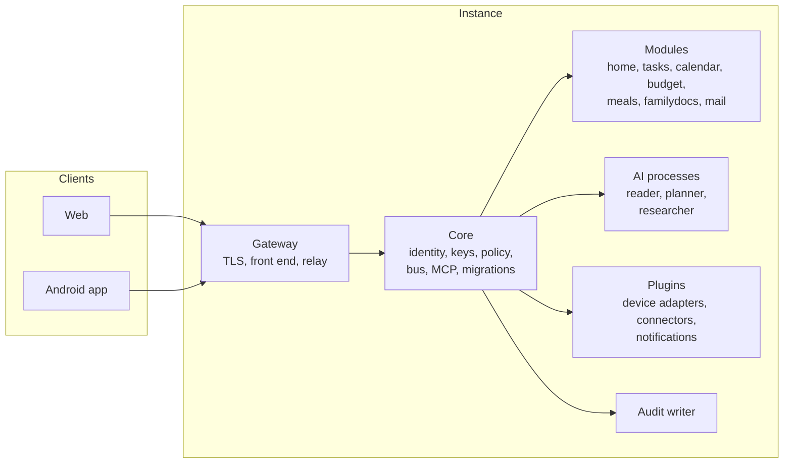

  <h1 align="center">Vilicus</h1>
  
<strong>A self-hosted, encrypted household orchestrator built in Rust, with an AI assistant that acts on your behalf</strong>

  
  
  
  

---

Vilicus is a personal orchestrator for a household: one installation serves one family (a single person, a couple, parents and children). Home automation, tasks, calendar, travel time, budget, meals and groceries, family procedures and an AI assistant share a single, encrypted data foundation, so you enter things once and every part of the system knows about them.

It is not a collaboration suite and not a product for companies. It is the missing foundation for a personal AI assistant: an assistant that only reads and advises is of limited use, one that can safely act (plan the week, build the shopping list, move an appointment, remind you of a forgotten reply) needs structured data to act on and strict rules about what it may do.

*Vilicus* was the steward of a Roman estate (the *villa*): the manager who ran the work, the stores and the accounts on behalf of the owner. Same job, for a modern household.

> **Status: early development, nothing usable yet.** The Cargo workspace ([`crates/`](crates/), [`testing/`](testing/)) has its merge gates in CI (crate graph, lint, tests, `cargo deny`, `cargo vet`, `cargo audit`, a Debian 13 VM smoke test), the shared vocabulary (`vilicus-types`) and the wire framing and canonical encoding (`vilicus-proto`); the Core, the Gateway and the modules are not written yet. This repository also holds the vision, the architecture and security documents, the [product requirements](doc/prd.md), the [architecture spine](doc/architecture-spine.md), the [V0.1 stories](doc/backlog.md), and the V0.1 spikes ([`spikes/`](spikes/)) that tested the riskiest parts of the design before the product code, with a replayable test harness ([`e2e/`](e2e/README.md)) and its [report](doc/qa/epic-1-report.md). Everything listed below is a goal, not a shipped feature. See the [Roadmap](#roadmap). Design notes live in [`doc/`](doc/README.md).

## Key Features (planned)

### :house: One household, one foundation

- One instance covers one household, with a **partition per person**, a **shared household partition** (children, meals, common tasks) and a **home partition** for the house's devices and rules. A member's data is encrypted under their own keys; what that does and does not protect against is stated under [Security first](#lock-security-first)
- Every module reads and writes through the same Core, so a planned recipe lands in the calendar, feeds the shopping list and the budget, and can remind you when it is time to cook
- Modules are independent: each one carries its own databases and its own migrations, and never reads another module's tables

### :lock: Security first

- **Encrypted at rest** with SQLCipher (AES-256). Keys are random data keys wrapped by several independent secrets: a mandatory passphrase (Argon2id), an offline recovery secret printed at enrollment, and later one per enrolled passkey (WebAuthn PRF where the authenticator supports it). A copied disk reveals no member or household data; Core metadata and the home partition, which must run while everyone is locked, are protected by the instance key, sealed to the TPM when the host has one. Secrets that let a device open the house are typed only at the host command line, never in the browser, sealed to the TPM under a signed boot policy (a host without a TPM and signed kernel images cannot run those adapters), and are not in backups
- **Backups run unattended and off-host**: encrypted to a backup public key whose secret, generated by Vilicus, stays offline; scheduled, sent to S3-compatible object storage with credentials that cannot delete or overwrite, and checked by a verify command; passphrase-derived wrappers inside a backup are sealed too, so a stolen backup cannot be attacked by guessing passphrases; making a backup needs no secret; restoring or checking a backup's contents does
- **Separate instance admin**: the admin runs the system but holds no data key and cannot reset a member's key. Losing every authenticator and the recovery secret loses that member's personal partition, by design
- **Not zero-knowledge, and honest about it**: the running Core holds unlocked keys in memory, so at-rest encryption protects against stolen disks and backups, not against a compromised running host
- **Between adults, isolation is policy, audit and friction, not a cryptographic guarantee** against whoever has root on the host, who in a self-hosted household is usually one of the adults. Data a member delegates to a scheduled task is readable by whoever controls the host, or holds a backup and its backup secret, for as long as the delegation exists
- **Passkeys by default** for login; TOTP only as a login fallback, never for confirmations. Browsers are paired during enrollment or with a short one-time code bound by a password-authenticated key exchange, and a new device waits 24 hours before it can pair another
- **Tamper-evident, encrypted audit log** of every action, including every action taken by the assistant. Tampering by root on the host is detected only when the head hash is anchored outside it: on an optional remote sink first (sent on a fixed interval, so it does not learn when the household is active), on your paired native devices later
- **Transport**: TLS 1.3 with the hybrid X25519MLKEM768 key exchange when the client prefers it (lists it before any other group the server supports) and Vilicus itself terminates TLS. In testing on 2026-10-16, Playwright builds of Chromium 156 and Firefox 157, curl and OpenSSL 3.5, Node.js 24 (OpenSSL 3.5) and Go 1.27 negotiated it; clients without it, such as those on OpenSSL 3.0 or WebKit on Linux, connect with a classical exchange instead. Safari and Android clients are not tested yet. Signatures and WebAuthn remain classical, and a third-party reverse proxy that terminates TLS removes the end-to-end benefit. No claim of quantum safety is made
- Written [threat model](doc/threat-model.md) from day one, no home-made cryptography, audited libraries (any exception is recorded in the [decision log](doc/decisions.md)), minimal dependencies in the Core, signed releases

### :robot: An assistant that can act, safely

- **Its own assistant**, which runs in sandboxed processes and talks to the Core over MCP internally. No outside AI assistant is given an API into the household's data
- **The model is an untrusted component.** It proposes typed actions; deterministic code in the Core validates them against policy. It never holds keys or credentials
- **Quarantined reader and privileged planner**: the component that reads untrusted mail or web content returns only closed enums, bounded numbers and opaque identifiers; the component with the tools never sees raw untrusted text
- **Capability tokens per task**, short-lived and scoped to a module and a partition, not a blanket "AI access"
- **Three action tiers plus human-only actions**: read, reversible write (journaled and undoable, with no effect on a third party), and tier 2 for anything irreversible or that reaches outside (payment, sending, answering an invitation, deletion). Tier 2 is confirmed only from a **paired native app** that displays the parameters and signs them with a hardware-bound key; the web client never confirms
- **Provenance (taint) on every record** of every module: content from a mail or a web page is untrusted, derived data inherits the most restrictive label, and promoting tainted data to trusted happens only from the host command line, by batch only for structured records and one by one for free text, never from the web
- Hard limits (daily amounts, send quotas, loop detection), a daily digest of what the assistant wrote, and a kill switch that an injected session cannot trigger and that never stops the house
- **Same question, two answers**: the household context plus the asking member's own context, never another member's private data
- **Provider policy by data type**: health, the private journal and the budget stay on a local model; meals and planning may use a remote provider an adult configured. A small **alignment controller** running locally on structured state can remove friction from low-risk elevated writes; it never decides on untrusted text and never replaces a human confirmation of an irreversible action. Remote providers are optional connectors
- **Scheduled tasks** (briefing, reports, reminders, quick check-ins) run by the Core on behalf of one member, with caps, audit and the kill switch. A task waits for its member's next unlock unless the member opts in, per task, to a delegation sub-key that lets it run while they are locked (see the security section for what that costs)
- **A researcher** that reads the open web for a member's question and writes a sourced report for a human to read. It receives only the question, follows only links found in pages it fetched, and has no write tool
- **Playbooks**: declarative, versioned chains of tool steps run by the Core without a model, limited to reversible actions and messages to the member's own accounts
- **Real-time voice**, transcribed and spoken locally, with a car mode; a spoken "yes" approves only a low-risk elevated write, never an irreversible action

### :bricks: Modules

- **Home automation**: devices, rooms, scenes, modes, presence and alerts, with deterministic rules that keep running after a power cut while every member is locked. Vilicus arms, locks, closes and alerts, and rules only move locks, alarms and cameras toward the safe state. Until the native app exists, Vilicus does not unlock, disarm or open at all: you use the device's own app or a physical gesture. Afterwards these are confirmed on the native app, never by the assistant
- **Tasks**: kanban with checklists, personal and professional
- **Calendar**: personal and professional, connected to your existing accounts
- **Places and trips**: places of life and work, travel time and transport mode
- **Budget**: real personal budget management, imports from bank statements
- **Meals and groceries**: recipes, meal plan, stock, automatic shopping list, a cart prepared for you to validate, and the recipe delivered at the right moment
- **Family documentation**: procedures, task distribution, notes that can be promoted from a task into a durable page
- **Mail**: reading, search and classification of each member's own accounts, important-topic alerts, forgotten replies, and reply drafts; sending to a third party is confirmed on the native app
- **Children's routines**: routines with reminders and a journal of episodes, kept for a limited period, on a local model only, never on a messaging channel
- **Activatable modules**, off until a household or a member turns them on: **watch and digests** (feeds turned into daily and weekly digests), **files** on a self-hosted file server, **publishing** drafts on a self-hosted blog, **professional activity** (activity notes, monthly report, job applications). A module that is off exposes no tool and opens no file

### :electric_plug: Connectors

- Mail and calendar through IMAP/SMTP with application passwords and CalDAV first; Gmail and Outlook through OAuth only with a client you create yourself, read-only by default
- AI providers through their API, a member's own Claude plan through the unmodified Claude Code binary, plus local models
- Device adapters for home automation (a Zigbee coordinator, local gateways, vendor clouds), each a sandboxed plugin with a named USB or local network grant
- Messaging channels (Signal, Telegram, WhatsApp, Discord) bound to a member from the app: they can trigger reads and reversible writes only, their content is untrusted, and what Vilicus sends on them stays generic and points to the app. The app remains the primary channel
- Grocery-store connectors are **unofficial, community-style plugins** running in isolated, sandboxed processes with no keys, kept out of the Core (see [Disclaimer](#disclaimer))

### :iphone: Clients

- One responsive front end, three wrappers: **web** and installable web app (short sessions, never confirms tier 2), **Android app** (blank until paired with an instance, hardware-bound key, tier 2 confirmation, content-free notifications), and a desktop shell later
- A **household display** (a wall tablet) shows the house and drives lights and shutters, without access to anyone's data
- Devices are paired explicitly
- The web client and its notifications are in French and English; Chrome and Firefox on desktop and Android are the supported browsers of the first milestone, Safari best effort
- Public exposure is an explicit choice with a blocking warning, not a default. Away from home, devices reach Vilicus through a WireGuard endpoint that Vilicus manages, with TLS still ending at Vilicus

## Architecture

*Simplified. The full schemas (components, tier 2 confirmation flow, bootstrap and pairing, key lifecycle) are in [`doc/architecture.md`](doc/architecture.md).*

- **Core**: identity, authentication, key management, policy engine, capability tokens, internal event bus, module registry, migrations, home rules, and the MCP endpoint for its own AI processes. The only component that holds keys
- **Gateway**: exposed and therefore low trust, with no keys. Serves the web client and the app API, relays pairing and confirmation traffic. It can delay or drop a signed tier 2 confirmation, not forge one; before the native app it controls what a browser light confirmation shows (see the threat model)
- **Modules**: trusted crates compiled into the binary, without keys, each with its own SQLite databases (one per partition) and embedded migrations. Modules communicate through typed events and public read APIs; links use opaque identifiers
- **AI processes and plugins**: separate sandboxed processes, one Unix socket each, no keys, network access only through an egress proxy with an exact-hostname allowlist
- **Storage**: SQLite with SQLCipher rather than PostgreSQL, to keep a single binary with no external service and native encryption at rest
- First launch: a one-time bootstrap token printed on the console, a setup wizard that is disabled afterwards, then per-member enrollment of passkeys, passphrase and recovery secret

## Roadmap

The order follows the [product requirements](doc/prd.md), section 6. The split after V0.1 into numbered milestones is decided when V0.1 ships.

| Milestone | Scope | Status |
|-----------|-------|--------|
| Design | Vision, architecture, threat model, key management, AI safety, capability matrix, decisions, research notes, product requirements, architecture spine | Done, kept up to date |
| V0.1 | The Core: Debian package, members and keys, recovery, device pairing, partitions and taint, module platform, action pipeline, audit log, plumbing for plugins, AI processes and channels proven by test doubles | In progress: spikes run in containers and a Debian 13 VM (runs on the reference host and real devices pending); workspace, merge gates, shared types and wire protocol done |
| Next | Home automation module, at parity with an existing home automation setup | Planned |
| Next | Meals and groceries, first model connectors, read-only conversation, scheduled tasks with opt-in delegation | Planned |
| Next | Store connector (a prepared cart you validate on the store's site) | Planned |
| Next | Full assistant conversation, memory, quarantined reader, researcher, playbooks, tool policy, activatable modules | Planned |
| Next | Messaging channels | Planned |
| Next | Personal journal, quick check-ins, real-time voice | Planned |
| Next | Mail without sending to third parties, watch and digests, files, publishing drafts, professional activity, children's routines | Planned |
| Next | Android app with tier 2 (sending mail, publishing, final forgetting) | Planned |
| Next | Calendar and tasks | Planned |
| Next | Memory import from a previous assistant, then its switch-off once parity is reached | Planned |
| Next | Member removal, then places, budget, family documentation | Planned |
| V1 | First community release: upgrade path, signed apt repository, external security review | Planned |

## Not Planned

| Feature | Rationale |
|---------|-----------|
| **Multi-tenant SaaS hosting** | One instance is one household, self-hosted |
| **Docker as a requirement** | Single binary, no container runtime needed |
| **Team collaboration features** | Not a company tool |
| **Automatic payments without confirmation** | Irreversible actions always need a human |
| **Confirmation from the web client** | A browser cannot prove what was displayed; tier 2 needs a paired native app |
| **Zero-knowledge server** | The running Core holds unlocked keys by design |
| **Post-quantum signatures** | No public CA issues them and WebAuthn support is in drafts; only the transport key exchange is hybrid |
| **API for outside AI assistants** | Vilicus has its own assistant; giving an outside one a door into the household's data defeats the trust model |
| **Media server** | Out of scope; Vilicus has no media feature |
| **Certified alarm or life-safety system** | Home alerts are best effort and do not replace a monitored alarm or the devices' own sirens |

## Disclaimer

Store connectors will rely on unofficial interfaces. Retailers' terms of use generally restrict automated access, and an account can be suspended for it. Such connectors, when they exist, are optional, isolated from the core, act only inside the user's own session with human validation before any order, and are used at your own risk. Prefer an official partner API whenever one is available.

## Documentation

Design documents live in [`doc/`](doc/README.md), with an index, a reading order and a glossary: [architecture](doc/architecture.md), [threat model](doc/threat-model.md), [key management](doc/key-management.md), [AI safety](doc/ai-safety.md), [capability matrix](doc/capability-matrix.md), [decisions](doc/decisions.md) and [research notes](doc/research-notes.md). Planning: [product requirements](doc/prd.md), [architecture spine](doc/architecture-spine.md), [backlog](doc/backlog.md) with its [stories](doc/stories/), and the [QA report](doc/qa/epic-1-report.md) of the spikes.

## License

Apache-2.0 - see [LICENSE](LICENSE).

## Author

Rwx-G
