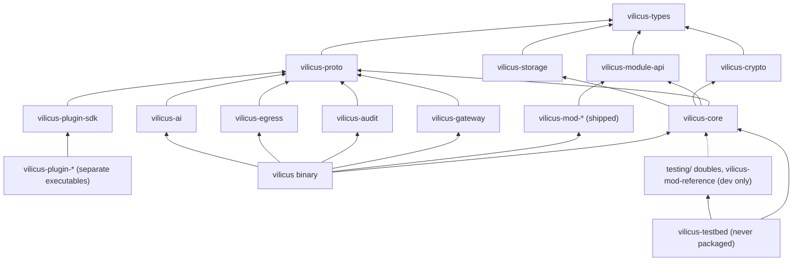
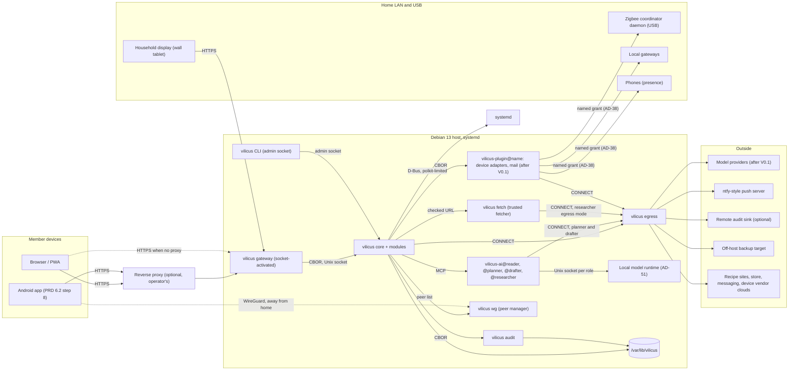
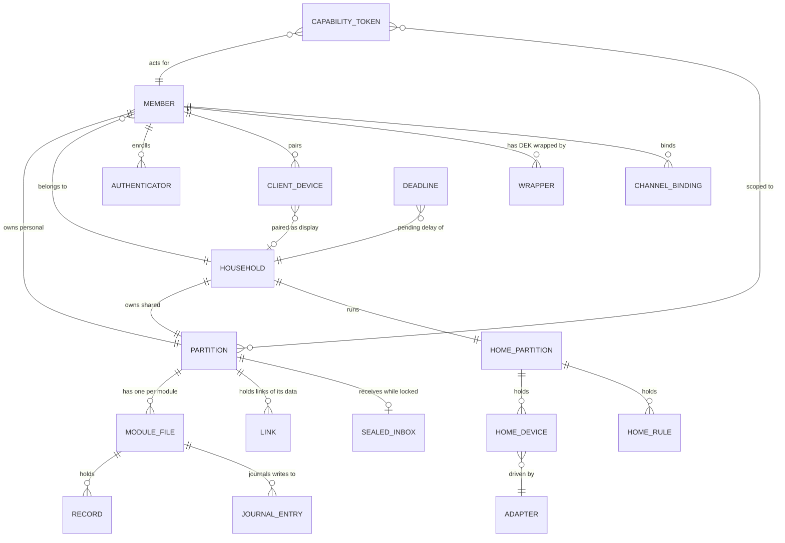

# Architecture Spine: Vilicus

The design documents in `doc/` explain why; this spine fixes what independently built units must agree on. A rule here never restates a design section: it binds a choice the design left to the builder. `[ADOPTED]` marks a call already settled by an accepted decision (D-n), a design section or the PRD. `[ASSUMPTION]` marks a call made on the fast path that the owner has not confirmed. Anything beyond V0.1 that is not adopted is an assumption by default.

## Design Paradigm

**Microkernel by trust level.** The Core is the kernel: the only policy decision point, the only key holder, the only executor of writes. Every other process (Gateway, audit writer, egress proxy, AI processes, plugins) is an untrusted or minimal adapter that talks to the Core over a Core-owned Unix socket with a closed-type protocol. Inside the Core, **ports and adapters**: modules implement the module API port and never see the kernel's internals.

| Layer | Lives in | May hold keys |
| --- | --- | --- |
| Kernel: identity, keys, policy, pipeline, tokens, registry, bus, journal, migrations, timers | `vilicus-core` (+ private `vilicus-crypto`, `vilicus-storage`) | Yes |
| Module port and modules | `vilicus-module-api`, `vilicus-mod-<name>` | No: scoped handles only |
| Adapters, one process each | `vilicus-gateway`, `vilicus-audit`, `vilicus-egress`, `vilicus-ai`, plugins | No (audit: its own HMAC key) |
| Shared vocabulary | `vilicus-types`, `vilicus-proto` | No |

## Invariants & Rules

### AD-1: The Core decides, everything else proposes [ADOPTED]

- **Binds:** all
- **Prevents:** a component (Gateway, AI process, plugin, client) authorizing or executing an action on its own judgment.
- **Rule:** authorization, key use and execution of writes happen only in the Core process. Other processes send requests and receive results; none holds a decision that the Core does not re-check (`doc/architecture.md` section 2, rules 1 to 3).

### AD-2: One binary for first-party processes, separate executables for plugins

- **Binds:** FR-1, FR-2, FR-25, FR-38, FR-47, FR-48, FR-49, DC-57
- **Prevents:** first-party connectors getting implicit trust from living in the main binary; process roles drifting into one address space.
- **Rule:** `vilicus` is one executable whose subcommands run the Core, Gateway, audit writer, egress proxy and each AI process role as separate systemd units [ADOPTED, D1]. Every plugin, first-party or third-party (messaging connectors, store connectors, notification transports added after V0.1), is a separate executable with a signed manifest bound to its hash, under the same sandbox profile and rights review. Being first-party grants nothing. The V0.1 security notification webhook is not a plugin (AD-32). Before V1, first-party plugins ship inside the signed main package, version-locked to the Core, so the signature rule is met by the package signature and V0.1 has no plugin install command [ADOPTED, D92, D102]; after V1, a third-party plugin signed by its author may be installed through an H action with delay and veto, any of its write operations that does not map to a capability matrix row is tier 2, and it declares no I13 exception class (AD-48) [ADOPTED, D92].

### AD-3: Crate dependency direction

- **Binds:** all crates, FR-61, FR-109, DC-57
- **Prevents:** a module, the Gateway, an AI process or a plugin linking key, storage or policy code; test code reaching the shipped binary.
- **Rule:** dependencies follow the graph below and nothing else. `vilicus-crypto` and `vilicus-storage` are dependencies of `vilicus-core` only. `vilicus-mod-reference` and the test doubles under `testing/` are dev-dependencies, never linked into the shipped binary. A separate `vilicus-testbed` binary, never packaged, links the reference module, starts the test doubles, which are separate executables shipped beside it in the testbed artefact (D141), and accepts a CI test key; release gates that need a module or a double run against it, and every other gate runs against the shipped `.deb` [ADOPTED, D102]. A CI check over `cargo metadata` fails on any edge not in the graph; a direct dependency on a crate the graph already reaches transitively is allowed, except that `vilicus-crypto` and `vilicus-storage` still accept `vilicus-core` only (D140). `vilicus-fuzz` (`fuzz/`) is outside the graph: it depends on `vilicus-proto`, no crate may depend on it, and only it may depend on the fuzzing crates (D142).



### AD-4: Keys never leave the kernel [ADOPTED]

- **Binds:** FR-11 to FR-14, FR-53, FR-57, all modules
- **Prevents:** key material reaching module code, logs or another process.
- **Rule:** every key type is defined in `vilicus-crypto`, is not `Clone`, not `Debug`-printable, zeroized on drop and held in locked memory: one guarded pool locked at start, the Core refusing to start if the lock is refused, slots reached only through a closure that scrubs the stack [ADOPTED, D131]. Modules receive opened, partition-scoped database handles, never a key or a path to a key (`doc/key-management.md` section 10, FR-13). Other processes receive secrets only as AD-25 allows.

### AD-5: One encrypted file per module per partition [ADOPTED]

- **Binds:** FR-18 to FR-23, all modules
- **Prevents:** two modules sharing tables, one file mixing partitions, or a module connection attaching another file.
- **Rule:** module data lives in `<module>.<partition>.db`, one SQLCipher file with one key derived per file (D3, `doc/key-management.md` section 2). A partition is a member's personal partition, the household partition, or the home partition (AD-37). A module reads and writes only its own files; another module's data is reached only through that module's typed API registered with the Core, which checks the caller's partition scope. No transaction spans two files. Every connection the Core opens, not only the migration connection, has an authorizer that refuses `ATTACH`, `DETACH` and extension loading (invariant I6). The Core keys each connection, runs its setup pragmas (`secure_delete` on, `trusted_schema` off) and enables `SQLITE_DBCONFIG_DEFENSIVE`, reading each back, before installing the authorizer [ADOPTED, D127]; after that, no pragma outside a read-only introspection allowlist runs, SQL functions are allowlisted, writes to SQLite's internal tables are refused outside migrations, and the extension loading C API is off. A function call denied by the authorizer fails with `SQLITE_ERROR`, not `SQLITE_AUTH`, and the storage layer classifies it as a refusal [ADOPTED, D126]. Module writes go through the typed record API of AD-9. Each module file's key epoch (partition root version, generation) is written atomically in a clear sidecar `<file>.epoch` (a counter, not a secret) and repeated in the file's `_meta` table (AD-26) for a cross-check; a change of epoch first writes a pending `<file>.epoch.next`, and every open fails with a typed error while one exists, so a crash between the two writes is resolved by the Core, never guessed (D143); module SQL, migrations included, can neither write, drop, alter nor attach a trigger to `_meta`, and SQLite's virtual-table modules are allowlisted like functions; `core.db` keeps a copy for `vilicus status` only, so losing `core.db` never loses the epoch needed to open a file.

### AD-6: Record envelope

- **Binds:** FR-18, FR-58, DC-4, DC-36, DC-53, DC-54, DC-58, DC-59, all module schemas
- **Prevents:** modules inventing their own id, time, revision or provenance columns, which the Core then cannot read uniformly; household free text decaying to `external` through ordinary co-authoring.
- **Rule:** every module table carries `id`, `source`, `taint`, `data_types`, `author`, `created_at`, `updated_at`, `rev`, and declares each other field structured or free text with a maximum length (FR-58). `data_types` is the set of data types (AD-9) the record contains, set by the Core: a derived record's set is the union of its inputs' sets, computed like taint (I43) [ADOPTED, D103]. A field is structured only if its value set is fixed at build time (a compiled enumeration, a bounded number, a date, an opaque UUIDv7) or it is a reviewed vocabulary, whose labels an adult confirms one by one, at most 32 characters each from a restricted alphabet; any other run-time vocabulary (tags, categories, room, scene, mode or ingredient names) is free text [ADOPTED, D104]. The module registry refuses a table without the envelope, and the storage layer validates every structured field against its declaration on every write (its closed type and its maximum length), refusing, never truncating or coercing, a value outside it [ADOPTED, D98]. Stored `taint` is `trusted` or `external` only; `member` is a read-time view, never stored. A write that a member makes or explicitly approves (own action, light confirmation of an elevated request) is stored `trusted` with that member as `author` and provenance pointing to its inputs, except that free text drafted in a tainted session keeps `external` whatever the approval, and editing the draft, by any amount, does not change that; only text the member writes in full in an empty field of the approval screen is stored `trusted` [ADOPTED, D99], and a member-written field that contains 8 or more consecutive words of the assistant's draft is stored `external`, a verbatim test, not an edit ratio [ADOPTED, D104]; before the native app this bounds fatigue approvals, not a compromised Gateway (R16); only content that came from outside the household (plugin, import, web, reader output, model free text no member approved) is stored `external` [ADOPTED, D70]. `source` takes values from the closed vocabulary of the conventions table. The envelope columns, their order and their SQL types are fixed, and a file registers only if each table's stored statement is exactly the one its declaration implies [ADOPTED, D144].

### AD-7: Taint is set by the Core alone

- **Binds:** FR-19, FR-20, FR-36, FR-58, FR-59, FR-67, FR-69, DC-12, DC-17, DC-36, DC-54, DC-59, DC-66, DC-67, all AI, plugin and event paths
- **Prevents:** a module or an adapter computing or relaxing taint differently from the policy engine.
- **Rule:** the Core computes effective taint per viewer at read time and session taint on consumption [ADOPTED, `doc/architecture.md` sections 5.4 and 9.3]. Only free text of `member` effective taint taints a session; structured fields (enumerations, numbers, dates, identifiers within their declared bounds) of a `member` record do not [ADOPTED, D70]. On write, the Core sets `taint` per AD-6: `trusted` when a member made or approved the write (free text drafted in a tainted session excepted, D99), otherwise from the principal's session taint and from the input records the call declares, any `member` or `external` input storing `external`; a module that derives a record declares its inputs and never chooses the label, and the Core computes its `data_types` from the same inputs (AD-6). A member-approved assistant draft stored `external` reaches a planner as quoted data within its maximum length and taints the session [ADOPTED, D104]. Anything arriving from a plugin is stored `external` regardless of what the plugin claims. Taint effects (elevation of tier 1, tainted queue for tier 2, denial of H) apply to `AiTask` and `Plugin` principals only; for them, a household write from a session that has read personal free text is also elevated, and a record kind exempt from the elevated queue accepts only structured fields [ADOPTED, D104]; `Member`, `Cli`, `Rule`, `Playbook`, `Display`, `Adapter` and `Event` calls are never gated by taint, but their writes still store the computed taint, so a record derived from device state stays `external` for any AI session that later reads it. Conversation turns record their provenance, so a memory fact drawn only from the member's own typed words is stored `trusted` in that member's partition and a fact touched by external content stays `external`. A transcribed turn carries `spoken` provenance: it does not taint the session, but a fact drawn from it is stored `external` until the member confirms it in the app (I42) [ADOPTED, D112]. Consolidation builds each model context from inputs of one label: a context of trusted turns and trusted facts only, whose outputs are `trusted`, and separate contexts for the rest, whose outputs are `external`; the provenance of a consolidated fact is the set of records placed in its context, computed by the Core, never stated by the model. Consolidation runs only inside its owner's unlock window [ADOPTED, D111].

### AD-8: Two mutation paths, and only two

- **Binds:** FR-3, FR-5, FR-6, FR-10, FR-26 to FR-30, FR-50, FR-107, FR-108, DC-37, DC-43, DC-56, all writes
- **Prevents:** the web client or the CLI writing data through a side door that skips schema, taint, journal, undo or audit; H actions leaking into the tool registry; one step-up assertion spent on a different action.
- **Rule:** (1) every **data write**, from any principal, is a registered tool call through the Core pipeline (`doc/architecture.md` section 9.2). (2) Every **H action** (pairing, rights, recovery, exposure, plugin install, member add, member suspend, provider configuration) is a Core operation outside the tool registry, reachable only from a human web session with step-up or from the CLI, and always audited (invariant I18). The actions FR-50 marks host-only run at the root CLI only: changing the listening address or exposure (`vilicus instance listen`), redeeming the admin recovery code (`vilicus admin recover`), `vilicus member enroll-first` and, after V0.1, `vilicus ai connect claude` (AD-53); in V0.1, provider configuration is reachable through the Core API only, exercised against the test double [ADOPTED, D101]. (3) Every step-up is bound to exactly one action: the Core creates the request first, derives the WebAuthn challenge from its canonical hash (AD-13) and a non-secret session handle, the request carrying a random identifier and its canonical bytes being what is executed (set in `webauthn-rs` 0.5.5 through its serialized authentication state) [ADOPTED, D124], and one assertion authorizes that request only, never a time window or a second request [ADOPTED, D71]. The principal of a call is a closed enum: `Member` (web session), `Cli`, `AiTask` (capability token), `Plugin` (capability token), `Event` (AD-27), `Rule` (a home rule validated by a human, AD-39), `Display` (a household display, AD-40), `Adapter` (a device adapter, AD-38), `Playbook` (a playbook validated by a human, AD-45). A scheduled task acts as `AiTask` with one capability token per run (AD-44). Capability token checks apply to token principals only; caps and the daily digest apply to token principals and to `Playbook`; the kill switch revokes every token and suspends rules, playbooks and scheduled tasks of assistant origin (AD-11). The kill switch is reachable from a web session and from the root CLI (`vilicus killswitch`, no passphrase) [ADOPTED, D101]. A `Member`, `Cli`, `Rule`, `Playbook`, `Display` or `Adapter` call is checked against its session, host authorization, validated rule or playbook, display scope or adapter manifest and grant. Every token principal acting for a member, and every playbook a member owns, is further limited by that member's tool policy (AD-47).

### AD-9: Module contract and execution model

- **Binds:** FR-22 to FR-24, FR-29, FR-39, FR-44, FR-45, FR-46, FR-68, FR-85, FR-93, FR-104, DC-10, DC-13, DC-46, DC-58, DC-71, all modules
- **Prevents:** modules spawning async runtimes, holding connections across await points, writing SQL that skips envelope, validation or journal, declaring tools that the capability matrix does not know, holding records whose data type the provider policy cannot read, or a module fault taking the Core down.
- **Rule:** a module declares, through `vilicus-module-api`, its schema and migrations, record types each with the data types its fields may hold, from the closed set in `vilicus-types` that the provider policy (FR-68) and the channel ceilings (AD-50) read [ADOPTED, D80, D103], tools (name, schema, tier, `network_effect`, exception class if any per DC-11, capability matrix row), event topics, and undo handlers [ADOPTED, `doc/architecture.md` section 12; invariant I13]. A CI check compares the registry's exported tool table with `doc/capability-matrix.md` and fails on any difference in either direction; the registry build refuses a record type without a data type. **Writes:** modules write only through the typed record API of `vilicus-module-api` (insert, update by id with the expected `rev`, delete by id), implemented by the Core over `vilicus-storage`. Reads use parameterised SQL through a read handle whose authorizer allows `SELECT` only. In the write transaction the Core stamps the envelope, validates each field against its declaration, sets `taint` and `data_types`, writes the `_journal` images and bumps `rev`. The table declaration in Rust is the single source of truth; the registry compares it with the schema the module's migrations produce (`PRAGMA table_xinfo`) in a build-time test and when it opens a file. Every runtime connection's authorizer refuses `ATTACH`, `DETACH`, extension loading and every `PRAGMA` outside a read allowlist. The reference module proves this contract in V0.1. **Execution model:** the Core has an async runtime for I/O, one writer thread per open file (`[ASSUMPTION]`), a bounded blocking pool for CPU-heavy work (Argon2id, HPKE, copies, migrations), and a dedicated thread for the home rule engine. The pool has one permit fewer than the host's cores; Argon2id runs its lanes in order on one pool thread, without the `argon2` `parallel` feature, and holds at most two permits through one FIFO limiter acquired before the pool permit (two derivations at once, a 4-second refusal, one request per member), its memory never above the limit times m and covered by the Core unit's `MemoryMax=` [ADOPTED, D128, D129, D136]. Handlers are synchronous functions run on the file's writer thread. A cross-module API call made inside a write handler is read-only, served from a read connection on the caller's thread, and never re-enters another writer thread; E32 measures rule latency during two concurrent unlocks and a backup, with the Argon2id parameters, pool and limiter of E12, and passes at p99 under 100 ms for one action through the full pipeline (policy, write, audit) on the reference host under a simulated load of two active adults plus the testbed; on failure this execution model is revised before the Core process is built [ADOPTED, D116]; it passed in emulation, and the reference host run, with E12's final m, is pending (D136). **Fault isolation:** release builds use `panic = "unwind"`. Each handler runs inside a boundary that marks the thread; a panic outside any boundary runs a hook that wipes the key pool and aborts the Core [ADOPTED, D131]. The Core calls every handler, undo handler and event consumer inside `catch_unwind` on the file's writer thread; a panic rolls back the transaction, marks the module faulted for that partition (AD-54), alerts the instance admin, and never unwinds into the Core. Each handler call has a time budget; when it is exceeded the module is marked faulted and receives no more calls. Modules spawn no threads and do no blocking I/O. The Core unit uses `WatchdogSec=` with a keep-alive from the home rule loop. A release-gate test checks that a panicking reference handler leaves unlocked members unlocked. Modules are `#![forbid(unsafe_code)]` [ADOPTED]. Declarations are `const` data checked by `const fn` rules in `vilicus-module-api`, again by the registry; a schema carrying a clause, key, index, trigger or view the declaration does not imply is refused [ADOPTED, D144].

### AD-10: Cross-module consistency by outbox and links [ADOPTED]

- **Binds:** FR-24, FR-41 to FR-43, every module that reacts to another
- **Prevents:** cross-file transactions, duplicated facts, links that cross partitions.
- **Rule:** a change and its outbox row commit in one transaction in one file; the Core delivers at least once after unlock; consumers are idempotent by event id, recorded in `_consumed` (AD-26). Cross-module references are opaque ids registered in the link table of the partition that owns the data; because that table is in `core.<partition>.db`, a link is registered by the Core when it delivers the outbox row that requests it, never in the module's transaction. No link crosses partitions (D20, `doc/architecture.md` section 5.3).

### AD-11: Capability tokens are references, not credentials

- **Binds:** FR-25 to FR-28, FR-30, FR-37, FR-68, DC-46, DC-58, DC-68
- **Prevents:** adapters validating tokens offline with diverging rules, revocation that waits for an expiry, approvals that outlive their task, a session silently receiving data above its provider.
- **Rule:** a capability token is an opaque random identifier whose scope (task, member, modules, partitions, actions, budget, expiry, provider) lives only in Core state. A token lives 10 minutes and its V0.1 budget is a number of tool calls (default 50), both named constants (`[ASSUMPTION]`, D113). At issuance the Core binds the token to a provider allowed for every data type (AD-9) the token can read; a tool result whose data types that provider may not receive is refused, never downgraded or filtered silently [ADOPTED, D80]. For a session whose output may reach a secondary channel, the token can read only the data types on that channel's ceiling (AD-50) [ADOPTED, D103]. A token is accepted only from the peer unit it was issued to (AD-24). It travels on every request, including every MCP request (the MCP revision in use has no session state). Revoking deletes the state, which is how the kill switch meets its 5-second bound. The kill switch also cancels every pending elevated request from token principals, suspends AI processes and connector units (AD-53), rules, playbooks and scheduled tasks of assistant origin and plugins whose manifest declares a `network_effect`, and never stops an `Adapter` principal, a `Rule` of human origin or a notification transport plugin, which carries only Core-rendered alerts (AD-32); the I12 test asserts both halves. Approving a request whose task no longer exists is refused.

### AD-12: Internal wire protocols (resolves D19) [ADOPTED]

- **Binds:** FR-25, FR-37, FR-55, DC-57, every Unix socket
- **Prevents:** each adapter inventing its own framing or codec, and an unbounded message exhausting the Core.
- **Rule:** every socket between the Core and the Gateway, the audit writer, the egress proxy and plugins carries CBOR messages with closed types (`deny_unknown_fields`), length-prefixed frames with a maximum size, and per-call timeouts. AI processes speak MCP (JSON-RPC 2.0) to the Core, which is the MCP server, over their socket; a framing layer in front of the MCP library enforces a maximum message size before any parsing, and tool arguments get the same closed-type validation. Decided by the owner on 2026-10-14 as the resolution of D19. **Envelope:** a frame is a 4-byte big-endian length followed by one CBOR message; each socket kind declares its maximum (`[ASSUMPTION]` 1 MiB for control sockets, 16 MiB for data sockets). The first frame is `Hello` (protocol, versions, unit, build); the Core answers with the chosen version or refuses. Every request carries a `request_id` and, when it writes, a `call_id` (AD-28); responses correlate by `request_id`; `Cancel` (by `request_id`) and `Ping` are defined. A message type evolves only under a new protocol version. Until V1, first-party plugins are version-locked to the Core (D102), so a protocol version window is needed only from V1. On MCP, transport and parse faults are JSON-RPC errors; policy refusals are tool results with the error flag set, the stable error code and the retry class of the conventions.

### AD-13: One canonical encoding for anything hashed or signed

- **Binds:** FR-28, FR-31, FR-53, DC-68, tier 2 confirmations, audit parameter hashes
- **Prevents:** the Core, the web client and the native app hashing the same request differently.
- **Rule:** anything hashed or signed is encoded by the Core as deterministic CBOR (RFC 8949 section 4.2.1) from the `vilicus-proto` types, then hashed with SHA-256. The Core sends signers the exact canonical bytes. A signer hashes those bytes, decodes them to render what it displays, and refuses if decoding fails; it never re-encodes from JSON or from its own model. The normative encoding is dCBOR restricted by the profile of D130: no floating-point value, no indefinite-length item, no tag outside a listed set, which is empty, integers within [-2^63, 2^64 - 1], at most 32 nested arrays, maps or tags, and NFC text under the Core's pinned Unicode version. RFC 8949 section 4.2.1 alone allows non-NFC text and integers down to -2^64, which the profile refuses. Decoders reject non-canonical input. Each decoder walks the item heads before decoding, refuses trailing bytes, and refuses an input whose re-encoding differs from it; the encoder refuses non-NFC text and keys equal once normalized. A signer on newer Unicode tables than the Core may refuse text holding code points new to the Core's version, which fails closed [ADOPTED, D130]. The closed-type check lives once in `vilicus-proto`, on `dcbor`. The web client renders light confirmations with `cbor2`, a dependency approved by the owner (D113). Every decoder, the TypeScript one included, is tested against the same vectors as the Core (E19).

### AD-14: Client API typed once, in Rust

- **Binds:** FR-50 to FR-52, FR-106, FR-110, Android app
- **Prevents:** front-end and back-end request shapes drifting.
- **Rule:** the Gateway serves an HTTPS JSON API under a versioned prefix and translates it into typed CBOR requests to the Core. Request, response and error types are defined once in `vilicus-proto`; TypeScript and Kotlin types are generated from them and never hand-written.

### AD-15: AI processes see tools, never storage

- **Binds:** FR-33 to FR-36, FR-62 to FR-69, DC-15, DC-16, DC-46, DC-49, DC-65
- **Prevents:** an AI process reading data outside its token, a provider receiving a data type its policy forbids, or the reader reaching the network.
- **Rule:** each AI role (reader, planner, drafter) is its own process with no database access; it sees only the tools its token allows, through MCP (`doc/ai-safety.md` section 2). The provider policy (FR-68) is enforced by the Core through the provider bound to the token at issuance (AD-11). The planner and the drafter run model connectors that reach providers only through the egress proxy, or reach the local model runtime (AD-51) over its socket. The researcher is a fourth role, contained by AD-46. The reader and the researcher never share a runtime process with the planner or the drafter (AD-51) [ADOPTED, D110]. Model connectors are of two kinds: completion connectors, used by role processes, and agent connectors (the Claude subscription connector, AD-53); the V0.1 test double covers both (FR-68). No model connector enables a provider-side capability: server-executed tools, remote MCP or account connectors, response or file storage on the provider. API connectors build request bodies from an allowlisted set of parameters, and a connector test asserts the exact body against a test double. A remote provider's multi-tenant hosts are outside this isolation (R53). The quarantined reader has no network at all [ADOPTED, `doc/architecture.md` section 11.1] and therefore runs on the local model runtime only (`[ASSUMPTION]`, revisit with E25). Children's dietary constraints never reach a remote provider: around a remote meal-planning call the Core applies a deterministic filter to the request and to the returned plan, and the remote model never sees the health constraint [ADOPTED, D80].

### AD-16: Only the egress proxy reaches the network

- **Binds:** FR-2, FR-32, FR-40, FR-53, FR-55, FR-56, DC-60, DC-70
- **Prevents:** a process opening its own outbound connection, Core-side fetches bypassing the allowlist, a loopback grant that opens every loopback listener, a name that rebinds to an internal address, and a network filter that silently does nothing.
- **Rule:** every unit except the egress proxy, device adapters holding a private address range grant (AD-38) and the WireGuard peer manager (AD-42) runs with `RestrictAddressFamilies=AF_UNIX` and `IPAddressDeny=any`; the Gateway receives its listening socket by systemd socket activation, so it needs no address family of its own. No unit receives `IPAddressAllow=` for loopback, and the egress proxy keeps no TCP listener: each caller reaches it on its own Unix data socket (AD-55); the Claude subscription connector units run with `PrivateNetwork=yes` behind a forwarder (AD-53) [ADOPTED, D115]. All outbound traffic, the Core's own fetches included (recipe URL import, remote audit sink, notification webhook, heartbeat, backup upload, model providers), goes through the egress proxy with an exact-hostname allowlist per caller, a block on internal addresses, and per-host budgets shared by every caller, counted in tunnels per sliding window with a reserve for the Core and the backup caller (FR-105; the trusted fetcher and the Core egress mode open one tunnel per request) [ADOPTED, D133]. The egress proxy resolves every name itself, checks each resolved address at connect time, and connects to that exact address. The allowlist decision is taken on the canonical hostname before any lookup, so a name off the caller's allowlist never reaches the resolver; one refused address in an answer refuses the whole name. A CONNECT target is a DNS hostname: IP literals, a trailing dot, userinfo and any form the C library reads as an address are refused, and names compare in lowercase ASCII. The proxy speaks HTTP/1.0 and HTTP/1.1 CONNECT only, never HTTP/2 or HTTP/3, and resolves absolute names, with no search list, through its configured DNS servers only, never through the hosts file or other name service modules. The proxy logs an allowlisted target by name and any other target only as its length and a keyed hash. Each caller socket has its own connection limit; a tunnel closes when idle and at a maximum lifetime; the dial phase has one deadline over all checked addresses [ADOPTED, D133]. For a caller that reaches a shared front end, the first TLS ClientHello of each tunnel must name the CONNECT host in SNI and must not offer Encrypted Client Hello, and plugin HTTP clients do not enable it; an allowlist entry on a front end that does not refuse a Host differing from SNI needs a stated reason in the allowlist review; fronting by the HTTP Host header stays a named risk (R54) [ADOPTED, D134]. It refuses loopback, RFC 1918, link-local and unique local addresses, 100.64.0.0/10, IPv4-mapped and NAT64 forms of all of these, multicast and unspecified addresses, the WireGuard subnet, and the host's own and the household's public addresses. The household's whole delegated IPv6 prefix is refused, and the host's own addresses and the household's WAN addresses are tracked at run time, not configured once. IPv6 is accepted only inside global unicast (`2000::/3`); every other IANA special-purpose range that is not globally reachable is refused, documentation and benchmarking ranges included, and 6to4 and NAT64 forms, network-specific NAT64 prefixes included, are judged on the embedded IPv4 address [ADOPTED, D133]. The Core's URL check is advisory; the proxy's check is the control; a test covers a name that rebinds between two lookups. Two named exceptions exist. Core-originated traffic (push webhook, backup upload, remote audit sink, heartbeat) may reach a private host and port that the instance admin names through an H action with step-up, alerted to every adult; the proxy allows that destination to the Core and the backup caller only, never to an AI process or a plugin [ADOPTED, D105]. A named destination records the host, the port and the private range its addresses must fall in, checked at connect time [ADOPTED, D133]. A URL that a Core stage fetches (recipe import, a watched feed, any future subscription) goes through a named Core egress mode that may reach any public host with per-host budgets (FR-40); such a URL is never supplied by an AI principal: the tool accepts it from a `Member` principal, or from text the member typed in the current turn, verbatim, never composed or edited by a model. The Core refuses to start if the host cannot enforce the IP filter. The check runs as root before the Core, outside any IP filter: it owns a loopback UDP listener, sends a control datagram that must arrive, then has a transient unit with `IPAddressDeny=any` send one that must fail with `EPERM` and not arrive; anything else refuses startup [ADOPTED, D125]. A connection that times out counts as enforcement in a negative connection test, since `IPAddressDeny=` drops rather than rejects (E10, E14).

### AD-17: Audit is append-only through one socket [ADOPTED]

- **Binds:** FR-3, FR-31, FR-32, DC-7, DC-61, DC-69, every action
- **Prevents:** components writing audit in different shapes, sensitive parameters reaching the log, or two owners of the emergency spool.
- **Rule:** only the Core appends, through the audit writer's append socket; plugins and AI processes cannot. The audit writer also has an admin socket for the root CLI only (AD-55). `audit.db` is a SQLCipher file under a key derived from the audit key (`vilicus/v1/audit/db`), opened only by the audit writer [ADOPTED, D114]. Each entry has the fixed shape of `doc/architecture.md` section 14 with a canonical parameter hash (AD-13) and the principal of AD-8, never a sensitive parameter in clear. Home rule runs and adapter reports are audited in aggregated entries per rule and per device class per period (`[ASSUMPTION]` 1 hour), accumulated in the home partition and flushed at period end or on shutdown; an action on a safety-relevant device is always an individual entry. Pause automations joins the emergency set of `doc/architecture.md` section 17, and disarm and unlock join it once the native app offers them (D69). When the writer is down, the Core owns that section's spool: entries are sealed with a MAC under a key derived from the instance key and replayed by the Core in order when the writer returns. The Core sends the remote sink (FR-32) an HTTPS POST of a CBOR record carrying the head hash, its sequence number, and the latest backup sequence number and manifest hash (AD-31) [ADOPTED, D106], through the egress proxy on a fixed interval (`[ASSUMPTION]` 15 minutes) and at shutdown, whether or not anything was audited, never per audited event, so the sink does not learn the timing of household activity; root can rewrite undetected only the entries written since the last head hash sent.

### AD-18: Cryptographic suite v1 (resolves `doc/key-management.md` section 12)

- **Binds:** FR-7, FR-8, FR-11, FR-14, FR-53, FR-66, DC-62
- **Prevents:** wrappers written with different primitives or without algorithm identifiers.
- **Rule:** wrapping uses AES-256-GCM with random 96-bit nonces; derivation uses HKDF-SHA-256 with the versioned labels of `doc/key-management.md` section 2; passphrases and the backup secret use Argon2id; the household key is wrapped to member public keys with HPKE (RFC 9180, base mode, DHKEM(X25519, HKDF-SHA256), AES-256-GCM). Every wrapper carries format version and algorithm identifiers. Primitives come from audited libraries only (D28); AES-GCM and HKDF come from aws-lc-rs, except inside HPKE, whose crate brings its own primitive crates under the same exception. Argon2id comes from the `argon2` crate, without its `parallel` feature, under a recorded exception to D28 [ADOPTED, D129], derived into a Core-owned buffer that is wiped after use, because the crate frees its own buffer without wiping it. HPKE comes from the `hpke` crate under a recorded exception to D28 (owner, 2026-10-15): it has no paid audit, so it gets an internal security review, assisted by the most capable model available, of the crate and of Vilicus's use of it before FR-8 code, together with the cross-test of D61; the exception is written in `doc/decisions.md`, and the documentation never calls it audited. The gate is done when the RFC 9180 test vectors pass, a cross-test against an independent implementation, used as a dev-dependency only, agrees on 10 000 random cases, and a written review with every finding closed or accepted is committed. A defect is fixed upstream and the fix pinned; failing that, V0.1 exits with UJ-2 limited to the first member and FR-8 ships in V0.1.x [ADOPTED, D107]. The gate is passed for `hpke` 0.13.0, except the CI job, which closes with the first CI story, under the usage rules of `spikes/hpke-review/REVIEW.md` [ADOPTED, D120].

### AD-19: Web client is a static, Trusted Types-native SPA (resolves D26) [ADOPTED]

- **Binds:** FR-17, FR-50 to FR-52, DC-62
- **Prevents:** a framework or a component that needs inline script, `eval` or raw HTML, which would break the CSP of FR-17.
- **Rule:** the web client is built with Lit web components and Vite, embedded in the binary and served by the Gateway as static files; no server-side rendering. The CSP allows the `lit-html` Trusted Types policy only; `unsafeHTML`, `unsafeSVG` and any other HTML-from-string path are banned by lint, and a CI browser test loads every page under the production CSP header and checks the policy from the page's own scripts, because code evaluated through the DevTools protocol can run `eval` despite the CSP in Chrome (E22), with a control page that allows what the others forbid. `trusted-types lit-html` lets the first script that creates a `lit-html` policy own it, so Lit's module is loaded before any other script (D122). Script nonces are generated per response by the Gateway. The pairing page is a separate HTML document whose own CSP adds `'wasm-unsafe-eval'` (AD-21); no other page has it. External content is sanitized with an allowlist (inert presentational elements only, no URL-bearing, style or handler attribute, no `href` on links), then rendered in an iframe with an empty `sandbox` attribute from a separate origin (same instance name, port 8443) whose responses also carry the CSP `sandbox` directive and `X-DNS-Prefetch-Control: off`, never carry `Set-Cookie` and never relay upstream headers [ADOPTED, D139]. That origin is same-site with the client, so the session cookie accompanies the iframe's own document request; requests the sandboxed content starts have an opaque origin, are cross-site and carry no `SameSite=Strict` cookie (E26). Its CSP forbids every subresource and every form and carries no `report-uri`, and no GET endpoint of the API has a side effect. The client's `frame-src` lists the content origin only, which also keeps the iframe from navigating elsewhere; links of external content are shown by the client outside the iframe with their full destination. The externally visible ports are exactly 443 and 8443 on every access path [ADOPTED, D139]. `connect-src` allows the client's own API and its change stream (AD-56) only; the CSP test checks that `img-src`, `style-src` and `connect-src` allow no remote origin, and links in model text are shown with their full destination. Supported browsers in V0.1 are the current and previous releases of Chrome and Firefox, on desktop and Android; Safari is best effort [ADOPTED, D107]. Lit and Vite decided by the owner on 2026-10-14. `[ASSUMPTION]` E26 partly passed: the port-based origin with the sanitizer passed with each FR-65 naming option, directly and behind Caddy and nginx, on desktop Chrome and Firefox; it stays open until run on Android. A reverse proxy terminates TLS on 443 and 8443 and forwards the Host header with its port.

### AD-20: Confirmation kinds are bound to clients [ADOPTED]

- **Binds:** FR-28, FR-60, FR-94, DC-34, DC-55, Android app
- **Prevents:** a client offering a confirmation kind it cannot carry.
- **Rule:** the web client offers none, light confirmation and step-up, never signed confirmation (D11); a step-up approves exactly one action (AD-8). A spoken confirmation approves an elevated tier 1 request that carries no I13 exception class, and nothing else: never a cart, an own-account delivery or a restorable physical action, never a rule, a scheduled task, a playbook, an H action or tier 2 (DC-34). Before a spoken yes, Vilicus reads the request back from a fixed template filled only with its structured fields, never from model text; the yes approves only the request read back, bound to its hash (DC-55). A spoken yes is recognized by the Core's speech stage on the local transcript, never by an AI process; the transcript of a confirmation window is not sent to the planner, and no tool approves a request. After the read-back of exactly one request ends, the Core opens a confirmation window of a few seconds; any other audio played by Vilicus closes it. A voice conversation can approve only requests it created. A label of a referenced record is spoken only if it is `trusted` for the member; otherwise the request is not voice-approvable. Signed confirmation exists only in the paired native Android app, rendered from templates shipped in the app, never from server-provided markup (D10). Until that app exists, no tier 2 tool is registered (FR-60).

### AD-21: Browser device key and pairing PAKE

- **Binds:** FR-15, FR-16, FR-28, DC-2, DC-5, DC-62
- **Prevents:** the browser and the Core implementing different PAKEs or different device-key uses.
- **Rule:** each paired browser holds a non-extractable ECDSA P-256 key created with WebCrypto; its public key is registered by the Core, which alone verifies every signature. For every request, the browser signs with its device key SHA-256 of `vilicus/v1/req`, the session id, a counter that strictly increases per session (8 bytes, big-endian), the method and the path with its query (each preceded by its length as 4 bytes, big-endian) and SHA-256 of the raw body, and sends the signed requests of a session one at a time [ADOPTED, D122]. The Gateway forwards method, path, raw body, counter and signature with the CBOR request. The Core verifies the signature over those bytes, checks the counter, and checks that the CBOR request equals its own decoding of the raw body. Light confirmations are signed over the canonical bytes of AD-13, after the browser has decoded them and checked that they approve the request shown, for this device [ADOPTED, D122]. Pairing codes use OPAQUE: `opaque-ke` in the Core and its WASM build in the browser, so the code is bound to the new browser's key registration: the new browser sends its public key with an HMAC under a key derived from the OPAQUE session key and a proof of possession, the issuing device checks the Core's signature over the registration response, and the code is used up once the OPAQUE run verifies [ADOPTED, D122]. `opaque-ke` (`=4.0.1`) and its browser build are used under a recorded exception to D28, with the WASM built from pinned source and matched byte for byte, the RFC 9807 vectors and a WASM-against-Core cross-test before FR-16 code [ADOPTED, D123]. Validated by E22 on desktop Chrome and Firefox (story 1.3); `[ASSUMPTION]` on Android until E22 runs there. The fallbacks of E22 are: a passkey re-proof every 15 minutes of activity, stated to the user; pairing codes issued only by `vilicus device pair`; approvals made by a step-up bound to the request hash [ADOPTED, D107].

### AD-22: Filesystem and configuration contract

- **Binds:** FR-1 to FR-3, FR-53, FR-54, FR-111, DC-63, DC-68
- **Prevents:** processes and packaging scripts disagreeing on where state, sockets and secrets live.
- **Rule:** non-secret configuration in `/etc/vilicus/vilicus.toml`; install-time secrets through systemd credentials; runtime secrets as AD-25; data in `/var/lib/vilicus` owned by the Core's static user, with `audit.db` in a subdirectory owned by the audit writer's user; sockets in `/run/vilicus`; runtime policy in `core.db`. No process reads a secret from an environment variable or a command-line argument. The instance key credential is sealed, on a host with a TPM, to the TPM's Secure Boot policy only (PCR 7), so kernel updates do not lock the house; a live image signed under the same Secure Boot authorities can unseal it (R50), and a pcrlock hook re-seals it before a Secure Boot database or SBAT update; after an unseal failure the instance admin restores the instance key from a backup with the backup private key, per the recovery runbook [ADOPTED, D96, D108]. Secrets that let a device open the house (AD-25) are sealed to PCR 7 plus a signed PCR 11 policy (unified kernel images measured by `systemd-measure`), which E31 tests on Debian 13 [ADOPTED, D108]. The Gateway's TLS certificate and key are a systemd credential of the Gateway unit; renewal hooks run `systemctl reload-or-restart vilicus-gateway`. Confirmed values are named constants in `vilicus-types`; only the backup schedule, the certificate alert lead time and the audit spool size are operator-tunable in `vilicus.toml` (D113). `[ASSUMPTION]` on the paths.

### AD-23: Schema changes move forward only, per file [ADOPTED]

- **Binds:** FR-23, FR-54, DC-50, every module
- **Prevents:** modules shipping migrations in different forms or applying them at different moments; one failed file stopping the others or forcing a household-wide restore.
- **Rule:** migrations are declarative SQL embedded in the binary with a frozen hash, applied per file through the authorizer connection, forward only (D21). The migration connection refuses every statement outside the runner. The runner owns the transaction, and migration SQL that commits, rolls back or opens a savepoint is refused [ADOPTED, D126]. A module that needs full-text search declares its FTS5 tables in the registry, which checks their arguments against an allowlist (built-in tokenizers, `content=` empty or a table of the same module); the migration policy allows `CREATE VIRTUAL TABLE` and `DROP VIRTUAL TABLE` only for the `fts5` module, case-insensitively, and each FTS5 table sets `secure-delete` to 1; shadow tables stay read-only to module SQL under `SQLITE_DBCONFIG_DEFENSIVE` [ADOPTED, D127]. Each file is migrated on a copy that is swapped in atomically on success, after a cold copy kept until the next verified backup, at most three per file; on failure the old file stays in place, that module is disabled for that partition, the instance admin and the partition's members are alerted, and the fix is a forward release; other files proceed [ADOPTED, D84]. `wrappers.db` and `core.db` migrate at the acknowledged upgrade; `core.<partition>.db` and module files, which need the partition key, migrate at that partition's next unlock (`doc/architecture.md` sections 5.2 and 12). `vilicus upgrade check` reports pending and failed migrations per file before and after an upgrade (D84), and verifies free space of twice the largest file. Before copying, the Core closes every connection to the file, runs `checkpoint(TRUNCATE)` and checks that no WAL content remains. The copy is made by the Core's maintenance path outside any authorizer connection, as a file copy or with SQLite's online backup API, never with `VACUUM INTO` or `ATTACH`, which the authorizer refuses [ADOPTED, D126]. It then copies, migrates the copy, fsyncs it, renames the original to `<file>.pre-<version>` (this is the cold copy), renames the copy into place and fsyncs the directory. Every close of a file runs `checkpoint(TRUNCATE)`. The migration connection sets `secure_delete` = ON like every other connection; checkpoints on authorizer-guarded connections go through `sqlite3_wal_checkpoint_v2`, and VACUUM runs only on a dedicated Core maintenance connection [ADOPTED, D132].

### AD-24: Process lifecycle and peer identity

- **Binds:** FR-1, FR-2, FR-25, FR-33, FR-55, DC-57, DC-65, every process
- **Prevents:** each epic inventing how processes start, under which identity, and how the Core recognizes them.
- **Rule:** the package installs static units for the Core, Gateway, audit writer, egress proxy and, from the milestones that introduce them, the WireGuard peer manager (AD-42), the trusted fetcher (AD-46) and the local model runtime (AD-51), each under its own static system user, and template units `vilicus-ai@<instance>.service` and `vilicus-plugin@<name>.service` with `DynamicUser=yes`, plus `vilicus-claude@<member>.service` under a static per-member user (AD-53). AI process instances are named `vilicus-ai@<role>-<member>-<provider>`; researcher instances are `vilicus-ai@researcher-<task>`. The egress allowlist of an instance is derived from its provider alone; an instance bound to the local model runtime has no egress entry. The Core binds each AI connection to (role, member, provider) from the unit name and refuses a token whose member or bound provider differs; an instance with no live token stops after an idle timeout. The Core starts and stops template instances through systemd's D-Bus API, limited by a polkit rule to those templates. Every Vilicus unit sets `ProtectProc=invisible`. Until V1, first-party plugin executables and units ship in the main package (D102); after V1, installing a plugin's executable and unit drop-in is done by the root CLI after the H action is approved. On every accepted connection, the Core identifies the peer by its systemd unit, not by uid alone: it takes the peer's pidfd (`SO_PEERPIDFD`) and pid at accept, checks that the pid is listed in `cgroup.procs` of the cgroup systemd reports for the unit the socket belongs to (`ControlGroup`, pinned once the unit is active), then checks that the pidfd's process has not exited, so a reused pid is refused; it never reads `/proc/<pid>`, which `ProtectProc=invisible` hides from it, and never compares the last component of a cgroup path alone (E10, passed on a Debian 13 VM) [ADOPTED, D125]; a failed `SO_PEERPIDFD`, whatever the errno, refuses the connection with no fallback to the pid alone, and the Core refuses to start on a kernel older than 6.5; `SO_PEERCRED` is never sufficient on its own, whatever another document says about peer credentials, except on the admin socket, whose only identity is uid 0 by `SO_PEERCRED`, in a directory readable by root only. E10 validated this in a container and on a Debian 13 VM; if the cgroup unit cannot be read on a host, each first-party unit runs under its own static user and the Core checks the uid with `SO_PEERCRED`, recorded as weaker. The Core watches the verified process's pidfd for as long as the connection lives; when that process exits, the Core closes the connection and revokes the capability tokens bound to it, even if another process still holds the socket. Template units set `KillMode=control-group`, `NoExecPaths=/` and `ExecPaths=/usr`, and every Vilicus unit, the Core included, denies the `io_uring` system calls explicitly, since `@system-service` includes them [ADOPTED, D125].

### AD-25: Runtime secrets travel over the peer-verified socket

- **Binds:** FR-33, FR-38, FR-47, FR-55, FR-56, DC-44, DC-63, DC-66
- **Prevents:** runtime-configured secrets needing root to reach a process, the same secret delivered two ways, or a backup or a stolen disk opening the doors.
- **Rule:** secrets that exist only at install time (instance key, audit key) use systemd credentials; the backup public key (AD-31) is not a secret. Secrets configured at runtime (provider API keys, plugin secrets, account tokens) are stored encrypted by the Core (Core metadata or the member's partition, by owner) and sent by the Core over the peer-verified socket to the one process that needs them, for the duration of its task; the process keeps them in memory only. Device adapter secrets belong to the household and are stored in the home partition, so they reach adapters while every member is locked. Secrets that let a device open the house are the exception: security-adapter vendor credentials, the coordinator's network key, and a router admin credential if one is used for presence. They never transit the Gateway: they are entered only at the host CLI as systemd credentials sealed to the signed boot policy of AD-22 and reach their one unit by `LoadCredentialEncrypted=`; a host without a TPM and unified kernel images cannot run such adapters, backups do not carry them, and they are re-entered after a restore on another host [ADOPTED, D78, D108]. The coordinator daemon receives its network key the same way, with its own write-back of the key and its own backups disabled; where a daemon cannot take its key from a credential, the documents state that the radio key sits in clear in its configuration. A read-only router account is preferred for presence. Each plugin's persistent state lives in an encrypted state store in its own state directory, keyed from the instance key for a household-owned plugin and from the owning member's partition key for a member-owned one; the store is part of backups, except the TPM-sealed secrets above, and a member-owned plugin runs only while its owner is unlocked; no delegation sub-key opens a plugin's state store [ADOPTED, D95, D111]. A secret rotated by a vendor comes back to the Core in a typed `secret_rotated` message and is persisted only by the Core. Each adult's alert destinations are Core metadata in `core.db`, readable while every member is locked. FR-55 was corrected accordingly.

### AD-26: The Core owns the write journal

- **Binds:** FR-28, FR-29, FR-30, DC-68, every module
- **Prevents:** two owners of journal and undo data, and undo that races a later write.
- **Rule:** the registry creates in every module file the Core tables `_meta` (module schema version, Core schema version, file generation, partition root version), `_journal`, `_outbox`, `_consumed` (event id, consumer, time) and `_dead_letter`. Each file has two migration tracks, Core first then module, both under AD-23. The pipeline writes, in the same transaction as the module write, the before and after images (a wrapped record key is never part of an image, D132), the `rev` before and after, the principal and the input record ids of the call (invariant I9). The pair (principal, `call_id`) is unique in the `_journal` of the file a call writes, checked in the write transaction; calls that write nothing are not deduplicated. A consumer records the event id in `_consumed` in the transaction of its effect. Outbox rows are marked delivered, never deleted, and kept for `[ASSUMPTION]` 30 days, so a restore re-delivers every row newer than the oldest file copy in the backup. Undo is the Core tool `core.undo_write`, refused when a record's `rev` has moved since; modules supply undo handlers, never journal rows. The daily digest is rendered from `_journal`, with writes made in a voice session listed separately (D112). Journal retention is set by the Core per partition kind, never by a module: 30 days in personal and household partitions, the undo period of FR-29, with expired entries deleted under `secure_delete` = ON and followed by a TRUNCATE checkpoint [ADOPTED, D113, D132]; the home partition 24 hours (`[ASSUMPTION]`). Adapter state reports are observations and are not journaled; the digest shows home activity only as aggregated counts. `_meta` holds `core_schema_version` and `module_schema_version`, written only by the migration runner in the migration's own transaction, one version at a time [ADOPTED, D144].

### AD-27: Event-triggered writes are pipeline calls

- **Binds:** FR-24, every module that consumes events
- **Prevents:** an event consumer writing outside the pipeline and laundering taint into a `trusted` derived record.
- **Rule:** a consumer that writes in reaction to an event does so through the pipeline with principal `Event`, carrying the emitting call's id, its author and its taint raised to the most restrictive of its inputs. Such a write is at most tier 1 and never triggers tier 2 (D20). Undoing the triggering write emits a `*.reverted` event instead of cascading undo.

### AD-28: Idempotency by caller call id

- **Binds:** FR-26, FR-43, FR-47, NFR reliability
- **Prevents:** a legitimate repeated action being dropped, or a retried one applied twice.
- **Rule:** every call carries a `call_id` (UUIDv7) generated by the caller, before any offline queueing in the client; the Core deduplicates on principal plus `call_id` (AD-26). Keys derived from business parameters (`doc/architecture.md` section 9.2, step 7) are used only for outbound effects. A handler that needs an outbound effect writes an effect intent row to `_outbox` (kind effect, business idempotency key). After commit the Core performs the plugin call and records the outcome in the same file. A plugin returns `done`, `failed` or `unknown`; `unknown` is reported to the member, never retried blindly. Only the Core retries, with the same key.

### AD-29: Events are versioned and delivered in order per file

- **Binds:** FR-3, FR-24, FR-54, DC-62, every event topic
- **Prevents:** a consumer of a newer version rejecting rows written before an upgrade and blocking a partition's outbox forever.
- **Rule:** every event payload carries a version and evolves append-only; consumers accept every earlier version. A file's outbox is delivered only after its migrations run, in commit order per source file. After 5 failed deliveries an event goes to `_dead_letter` (AD-26), the instance admin is alerted, and later events proceed; consumers tolerate a gap in order after a dead letter, and `vilicus events replay <dead-letter id>` re-delivers one. Delivery is ordered per source file and consumer. A consumer that is not ready (AD-54), its partition locked included, is not a failure: the event stays in the source outbox. In V0.1, events are delivered only within their source partition [ADOPTED, D107]. Module events never cross partitions; from the home milestone, only rows produced from the home partition or by the Core (disclosure grants) are sealed into another partition's inbox (AD-37).

### AD-30: Durable time

- **Binds:** FR-8, FR-12, FR-14, FR-28, DC-3, DC-68, every delay and expiry
- **Prevents:** delays that reset at reboot, or that a clock jump shortens, including one across a reboot with a wrong clock.
- **Rule:** delays longer than a web session (adult veto, recovery wait, request expiry, unlock window) are deadlines; the unlock window ends at the unlock time plus the chosen duration, whatever the web sessions do (D113). They are stored as UTC wall-clock times in `core.db` and re-armed at start. Each deadline also persists the uptime accumulated toward it; a security delay (veto, recovery wait) completes only when the wall clock and the accumulated uptime both agree it has elapsed, and a large disagreement suspends it like a clock jump. Short expiries (tokens, nonces, pairing codes) use the monotonic clock. When the Core detects a wall-clock jump against its monotonic clock, it suspends completion of every pending delay and tier 2 until a human acknowledges [ADOPTED, `doc/architecture.md` section 17]. Plans and other day-based data use the household time zone stored in `core.db`.

### AD-31: Backup and restore protocol

- **Binds:** FR-3, FR-32, FR-53, DC-19, DC-44, DC-51, DC-61, DC-69
- **Prevents:** inconsistent copies of open files, a restore that resurrects revoked devices or an older backup, off-host copies a host compromise can delete, passphrase wrappers guessed offline, and backups that need a human to type a secret, so never run.
- **Rule:** backups run unattended [ADOPTED, D85]. A systemd timer starts `vilicus backup` as root, which assembles the archive. It asks the Core over the admin socket to checkpoint and pause writers (one file at a time, each writer paused only while its own file is checkpointed and copied, and only for files of at most 32 MiB; a larger file, like the home partition's, is copied with SQLite's online backup API in bounded steps; a checkpoint that meets a reader fails fast and the pause is retried, so no writer waits on a reader [ADOPTED, D136]) and to return the instance key sealed to the backup public key, and asks the audit writer, on its own admin socket (AD-55), to flush and return the audit key sealed to the backup public key. It copies files as root, plugin state directories included, excluding migration working copies and cold copies, and uploads through the egress proxy's Unix socket under a dedicated backup caller identity. Keys are sealed with HPKE (AD-18) to a backup public key whose private key stays offline, derived from the backup secret, so making a backup needs no secret and restoring needs it. The backup secret is generated by the Core (at least 128 bits) and shown once, never chosen. Within each backup, passphrase wrappers and file names are additionally sealed to the backup public key; recovery-secret and household-key wrappers stay as on the host [ADOPTED, D106]. A CBOR manifest records each file's generation and SHA-256, a monotonic backup sequence number, and a MAC under a key derived from the audit key; `vilicus backup verify` and `vilicus restore` check it before writing anything. The remote sink also receives the latest sequence number and manifest hash (AD-17), and a restore refuses an older or failing manifest unless the operator acknowledges it. "Verified" means manifest and hash checks without the backup secret, run after each upload; cold copies (AD-23) are kept until then. The target is S3-compatible object storage reached through the egress proxy, with credentials that can write but not delete or overwrite, or object lock, configured by `vilicus backup target set` (root); retention is 7 daily and 4 weekly backups, shown to every adult as a privacy setting. Changing the target or the backup secret raises an out-of-browser alert to every adult and follows the delay and veto of rights changes [ADOPTED, D106]. An overdue backup raises an alert to the instance admin, and CI runs a restore drill in the Debian VM (AD-33). TPM-sealed secrets (AD-25) are never in a backup. `vilicus restore` is a root CLI operation, root-equivalent by nature; it runs with services stopped, unwraps the instance and audit keys and writes them as new credentials bound to the new host's TPM, or as file credentials without one, then discards the backup private key; the Core then starts in a restored state that invalidates every device (household displays included), web session, enrollment token and channel binding before serving anything. Completing a recovery rotates the member's DEK (D106). Home partition files and every sealed inbox are part of every backup; the home partition's writer is not paused: the Core copies it with SQLite's online backup API in bounded steps that release its writer between steps, so no safety-relevant rule action waits behind a backup.

### AD-32: Security notifications are a Core stage in V0.1

- **Binds:** FR-7, FR-56, FR-63, FR-108, DC-6, DC-14, DC-41, DC-60, DC-73
- **Prevents:** security alerts depending on a plugin process being up, two owners of notification templates, an alert that tells the push server what happened, and an acknowledgement that anyone can forge.
- **Rule:** the V0.1 out-of-browser notification channel is sent by the Core itself, through the egress proxy, as a push webhook. Templates are static, owned by the Core and parameterized only by Core-resolved values; rate limits, delivery failures and acknowledgements are Core state. The payload a push server receives names no alert kind (one generic text per severity, `[ASSUMPTION]`); the kind is shown when the member opens the alert in a Vilicus client, and a topic on a public server uses an access token or a random name of at least 128 bits. The default push server is a self-hosted UnifiedPush server of the ntfy type, reached through a named private destination (AD-16); a public server is allowed when the household chooses it, and sees only delivery timing metadata [ADOPTED, D118]. Each alert carries a one-time acknowledgement token, opened on a device the member controls and redeemed at the Core, single use and rate limited (the push payload never carries the token, only the generic text and an opaque reference that redeems nothing; the token is shown when the member opens the alert in a signed-in Vilicus client; the push server keeps alerts long enough for an offline phone; phones reach a self-hosted push server off the household network through the WireGuard tunnel of AD-42 or a published endpoint that denies anonymous access with a read-only token per phone, the published endpoint being the V0.1 path [ADOPTED, D135]); it does not resist a compromised device or Gateway, and without it the waiting period runs to its cap [ADOPTED, D75]. An enrollment or re-enrollment completes only after the member redeems the token of a test notification sent to their destination; while an adult has had no working destination for 24 hours, every page shows a blocking banner and the waits of FR-8 and FR-14 run to their maximum [ADOPTED, D105]. The alert kinds are those of FR-56. Transports added after V0.1 (mail through an SMTP relay first) are plugins (AD-2) that receive already rendered, content-free payloads. Home alerts are a separate notification class with their own rate budget; push stays the Core stage and mail a plugin, so a plugin outage never silences the push. The Core sends a heartbeat at a fixed interval (`[ASSUMPTION]` 5 minutes) to a monitor outside the host, which alerts when it stops; a push server on the same host cannot report the host's death.

### AD-33: CI gates

- **Binds:** FR-2, FR-22, FR-61, FR-109, all crates
- **Prevents:** each epic deciding which checks block a merge.
- **Rule:** CI runs on Linux (`[ASSUMPTION]` GitHub Actions) and blocks a merge on: format, lint with warnings as errors, tests, `cargo deny`, `cargo vet`, `cargo audit`, the crate graph check (AD-3), the capability matrix check (AD-9), the unit profile check (FR-2), the CSP browser test (AD-19), coverage-guided fuzzing of every `vilicus-proto` decoder on a dated nightly toolchain, used by that job only (D142), and the release-gate invariants (FR-61), the upgrade test (AD-41) and the restore drill (AD-31). Tests that need systemd, sockets and sandboxing run in a Debian 13 virtual machine with systemd as PID 1; the first CI story checks that the runner supports nested virtualisation, with a self-hosted runner as the fallback. Gates that need a module or a double run against `vilicus-testbed` (AD-3); UJ-1 to UJ-3 run automated in the Debian VM with a virtual authenticator, and manually once per release on one Android phone and one desktop browser (FR-109). A negative test of the bootstrap order runs the ceremony from a browser profile without a virtual authenticator, because Chrome's CDP virtual authenticator bypasses Chrome's refusal on certificate errors (E24), and asserts that the Core refuses a ceremony from a `localhost` origin (D138).

### AD-34: Signed packages and anti-rollback from V0.1

- **Binds:** FR-1, FR-54, FR-111, FR-112, D28
- **Prevents:** V0.1 shipping unsigned, or the Core and the package scripts disagreeing on the highest version seen.
- **Rule:** each `.deb` is published with its SBOM and a detached OpenPGP signature by the project's offline key on the project's release page (FR-112), the same key type the V1 apt repository uses; `vilicus upgrade verify <package>` checks it against the project key embedded in the installed version before install. The Core enforces anti-rollback by its recorded version marker below and verifies no package signature at runtime. The highest version that ever ran is recorded in `core.db` and in a marker file in the data directory; the maintainer script and the Core both refuse an older version, except `vilicus restore` of a pre-migration copy with the version that wrote it (FR-54). `vilicus restore` targets an empty data directory. To restore over an existing installation, `vilicus restore --replace` (root) moves the data directory aside, after which the maintainer script finds no marker and accepts the version that wrote the backup; the marker is then set from the backup manifest.

### AD-35: One owner per shared household entity

- **Binds:** FR-70, FR-41, every module that refers to people
- **Prevents:** two modules each defining children's profiles or household members' preferences.
- **Rule:** home devices, rooms, floors, groups, scenes, modes and home rules are owned by the `home` module (git scope `home`, approved 2026-10-15) in the home partition. Other partitions may store their ids as plain references resolved through the `home` API at read time; they are not AD-10 links, never cascade, and a missing target reads as removed. The safety-relevant mark, the infrastructure mark and the approval of each rule touching a safety-relevant device (by hash of its structured form) are Core policy in `core.db`, written only by their H actions, except that the Core sets the safety-relevant mark itself at discovery for the classes of AD-38 (D72); the `home` module reads them through the Core and keeps no copy. Members are Core entities. Profiles of household subjects (children, FR-70) are owned by a single module, `profiles` [ADOPTED, owner 2026-10-14], in the household partition; other modules reference them by id through its API and never copy their fields. Each child profile has a per-household access setting: **none** (no account; adults keep the child's data on their side) or **member** (the profile is linked to a member account, flagged managed per `doc/architecture.md` section 6). Linking keeps the profile id, so module references stay valid. Whether a managed child holds the household key or a policy-granted capability (`doc/key-management.md` section 12) and from which milestone child accounts exist (PRD open question 5) remain open.

### AD-36: Public keys in `wrappers.db` are authenticated

- **Binds:** FR-7, FR-8, FR-53, DC-1, DC-40, DC-62, DC-72
- **Prevents:** an attacker with write access to the data directory substituting a member public key and receiving the household key at the next adult unlock (T23), or a compromised Gateway substituting it at enrollment.
- **Rule:** the Core generates each member's key pair at enrollment; no browser and no Gateway supplies it. At `vilicus member add`, the Core derives a member authentication key from the enrollment token and wraps it under a key derived from the authorizing adult's unlocked household key (`doc/key-management.md` section 2); at enrollment the Core MACs the new public key under it, and every member public key in `wrappers.db` is accepted for wrapping only after that MAC verifies [ADOPTED, D74]. An attacker who can write the disk but does not hold the household key cannot produce the MAC. The exact construction and the D61 review and cross-test gate V0.1 (D74), with the done state of AD-18; inbox key authentication does not, since sealed inboxes ship with the home milestone [ADOPTED, D107]. If the construction does not hold, V0.1 exits with a single member and member addition ships in V0.1.x [ADOPTED, D117]. Because HPKE base mode authenticates no sender, the first household key a member receives is confirmed by a tag under a confirmation key derived from the enrollment key and wrapped under the new member's DEK, and every later unlock checks HK against a commitment under a key derived from the DEK [ADOPTED, D121]; `[ASSUMPTION]` how a new HK version is confirmed after a rotation is open (R55).

### AD-37: Home partition and sealed inboxes

- **Binds:** FR-71, FR-76, FR-82, DC-20, DC-62, DC-69
- **Prevents:** home data that stops working when every member is locked, history written to the wrong place or by two paths, and inbox keys that cannot be trusted or rotated.
- **Rule:** the home partition is a third partition kind, one per instance, whose file keys derive from the instance key (`vilicus/v1/partition/home` label); only the `home` module writes it. Everything the house needs while every member is locked lives there: current state, a rolling event window (`[ASSUMPTION]` 24 hours), rule timers, override leases, suspensions, the pause flag, modes and adapter secrets other than the TPM-sealed ones (AD-25). From the home milestone (D107), each other partition has one inbox file `inbox.<partition>.db`, a SQLCipher file under a key derived from the instance key (`vilicus/v1/inbox/<partition>`) [ADOPTED, D114], written only by the Core through `seal_for(partition, kind, payload_version, payload)`, where `kind` is `History` (module, record type) or `Event` (topic, consumer); the kind and `payload_version` travel inside the sealed payload. Only rows produced from the home partition or by the Core (disclosure grants) cross partitions; module events never do (AD-29). The registry declares which module ingests each history record type. Sensitive history always goes through the inbox, even while the target is unlocked. Each row is sealed with HPKE (AD-18) to the partition's inbox public key, authenticated with a MAC under a key derived from the instance key; the private key is wrapped by the partition root and versioned with it, and a rotation keeps the previous private key until its rows are ingested. At the next unlock, after migrations, the Core ingests rows in sealed order as `Event` writes with `call_id` equal to the row id, not undoable, then deletes them. Household presence, door, window and alarm history go to the household inbox; each adult's individual presence history always goes to that adult's inbox, and the opt-in only decides whether the other adult may read it. Because the row MAC key derives from the instance key, whoever holds that key can forge rows: the inbox protects confidentiality, not integrity, against the instance key holder. An ingested row is stored `external` unless it carries a MAC under a key derived from the household key, which the Core adds only to rows it produces while an adult is unlocked (D93). A row with a household-key MAC proves only that the Core of an unlocked adult produced it, which an operator who is an adult can also do (R19). Ingestion accepts such a row only when its grant identifier names a live grant the recipient was notified of at creation, its author is that grant's owner and never the recipient, and its fields match the grant's registered derivation; the MAC input binds the grant identifier, owner, recipient and a sequence number. Ingestion is journaled and reviewable, and runs continuously while the target partition is unlocked [ADOPTED, D93]. Plugin persistent state is not in the home partition; it lives in each plugin's own state store (AD-25) [ADOPTED, D95].

### AD-38: Device adapters and the device boundary

- **Binds:** FR-72 to FR-75, FR-77, FR-83, DC-21, DC-38, DC-44, DC-45, DC-63, DC-64, DC-70
- **Prevents:** each adapter inventing its own device shape, command semantics, network access or side door to the devices; an untrusted adapter describing a lock as a switch; a relay-driven opener pulsed open before the native app.
- **Rule:** a device adapter is a plugin (AD-2) acting under principal `Adapter`, with no capability token and no member; it implements one fixed interface in `vilicus-plugin-sdk`: report discovery, state and availability, and execute commands. Commands are absolute target states, never toggles; every state report carries the `call_id` of the command it results from, or none. Only the `home` module writes device state, and only from adapter reports; a change is manual only when its report has no cause and no command to that device is pending. A command's outcome is the matching report within a per-capability timeout, and the Core may re-send an idempotent target state once on `unknown`. A grant names exactly one of: a USB device, a Unix socket path, a shared private namespace with a named managed daemon, or a private address range with ports, the ports enforced per unit by an nftables rule matching the unit's cgroup, installed by the root CLI with the grant; `IPAddressAllow=` alone never implements a grant [ADOPTED, D115]. A grant is an H action and audited, and internet access stays behind the egress proxy. A third-party daemon an adapter depends on (the Zigbee coordinator daemon) runs as a Vilicus-managed unit listening on a Unix socket, or on loopback inside a namespace shared only with its adapter, requires client authentication where it supports it, has its own interface disabled, holds the only grant to its radio, and receives its network key as AD-25 states. An adapter that drives a physical security device drives no other device family, and its secrets are sealed to the TPM (AD-25). Classification is fail-closed [ADOPTED, D72]: locks, alarms, cameras, gates, garage doors and covers not yet classified by an adult are safety-relevant from discovery and accept only safe-direction commands; once an adult has confirmed a device's class, an adapter report that changes it is refused and raises a home alert, and reclassifying is an H action. An unclassified `switch`, plug or relay output accepts no command from a household display, the assistant or a rule until an adult classifies it; a `momentary` output is safety-relevant from discovery, never tier 1, and when it drives an opener it follows the unlock and open rows (D69) [ADOPTED, D109]. The coordinator daemon keeps its radio with the current software until cutover day, then Vilicus takes it, with a rollback plan to the current software; other device families run in parallel before cutover (D79). Device quirks live in adapters, never in the `home` module. State reports are throttled per device, and energy readings are aggregated (for example per 5 minutes) before the `home` module writes them. The adapter unit template keeps `PrivateDevices=no` with `DevicePolicy=closed`, a `DeviceAllow=` per USB grant, and `BindsTo=` on the device's by-id unit so it stops on unplug and restarts on replug; whether `DynamicUser=` can open the serial device through a supplementary group is tested by E27, with a static user per adapter as the fallback. LAN adapters address devices by IP or by multicast discovery and get no unicast DNS right; internet names are resolved by the egress proxy. The Core refuses to start adapters if a negative connection test shows the IP filter or a per-unit port rule is not enforced; E27 tests from an adapter to every other loopback port. Presence comes from the router's leases or API and from unprivileged ping, never from raw network access; a read-only router account is preferred, and a router admin credential is a secret that opens the house (AD-25).

### AD-39: Home rules are deterministic Core code

- **Binds:** FR-78 to FR-80, FR-84, DC-23, DC-24, DC-35, DC-38, DC-64
- **Prevents:** rules that run twice, loop between devices, diverge by builder, or open the door; a browser step-up opening the door before the native app exists.
- **Rule:** the `home` module evaluates rules inside the Core on home-partition data only, with no model and no member key, on an in-process trigger stream fed by its own committed writes; rules are not outbox consumers. Each action is a pipeline call with principal `Rule(rule id, origin)` and the triggering event as cause; its `call_id` is a name-based UUID over rule id, trigger event id and action index, so a re-delivered trigger is deduplicated (AD-28). A chain depth counter travels across `Rule`, `Event` and `Adapter` hops and stops a chain at 5 (`[ASSUMPTION]`). A rule touching a safety-relevant device runs only while its structured form matches the hash approved by the H action, and only commands in the safe direction of the capability convention. Unlock, disarm, open and cutting the power of an infrastructure device are registered for no principal before the native app; from then on they are tier 2 confirmed on the native app (D69). Until then the household uses the vendor app or a physical gesture, and Vilicus arms, locks, closes and alerts. Timers are durable (AD-30) in household local time. A manual change takes a per-device override lease that rules respect until it expires; a lease never blocks a safe-direction action on a safety-relevant device, and a manual change away from the safe state of such a device raises a home alert. Pausing all automations is a `Member` or `Cli` action with step-up. A dry run returns a trace with no side effect. Undoing a tier 1 physical action sends a new command with the previous target state; it never rewrites the state row. A `momentary` command has no undo, since a second pulse is a new action [ADOPTED, D109]. Tier 1 physical actions carry the I13 exception class `restorable_physical`. Life safety comes first [ADOPTED, D91]: while a smoke or water alert is active, lock, close and cut commands are suspended for every principal, shutters may open and every adult is alerted, and unlock and disarm stay unregistered; a heating valve is never closed below a floor temperature; a closing command on a gate or a garage door is refused when the device reports no obstacle detection.

### AD-40: The household display is a principal, not a member

- **Binds:** FR-79, FR-81, DC-22, DC-25
- **Prevents:** a wall tablet borrowing a member session, or a display seeing data outside the home domain.
- **Rule:** a household display is a `ClientDevice` paired through an H action by an adult and holds a device key like a browser (AD-21). Its session is not bound to a member, does not follow the web session limits of D90 (15 minutes without activity, 12 hours at most), and is re-proven with the device key on every request; it is revoked like any device. Its scope is fixed by the Core: read the home domain and household presence, run tier 1 actions on devices that are not safety-relevant, change modes that concern no safety-relevant device, and suspend one rule that touches no safety-relevant device. No other tool is visible to it.

### AD-41: Home failure behavior and upgrades

- **Binds:** FR-82, FR-84, DC-26, DC-50
- **Prevents:** the house stopping during an upgrade, an audit outage or a clock jump, and a home migration that needs a `core.db` migration not yet acknowledged.
- **Rule:** the home partition migrates at the first start of a new version, on a copy per AD-23, without waiting for the FR-54 acknowledgement. A failed home migration keeps the old file, raises a home alert to every adult and is fixed forward (D84); the house keeps running only when the migration succeeds, which `vilicus upgrade check` lets the operator verify before upgrading. A release may not ship a home migration that depends on a `core.db` migration of the same release, and any `core.db` schema the home path reads stays readable by the previous version until the acknowledgement; the upgrade test in CI checks both. An adapter that stops reporting marks its devices stale after a per-device threshold, and rules that depend on stale devices fail visibly with a home alert. On a wall-clock jump, schedule triggers continue on the monotonic clock and safety-relevant actions wait for a human acknowledgement (AD-30).

### AD-42: Remote access is a WireGuard endpoint the Core describes and a small unit applies

- **Binds:** FR-86, DC-27
- **Prevents:** the Core holding network administration rights, peers added outside the pairing flow, or a remote path that ends TLS before Vilicus.
- **Rule:** the host network configuration owns the WireGuard interface and its private key. A dedicated unit, `vilicus wg`, under a static user with only the network administration capability, receives the complete peer list from the Core over its socket and applies it through netlink; it holds no other right and makes no decision. A peer is added only by an H action tied to a client device's pairing, and removing the device removes the peer. A peer's allowed address is a single address, and the configuration given to a client routes only the Vilicus host. By default the client key pair is generated on the client; a Vilicus-generated private key is the fallback, shown once with the configuration, with a screen that says the page's server sees the key, and Vilicus keeps only the public key. The package installs a firewall rule on the WireGuard interface that accepts only TCP to the Gateway's port on the instance address, and drops forwarding from that interface; `vilicus status` and a negative test in E28 check it. TLS still terminates at Vilicus, and the instance name resolves to the same private address inside the house and through the tunnel.

### AD-43: Delegation sub-keys

- **Binds:** FR-9, FR-88, FR-95, DC-28, DC-66
- **Prevents:** scheduled work holding a member's data key, or a sub-key that outlives its purpose.
- **Rule:** a delegation sub-key opens one module file in one partition, is created by an H action (with the delay and veto of rights changes for a household-partition module), sealed by the instance key in `core.db`, bound to the scheduled tasks that use it, and listed in the member's settings. A run that holds it reads the delegated file and writes only through the owner's sealed inbox (AD-37), so its output is stored `external`. For each delegated scheduled task the Core keeps a run descriptor in `core.db`: the fire time and staleness limit in clear, and the structured definition sealed under the delegation sub-key, so the run can read its own definition while its owner is locked, and schedule times are visible to the instance key holder (R34) [ADOPTED, D111]. A sub-key opens a module file only, never a plugin's state store (AD-25). Revoking it, removing the member or deactivating the module destroys it and marks the file for re-keying at the owner's next unlock; until then the sub-key copy in older backups still opens the file [ADOPTED, D94]. Any data type may be delegated; backups carry the sealed sub-keys (section 8.2 of the PRD).

### AD-44: The scheduler

- **Binds:** FR-87, FR-89, FR-96, DC-28, DC-58, DC-66
- **Prevents:** scheduled tasks defined as free text, running twice after a restart, or delivering content where it must not go.
- **Rule:** a scheduled task is a structured record (trigger, `kind` from a closed set each with a prompt template shipped with Vilicus, an optional instruction text, tools, caps, delivery, origin, owner member) in the owner's partition, with a run descriptor in `core.db` when delegated (AD-43); its timer follows AD-30 and the day type of the home context sources. Each run gets one capability token as `AiTask`, limited by the owner's tool policy; a late run happens at most once within its staleness limit, otherwise it is cancelled and recorded. The instruction is `trusted` only when the member typed it in full (D99); text drafted by the assistant in a tainted session stays `external` after validation. Each run starts with the session taint of its definition: tainted if any free-text field of the definition is `external`. A task proposed by the assistant keeps its origin and runs only after its owner validates it. Results go to the primary channel; a run whose output may reach a secondary channel gets a token that reads only the data types on that channel's ceiling, and sends a template or content within it (AD-50). Without a sub-key, a task waits for its owner's unlock. Output of a delegated run is stored `external` and shown as such [ADOPTED, D111].

### AD-45: Playbooks are deterministic Core code

- **Binds:** FR-98, FR-99, DC-31, DC-64
- **Prevents:** a second, model-driven automation engine beside home rules, or a playbook escaping caps, digest and tool policy.
- **Rule:** a playbook is a declarative document validated against a versioned schema and stored in the owner's partition; the Core runs it under principal `Playbook(id, origin)` with no model step. Each step is a registered tool call through the pipeline, at most tier 1 or a safe-direction home command; outbound effects only through system notifications or own-account delivery. An own-account delivery in a run needs no confirmation at each run once the owner grants a standing approval for that destination; the approval is revocable, listed in the member's settings and still follows the provider policy (AD-48) [ADOPTED, D89]. It shares the rule engine's trigger, timer, depth-limit and dry-run machinery (AD-39). Its steps count against caps, appear in the daily digest and are intersected with the owner's tool policy (AD-8, AD-47). Playbooks of assistant origin are suspended by the kill switch. A playbook triggers only on records written by a `Member`, `Rule`, `Adapter` or `Cli` principal (I41) [ADOPTED, D109]. A message step picks a template from the closed set shipped with Vilicus, or uses text the member typed in full (D99); its parameters are Core-resolved values of data types allowed on the destination channel; text drafted by the assistant is never a notification template.

### AD-46: Researcher containment

- **Binds:** FR-90, FR-105, DC-29, DC-39
- **Prevents:** the researcher exfiltrating household data through the links it chooses or the requests a page script makes, or hostile pages being parsed in the Core.
- **Rule:** the researcher process receives only the member's question as typed, never partition data, memory or conversation. The first query is built by a Core template stage; afterwards the researcher may only ask the Core to follow a link that appears verbatim in a page already fetched for the task. Every request is made by a trusted fetcher that runs no model and no page code, after the Core checks the URL: GET only, verbatim link, no model-composed query string, capped length, internal addresses blocked [ADOPTED, D73]. The fetcher sends no cookies and reaches the egress proxy in researcher egress mode (any public host, per-host budgets), which belongs to the fetcher alone. The fetcher is its own unit, `vilicus fetch`, with no key and no household data (`[ASSUMPTION]` a dedicated process rather than a Core stage, so hostile TLS and HTTP bytes stay out of the Core). The fetcher extracts the absolute links of each page with a minimal URL resolver (base and relative, entity decoding only) and returns the list with the bytes; the Core checks a requested URL by exact match against that list. The researcher has no network and parses the returned bytes in its sandbox; the browser plugin, if kept, has no network at all and only renders bytes the fetcher returned. The report is stored `external` and shown to the human only.

### AD-47: Tool policy and activatable modules

- **Binds:** FR-99, FR-100, DC-32
- **Prevents:** a member's assistant gaining tools the member did not enable, or a deactivated module still reachable.
- **Rule:** a member's tool policy is a subset of the capability matrix stored in `core.db`; the Core intersects it with every capability token issued for that member and with every playbook run that member owns. Only the member widens it (step-up); another adult may narrow it, and the member is notified. A module carries an `activatable` flag in its registry entry; while it is off for a scope, the Core issues no token naming its tools, starts none of its plugins and opens none of its files. Household activation is an H action with delay and veto; deactivation revokes tokens and sub-keys and suspends dependent tasks and playbooks, keeping data.

### AD-48: Named exception classes of I13

- **Binds:** FR-47, FR-80, FR-91, FR-101 to FR-103, DC-11, DC-23, DC-33, DC-47
- **Prevents:** each module inventing its own reason to treat an outbound effect as tier 1, and own-account delivery carrying local-only data to a hosted provider.
- **Rule:** the exception classes of invariant I13 are a closed set in `vilicus-types`: `reversible_external_state` (cart preparation), `restorable_physical` (home actions undone by restoring the previous state) and `own_account_delivery` (a write to an account the member owns that nobody else sees). A tool declares at most one; the registry build check refuses any other value; every such tool is tier 1; `reversible_external_state` and `own_account_delivery` require light confirmation, and `restorable_physical` does not (D56). An own-account delivery carries the data types (AD-9) of its payload, follows the provider policy by data type and passes the outbound content check; a local-only data type is never delivered to a hosted account [ADOPTED, D81]. A delivery body is plain text, or HTML rendered by the Core from a template that references no remote resource. Model-composed text in a delivery, a deposited file or a draft contains no URL except URLs that appear verbatim in the source records it cites; a deposited HTML, Markdown or SVG file and a draft reference no remote resource; draft images are only files the member uploaded. An own-account delivery tool takes no destination argument: the Core resolves the destination from the member's account registered by an H action. A destination is hosted unless its host resolves to the Vilicus host or to an address range the household declared private by an H action. The build check covers declarations only: that a `restorable_physical` command never moves a safety-relevant device away from its safe state depends on runtime marks and is enforced and tested at run time.

### AD-49: Disclosure grants

- **Binds:** FR-92, DC-30, DC-59
- **Prevents:** a cross-partition share computed by a model, losing its data type, or bypassing the recipient's partition.
- **Rule:** a disclosure grant is an H action that selects a derivation function registered in module code (no model), its fields, frequency, recipient and expiry. The derivation returns closed types only (AD-6). The Core runs it in the owner's partition, keeps the result's source data types, stores it with the taint of its inputs (I9) and the granting member as author, so the recipient's assistant reads it as `member` taint [ADOPTED, D104], then seals it into the recipient's inbox (AD-37). Revocation stops future runs; every run is audited without the value.

### AD-50: A secondary channel's ceiling is an allowlist of data types

- **Binds:** FR-37, FR-38, DC-9, DC-48, DC-58
- **Prevents:** a bound messaging account, taken over by SIM swap or account theft, reading presence, alarm state or children's schedules through tier 0 reads, a paraphrase carrying data past an output check, and each connector deciding its own ceiling.
- **Rule:** the ceiling of each secondary channel is a list of the data types (AD-9) it may carry, stored in `core.db` [ADOPTED, D82]. It gates inputs: a token issued for any session whose output may reach that channel, channel-originated or not, reads only data types on the ceiling (AD-11) [ADOPTED, D103]; the Core also checks every outbound message against it, and anything not listed is refused. `presence`, `home_state`, `alarm_state`, `calendar` and `child` are excluded by default; adding one is an H action. `budget`, `mail_raw` and `health` are never listed (FR-37). Connectors receive content already checked against the ceiling and never evaluate it themselves.

### AD-51: The local model runtime is a contained component

- **Binds:** FR-33, FR-62, FR-68, DC-49, DC-65
- **Prevents:** the component that sees every local-only data type and every hostile document the reader reads listening on the network, leaking across members through a shared cache, or loading unverified model files.
- **Rule:** the local model runtime, and any local speech engine (FR-62), runs as its own systemd unit under its own user, with no database access, no key and no network: it listens only on Unix sockets, one per AI role that uses it, and its unit has `RestrictAddressFamilies=AF_UNIX` and `IPAddressDeny=any` like every unit of AD-16 [ADOPTED, D83]. It is treated as untrusted, like an AI process. The quarantined reader and the researcher never share a runtime process with the planner or the drafter. Within each of those two groups, one runtime instance serves every role and member, with cache reuse disabled and requests serialised; per-member instances run only where E25 shows the memory fits [ADOPTED, D110]. No prompt or key-value cache is shared across members or roles. Model files are pinned by SHA-256 in configuration and the runtime refuses a file whose hash differs. E25 tests the runtime in this shape.

### AD-52: Bootstrap order

- **Binds:** FR-4, FR-5, FR-7, FR-65, DC-18, DC-42, DC-56, DC-60
- **Prevents:** a passkey enrolled over a temporary certificate or an address that becomes unusable once the instance name exists, and a wizard that disables the routes its later steps need.
- **Rule:** first boot runs in a fixed order: the bootstrap token, then the instance name and its certificate, then the instance admin's passkey on that name, then the instance admin's out-of-browser destination, confirmed by redeeming the token of a test notification (AD-32), then the first member [ADOPTED, D76, D105]. No WebAuthn ceremony runs over the temporary self-signed certificate (E24, desktop: browsers refuse WebAuthn on an IP origin; on `localhost` they do not, and a credential made there is bound to `localhost`). The temporary certificate names only the host's IP addresses and is destroyed with its listener once the instance certificate is installed; the Core's relying party accepts only the instance name as RP ID and its HTTPS origin, so a ceremony on `localhost` or an IP address is refused server side [ADOPTED, D138]. Steps after the admin passkey exists are admin-authenticated setup routes, not wizard routes; the wizard routes return not found once the admin exists (FR-4). The admin recovery code is printed only on the host console at bootstrap and stored only as an Argon2id hash; it is redeemed only by `vilicus admin recover`, and `vilicus member enroll-first` requires root plus that code [ADOPTED, D101].

### AD-53: The Claude subscription connector runs the unmodified binary, contained

- **Binds:** FR-33, FR-68, FR-97, DC-52, DC-56, DC-65, DC-70
- **Prevents:** Vilicus handling a subscription credential, the binary's own tools (shell, files, web) acting outside the token, a token visible to other processes, a conversation persisted in clear outside the partitions, the connector reaching host listeners, and one member's plan or one session's child serving another.
- **Rule:** the connector is a model connector of AD-15, of the agent kind, for the planner and the drafter [ADOPTED, D97]. **Process topology:** the connector unit `vilicus-claude@<member>.service` runs `vilicus ai-claude`, a Vilicus supervisor under a static per-member user created by `vilicus ai connect claude` (root CLI, that member's passphrase, only after the provider configuration H action of FR-68 has passed its delay) [ADOPTED, D101]. For each session the Core asks the supervisor to start one child of the unmodified Claude Code binary in headless streamed-JSON mode, whose only MCP server is the stdio command `vilicus mcp-bridge <session socket>`; the bridge relays to a per-session Unix socket the Core creates and binds to that session's token, so no token appears in argv, environment or files. One child serves one session, never reused across sessions, roles or members; revoking the token kills the child; the turn limit is set from the task's tool-call cap; the kill switch stops connector units like AI processes. Per-task and per-member caps apply to the connector in tokens, from the usage the stream reports, with a default well below the plan's window limit. **Binary and configuration:** the binary's hash and tested version ship in the signed Vilicus release and are installed by the root CLI into a read-only path, with self-update off [ADOPTED, D110]. Its configuration directory is the unit's state directory (mode 0700), its only writable path, excluded from backups; stderr is filtered to error codes. Every built-in tool is disabled and the MCP configuration is strict. No settings, hooks, plugins or memory files are loaded from disk, except a system-wide managed policy file that Vilicus writes if the binary reads one; session persistence is off. The connector passes a full model identifier and no fallback model, and fails closed on a reported mismatch; Vilicus's role prompt replaces the binary's system prompt. A canary test covers every writable path and the journal, a forced error run included (`[ASSUMPTION]` the binary's options suffice, E30). **Sign-in:** the binary's own login flow runs from the host CLI in a transient unit with the connector's sandbox profile, with the sign-in hostnames allowed only for its duration; a long-lived-token login variant is not used; Vilicus never reads the credential. The plan's account identifier is shown at sign-in, recorded, and checked at every start [ADOPTED, D110]. **Network:** the unit runs with `PrivateNetwork=yes`. A Vilicus forwarder joins its network namespace with `JoinsNamespaceOf=`, listens on 127.0.0.1 inside that namespace only, and forwards to the egress proxy's Unix socket; the proxy identifies the connector by the forwarder's peer identity (AD-24), and the connector reaches no listener of the host [ADOPTED, D115]. The running allowlist holds inference and token-refresh hosts only, and telemetry is off; an allowlisted provider hostname does not bind the account (R39). **Release check:** E30 inspects the binary's request bodies through a TLS-intercepting test proxy with a test CA (a release check, never in production), asserts that the offered tools are exactly the token's Vilicus MCP tools and that no account-level connector is offered, and reruns for every pinned binary version with a real plan; a failure blocks that version. The evaluation suite runs per (binary hash, model identifier, prompt template). **Policy:** the connector is its own provider-policy entry and allows no data type by default: the member opts in data types of their personal partition, and each household-partition data type needs the agreement of every adult [ADOPTED, D110]. The Core binds the connector to a token only for the sessions and runs of the member who owns it; usage counts against that member's plan, and a reached limit fails closed like an outage (FR-33).

### AD-54: Availability states per module file

- **Binds:** FR-11, FR-23, FR-24, FR-29, FR-99, every module
- **Prevents:** callers, the event bus and unlock each guessing whether a module file can serve, an event retried to exhaustion against a locked consumer, and unlock waiting for every migration.
- **Rule:** the Core tracks one state per module file, and every caller reads it from the Core:

| State | Meaning | Typed API calls | Events to its consumers |
| --- | --- | --- | --- |
| locked | Partition key not in memory | `module_unavailable`, `retryable` | Stay in the source outbox |
| opening | Keys derived, file being opened and checked | `module_unavailable`, `retryable` | Stay in the source outbox |
| re-keying | File re-keyed after a rotation or a sub-key revocation | `module_unavailable`, `retryable` | Stay in the source outbox |
| migrating | Migration running on a copy (AD-23) | `module_unavailable`, `retryable` | Stay in the source outbox |
| ready | Serving | Served | Delivered |
| failed migration | Previous file kept, module stopped for this partition (AD-23) | `module_unavailable`, `not_retryable` | Stay in the source outbox |
| faulted | A handler panicked or exceeded its time budget (AD-9) | `module_unavailable`, `not_retryable` | Stay in the source outbox |
| deactivated | Activatable module off for this scope (AD-47) | `module_unavailable`, `not_retryable` | Stay in the source outbox |
| newer than code | File schema newer than the module code (D21) | `module_unavailable`, `not_retryable` | Stay in the source outbox |

Events to a consumer that is not ready stay in the source outbox and do not count as failed deliveries (AD-29). No token names a tool of a module that is not ready. Unlock completes, for FR-11, when keys are derived and the session is usable; each file then goes through re-key, migration, ingestion and outbox delivery in the background, in that order; household key wraps run last.

### AD-55: Socket inventory

- **Binds:** FR-1, FR-2, FR-3, FR-25, FR-31, FR-55, every process
- **Prevents:** units disagreeing on socket paths, owners, protocols or identity checks, and one socket serving two kinds of client.
- **Rule:** each unit owns its runtime directory under `/run/vilicus`; listening sockets are passed by systemd (file-descriptor passing) or created by their owning unit, never by a client. The Core listens on one socket per peer instance. `core/peer/` is owned by the Core with mode 0700; each peer's socket sits in its own directory `core/peer/<unit>/`, which only that unit bind-mounts (`BindPaths=`), never the socket file itself, and the Core keeps its runtime directory across restarts so the bind source stays valid [ADOPTED, D125]. The inventory below is closed; a new socket is added here first. `[ASSUMPTION]` on the paths.

| Path | Listener | Clients | Protocol | Identity check | Permissions |
| --- | --- | --- | --- | --- | --- |
| `core/peer/<unit>/core.sock` | Core | One peer instance (Gateway, AI process, plugin, adapter, fetcher, `vilicus wg`) | CBOR (AD-12); MCP for AI processes | Unit name by `SO_PEERPIDFD` (AD-24) | Reachable only by that unit |
| `core/session/<id>.sock` | Core | `vilicus mcp-bridge` of one connector child (AD-53) | MCP | Connector unit by `SO_PEERPIDFD`, bound to one session token | Reachable only by that connector unit |
| `core/admin/admin.sock` | Core | Root CLI | CBOR | uid 0 by `SO_PEERCRED` | Directory readable by root only |
| `audit/append.sock` | Audit writer | Core only | CBOR | Unit name by `SO_PEERPIDFD` | Audit writer's directory |
| `audit/admin/admin.sock` | Audit writer | Root CLI only (flush, sealed audit key for backups) | CBOR | uid 0 by `SO_PEERCRED` | Directory readable by root only |
| `egress/control.sock` | Egress proxy | Core only (allowlists, modes, budgets) | CBOR | Unit name by `SO_PEERPIDFD` | Egress proxy's directory |
| `egress/data/<caller>.sock` | Egress proxy | One caller each (Core, backup caller, AI instance, fetcher, plugin, connector forwarder) | HTTP `CONNECT` | Caller by `SO_PEERPIDFD` | Reachable only by that caller |
| `llm/<role>.sock` | Local model runtime | The AI instances of one role group (AD-51) | Runtime protocol | Unit name by `SO_PEERPIDFD` | Passed by file-descriptor passing |
| Gateway TCP listener | Gateway | Browsers, reverse proxy | HTTPS | TLS, then device-key signatures (AD-21) | Socket activation; certificate as a systemd credential (AD-22) |

### AD-56: Live updates to clients

- **Binds:** FR-28, FR-50, FR-56, web client
- **Prevents:** each screen polling at its own rate, or a change channel that carries data the client has not read through a signed request.
- **Rule:** clients receive changes over one server-sent event stream per web session, opened by a signed request (AD-21), carrying only change notices (ids and versions); the client re-reads through signed requests. Polling every 30 seconds is the fallback. The stream is in the CSP `connect-src` of AD-19.

## Consistency Conventions

| Concern | Convention |
| --- | --- |
| Crate names | `vilicus-<role>`; modules `vilicus-mod-<module>`; plugins `vilicus-plugin-<name>`. Module names are the scopes of `.claude/rules/vilicus-git.md` (`familydocs`, never `docs`). |
| Tool names | `<module>.<verb>_<noun>`, for example `meals.add_shopping_item`; Core tools use `core.`; one tool, one capability matrix row. |
| Event topics | `<module>.<entity>.<past_verb>`, for example `meals.plan.updated`; reversals `<module>.<entity>.reverted`; device state `home.device.state_changed`. |
| Device capabilities | A closed set in `vilicus-types` (switch, momentary, level, color, cover, thermostat, contact, motion, temperature, humidity, power, energy, battery, lock, alarm, camera, vacuum, valve, and `presence` at household level only), each with typed state, absolute target-state commands and, where it applies, the safe direction of each command (lock: lock; alarm: arm; cover: close; valve: close; camera: on; switch: on when it powers a safety-relevant device). `momentary` is a pulse output: safety-relevant from discovery, never tier 1, no undo; an unclassified switch or relay output accepts no command from a display, the assistant or a rule until an adult classifies it (AD-38, D109). Adapters map to it, never extend it locally. |
| Devices | `ClientDevice` (browser, Android app, household display) and `HomeDevice` (physical or virtual device in the house) are distinct types; the word device alone is not used in code. |
| CLI | `vilicus <noun> <verb>` (`vilicus member add`); every command writes an audit entry. V0.1 includes `vilicus member reenroll` (an enrollment token for a lost passkey, after a rename or a restore), `vilicus member suspend` (also with a member's own passphrase for their own account), `vilicus member veto` (the vetoing adult's own passphrase), `vilicus member enroll-first` (root plus the admin recovery code), `vilicus admin recover`, `vilicus instance listen`, `vilicus killswitch` (no passphrase), `vilicus bootstrap token`, `vilicus host acknowledge-swap`, `vilicus backup target set`, `vilicus restore --replace`, `vilicus events replay <dead-letter id>` and `vilicus upgrade verify <package>`; `vilicus ai connect claude <member>` comes after V0.1. `device pair`, `unlock` and `member reenroll` require the target member's own passphrase (D77). Host-only actions are those of AD-8 (D101). The admin socket only accepts root. |
| Ids | UUIDv7, 16-byte blob in storage, lowercase hyphenated text at the edges; opaque, no meaning is parsed from them. A UUIDv7 discloses its creation time to whoever sees it; this is accepted. `[ASSUMPTION]` |
| Data types | The closed set in `vilicus-types` (D103); a record stores the set it contains in `data_types` (AD-6). The set is enumerated there only. |
| `source` vocabulary | Closed enum in `vilicus-types`: `member(id)`, `system`, `module(name)`, `plugin(id)`, `import(id)`, `ai_task(id)`, `scheduled_task(id)`, `playbook(id)`, `event(call id)`, `rule(id)`, `display(id)`, `adapter(id)`. `author` is the member for `Member` and `Cli`, the validating adult for a rule of human origin, empty with origin `assistant` for an assistant-origin rule, and empty for `Display` and `Adapter`. |
| Time | UTC integer milliseconds in storage, RFC 3339 at the edges; durable delays per AD-30; the Core injects date and time zone into every task. |
| Errors | One error enum per crate boundary in `vilicus-proto`; clients receive a stable error code, a message key and a retry class (`retryable`, `not_retryable`, `unknown_outcome`), never an internal message or a stack trace. |
| Documents and exports | A document generated by the Core and downloaded by a member is a `Member` read; sending it anywhere else is tier 2 (FR-106). |
| Logging | `tracing` to journald, structured; never a key, a passphrase, a token, record content or a sensitive parameter. Identifiers only; `request_id` and `call_id` (AD-12) are structured fields on both sides of every socket. |
| Text and language | English source strings with message keys; French and English catalogs required for every user-facing string of the web client and the notification templates, the language following a member setting that defaults to the browser's; the CLI is English only; the recovery secret is grouped characters with a checksum (FR-110). |
| Unsafe code | `#![forbid(unsafe_code)]` in modules, adapters, plugins and AI processes; `unsafe` is allowed only in the crates D140 lists (`vilicus-crypto`, `vilicus-storage`, `vilicus-core`, `vilicus-gateway`), for the system and SQLite calls it names, denied by default there and allowed per block with a `// SAFETY:` comment. |
| Dependencies | New crates and packages need owner approval; approved and still to choose: an S3-compatible object storage client (D106) and a passphrase-strength library (D113); `cargo deny`, `cargo vet`, `cargo audit` clean; a duplicated major of a crypto crate is allowed only when a dependency forces it, and is listed in `deny.toml` with the reason; `opaque-ke`'s key stretching function is implemented over the Core's `argon2` 0.6, so no `argon2` 0.5 duplicate remains (D123). |

## Stack

| Name | Version |
| --- | --- |
| Rust (edition 2024) | 1.99.0 |
| Rust nightly (fuzz job only, D142) | nightly-2026-10-01 |
| Debian target | 13 (trixie), amd64 for V0.1 |
| OpenSSL (system, for SQLCipher and webauthn-rs) | Debian 13 libssl3, 3.5 LTS line |
| tokio | 1.53.2 |
| axum / hyper | 0.8.9 / 1.12.0 |
| rustls (aws-lc-rs provider) / tokio-rustls | 0.23.46 / 0.26.6 |
| rusqlite with `sqlcipher` (links the SQLCipher of `vilicus-storage`, D143) | 0.40.2 |
| SQLCipher (vendored amalgamation, built by `vilicus-storage`, D143) | 4.19.0 (tag v4.19.0) |
| webauthn-rs | 0.5.5 (feature `danger-allow-state-serialisation`, for the step-up challenge only) |
| argon2 | 0.6.0, pinned exactly, without the `parallel` feature |
| aws-lc-rs (AES-256-GCM, HKDF) | as pulled by rustls 0.23.46 |
| zeroize | 1.9.1 |
| rmcp | 3.5.1 (MCP 2026-07-28) |
| opaque-ke / @serenity-kit/opaque | 4.0.1 / 1.1.0 |
| dcbor (canonical CBOR, Core) | 0.25.2 |
| unicode-normalization (NFC tables of the canonical form, Unicode 17.0.0) | 0.1.25, pinned exactly |
| libfuzzer-sys (fuzz targets of `vilicus-proto`, never shipped, D142) | 0.4.13 |
| cbor2 (CBOR decoder, web client) | 2.4.0 |
| ammonia (HTML sanitizer, Gateway, D139) | 4.2.4, pinned exactly |
| serde | 1.0.229 |
| sd-notify | 0.5.0 |
| Lit / Vite | 3.3.3 / 8.3.4 |
| cargo-deb / cargo-deny / cargo-vet / cargo-audit / cargo-cyclonedx | 3.8.0 / 0.20.2 / 0.10.2 / 0.22.2 / 0.5.9 |
| Kotlin / androidx.credentials / Compose BOM / target API (Android, after V0.1, PRD 6.2 step 8) | 2.4.21 / 1.6.0 / 2026.09.00 / 36 |

## Structural Seed

### Deployment



### Core entities



### Source tree

```text
Cargo.toml                 # workspace, edition 2024
crates/
  vilicus/                 # binary: subcommand dispatch, CLI
  vilicus-types/           # ids, taint, tier, principal, source vocabulary
  vilicus-proto/           # wire and API types, CBOR framing, canonical encoding
  vilicus-crypto/          # key types, wrappers, KDFs (core-only)
  vilicus-storage/         # SQLCipher handles, authorizer, migrations runner (core-only)
  vilicus-module-api/      # module port: schema, tools, events, undo handlers
  vilicus-core/            # pipeline, policy, tokens, registry, bus, journal, keys, timers
  vilicus-gateway/
  vilicus-audit/
  vilicus-egress/
  vilicus-ai/              # AI process runtime, MCP client, model connectors
  vilicus-plugin-sdk/
  vilicus-mod-home/        # first module after V0.1: devices, rules, modes
  vilicus-mod-meals/       # after V0.1
plugins/                   # vilicus-plugin-<name>, separate executables (after V0.1): device adapters, mail, messaging, store
testing/                   # dev only: vilicus-mod-reference, plugin, AI, channel and model doubles, vilicus-testbed binary
web/                       # Lit + Vite front end, built into the binary
android/                   # after V0.1, PRD 6.2 step 8
packaging/                 # cargo-deb metadata, systemd units and templates, polkit rule, maintainer scripts
ci/                        # Debian 13 VM harness for systemd-level tests
```

## Capability → Architecture Map

| Capability / Area | Lives in | Governed by |
| --- | --- | --- |
| 4.1 Installation, packaging, CLI | `vilicus`, `packaging/` | AD-2, AD-22, AD-23, AD-24, AD-31, AD-34, AD-55 |
| 4.2 Bootstrap and instance administration | `vilicus-core`, `vilicus-gateway` | AD-1, AD-4, AD-8, AD-19, AD-52 |
| 4.3 Members, 4.4 Keys and unlock, 4.5 Recovery | `vilicus-core`, `vilicus-crypto` | AD-4, AD-8, AD-18, AD-30, AD-36 |
| 4.6 Devices and sessions | `vilicus-core`, `vilicus-gateway`, `web/` | AD-11, AD-19, AD-21 |
| 4.7 Partitions, taint and segmentation | `vilicus-core`, `vilicus-storage` | AD-5, AD-6, AD-7, AD-27 |
| 4.8 Module platform | `vilicus-module-api`, `vilicus-core`, `testing/` | AD-3, AD-9, AD-10, AD-23, AD-26, AD-29, AD-54 |
| 4.9 Action pipeline and control | `vilicus-core` | AD-8, AD-11, AD-20, AD-26, AD-28 |
| 4.10 Audit log | `vilicus-audit`, `vilicus-core` | AD-13, AD-17 |
| 4.11 Assistant runtime | `vilicus-ai`, `vilicus-egress`, local model runtime, Claude subscription connector | AD-11, AD-12, AD-15, AD-16, AD-25, AD-51, AD-53 |
| 4.12 Channels | `vilicus-core`, `plugins/` | AD-2, AD-12, AD-16, AD-32, AD-50 |
| 4.13 Web client | `web/`, `vilicus-gateway` | AD-14, AD-19, AD-21, AD-56 |
| 4.14 Meals, 4.15 Journal | `vilicus-mod-meals`, journal module, `profiles` | AD-5, AD-6, AD-9, AD-10, AD-35 |
| 4.16 Store connector | `plugins/` | AD-2, AD-16, AD-20, AD-28 |
| 4.17 Home automation | `vilicus-mod-home`, device adapter plugins | AD-37, AD-38, AD-39, AD-40, AD-41, AD-16, AD-32, AD-35 |
| 4.18 Assistant parity and activatable modules | `vilicus-core` (scheduler, playbooks, tool policy), `vilicus-ai` (researcher), activatable modules and plugins | AD-43 to AD-51, AD-15, AD-16, AD-20 |
| Operations: CI, releases, documentation | `ci/`, `packaging/` | AD-3, AD-33, AD-34 |

## Deferred

- **Approved dependencies still to choose.** The passphrase-strength library (D113) and the S3-compatible client (AD-31, D106): approved by the owner; each package is chosen in its first story and added to the Stack with a pinned version.
- **Public-key authentication construction** (AD-36): the principle is fixed by D74; the exact construction and the first member's case are settled by the key prototype, whose encodings are fixed in `doc/key-management.md` section 2 (D119, passed); the internal review and cross-test of the `hpke` crate (AD-18, D61) passed except their CI job (D120), and a member's first receipt of the household key is confirmed (D121); confirming a new HK version after a rotation is open (R55). **Inbox key authentication** (AD-37) is settled with the home milestone, when sealed inboxes ship, and does not gate V0.1 (D107).
- **Alignment controller.** Out of V0.1 (PRD 6.1); it plugs into AD-11 and AD-8. Delegation sub-keys, also out of V0.1, are bound by AD-43.
- **Android app internals.** A native Kotlin app for pairing and signed confirmation after V0.1 (PRD section 6.2, step 8); whether the rest of its UI is native or the web client in a shell is decided when that milestone is planned. AD-13, AD-14 and AD-20 bind what it must respect.
- **Desktop client.** After V1 (architecture section 15 and E7 mention Tauri).
- **Memory store backend** (`MemoryStore`, D23): full-text and vector search inside the partition file, decided with the full conversation milestone.
- **Local model runtime choice and model families** (FR-33, E25), and local speech engines (FR-62): the product is chosen later; its shape is bound by AD-51.
- **Signed apt repository and reproducible builds** (D28): V1. The V0.1 signing key and anti-rollback are AD-34.
- **Observability beyond logs.** journald plus `vilicus status` (FR-3) in V0.1; metrics export is decided with V1 if a household asks for it.
- **Environments.** One supported production shape (a Debian 13 host); development on Windows goes through WSL or Docker for anything Linux-side; CI per AD-33. No staging environment for a single-household product.
- **Native Zigbee stack and coordinator choice** (FR-74, open question 15): the first home milestone uses the coordinator daemon's local API through an adapter, with the direct cutover of D79; AD-38 keeps the radio replaceable. How the daemon is packaged, pinned, updated and reviewed is settled before the home milestone is planned.
- **Adapter sandbox validation** on the target host (dynamic user and serial group, multicast join, router lease or API access per router model): settled by E27; AD-38 binds the profile.
- **Remote access details** (FR-86, AD-42): live peer changes, name resolution of a private address through public resolvers, and the Android single VPN slot, settled by E28.
- **Car voice in the installed web client** (FR-94): E29 settles whether background audio and microphone handling work before the native app.
- **License** (D29): Apache-2.0; `cargo deny` checks that every dependency is compatible.
