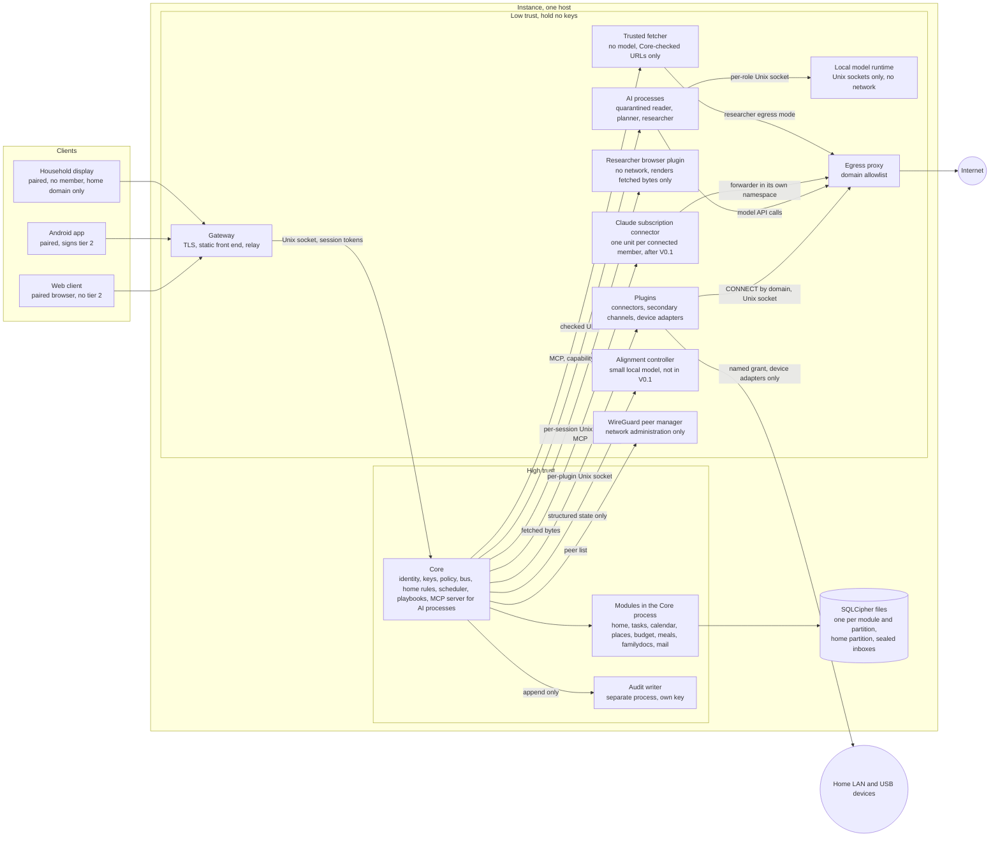
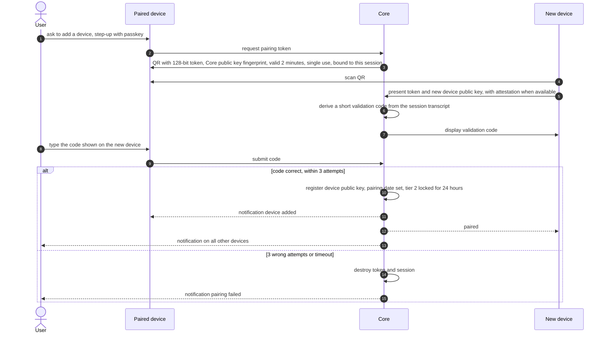
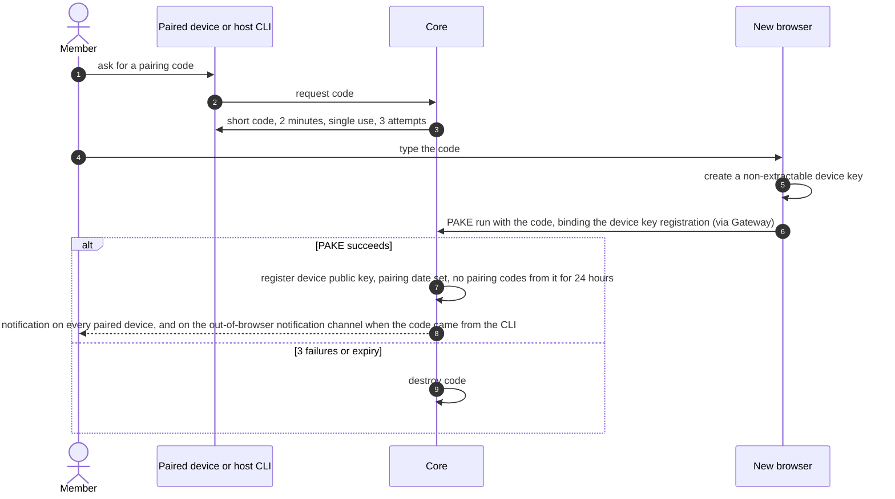
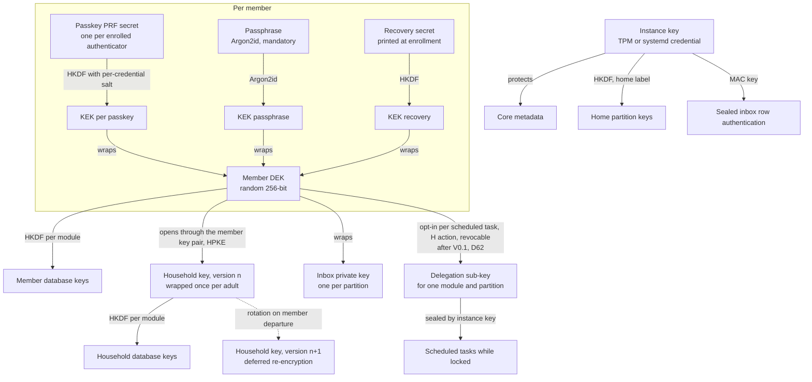
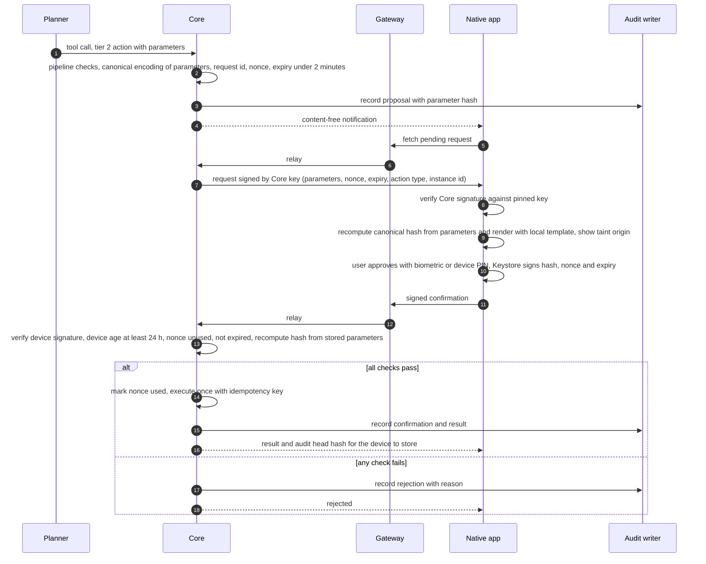

# Architecture

Status: design phase, no code yet. Revision 2: aligned with the product requirements ([prd.md](prd.md)) and the [architecture spine](architecture-spine.md), whose design changes are recorded as D34 to D61. Update of 2026-10-16: assistant parity (PRD section 4.18), recorded as D62 to D68, adds the scheduler, delegation sub-keys after V0.1, the researcher, disclosure grants, playbooks, activatable modules with a tool policy, own-account delivery and spoken confirmation, and risks R34 to R39. Revalidation of 2026-10-16, recorded as D69 to D86, keeps letting someone in off Vilicus until the native app, binds each step-up to one action, stores member-approved writes `trusted`, adds the trusted fetcher and the local model runtime as components, reorders bootstrap, adds re-enrollment and suspension, seals security adapter secrets to the TPM, binds providers by data type, runs migrations on copies and backups unattended, and adds risks R40 to R47. An update of the same day, recorded as D87 to D96, sets how a suspension is lifted, lets a single adult cancel an addition and any adult veto from the CLI, bounds the web session to 15 minutes idle and 12 hours, puts life safety before the safe direction, keeps plugins project-signed until V1, ingests sealed inbox rows as `external` by default, routes delegated writes through the sealed inbox, gives plugins an encrypted state store, seals the instance key to the Secure Boot policy only, and adds risks R48 to R51. A last update of the same day, recorded as D97 to D100, adds the Claude subscription connector, validates structured fields on write, keeps model-drafted free text `external` after an approval, reads a request back before a spoken yes, amends risk R39 and adds risk R52. The revision 2 revalidation of 2026-10-16, recorded as D101 to D115, lists every V0.1 action with its surface and keeps exposure and the admin recovery code at the host CLI, ships first-party plugins in the main package until V1, carries one data type set on every record, closes the definition of a structured field, requires a working out-of-browser channel at enrollment, sends backups to object storage with passphrase wrappers sealed, keeps V0.1 events within one partition, enters the secrets that open the house only at the host CLI, makes relays fail closed, separates hostile-content AI roles at runtime, labels spoken memory facts, fixes the V0.1 values, encrypts the audit and inbox files, replaces loopback address grants by per-port isolation, and adds risk R53. An owner decision of the same day, recorded as D118, makes a self-hosted push server the default for the out-of-browser channel. Update of 2026-10-17, from the V0.1 spikes (D120 to D139): external content sanitized before the separate origin (D139, section 6), peer identification by cgroup membership and pidfd and the default template profile (D125, section 4), the key memory rules of E16 (D131, section 4), deletion followed by a TRUNCATE checkpoint (D132, sections 5.1 and 12), extension loading turned off on every connection (D126, section 12), the push payload and the acknowledgement token (D135, section 13.4), the E24 and E3 results (section 15), and risks R54 and R55. Update of 2026-10-18: the eleven spike records left Proposed were settled after research (D121, D123, D125, D127 to D129, D134 to D138): peer identity and the template profile (section 4), the egress allowlist review for front ends (section 4), the bootstrap's relying party checks (section 7.1), the push payload and its reachability (section 13.4), the D28 exceptions (section 16), R54 accepted and R55 narrowed to rotation. This is the central document: the other documents refer to it for component names and trust boundaries, and it refers to them for detail. Terms in **bold** at first use are defined in the [glossary](README.md#glossary).

Companion documents: [threat-model.md](threat-model.md) (who attacks what), [key-management.md](key-management.md) (keys, unlock, recovery, rotation), [ai-safety.md](ai-safety.md) (rules for the assistant), [capability-matrix.md](capability-matrix.md) (every action, its tier and confirmation), [decisions.md](decisions.md) (why), [research-notes.md](research-notes.md) (what is verified, assumed, or still to test). The [architecture spine](architecture-spine.md) (AD-1 to AD-56) binds the choices this document leaves to the builder; [prd.md](prd.md) says which milestone ships what.

## 1. Purpose and how to read this document

Vilicus is one self-hosted installation per household. It stores sensitive data, holds credentials for outside services, and lets an AI assistant act through typed tools. The architecture has one job: make sure that a wrong, fooled, or hostile component can only do a bounded amount of damage, and that the damage is visible afterwards.

Sections 3 to 8 describe structure and keys. Sections 9 to 11 describe how actions are authorized. Sections 12 to 16 describe modules, plugins, audit, transport and the supply chain. Section 17 lists failure behaviour, section 19 records the challenge passes this document went through, and section 20 lists the risks that remain open. Anything marked **open** is a decision not yet taken.

## 2. Design rules

1. **The Core decides.** Models, plugins, the Gateway and clients propose or relay; only the Core authorizes and executes.
2. **Keys live in one place.** Only the Core holds key material. Modules receive opened database handles scoped to a partition, never keys. Plugins and AI processes receive nothing secret except what a single task needs.
3. **No third-party code in the Core process.** Trusted modules are crates compiled into the binary. Everything else runs as a separate, sandboxed process behind a closed-type protocol.
4. **Trust labels travel with data.** Every record carries a taint label (section 5.4). Labels only get more restrictive as data is combined.
5. **Irreversible means a human, on a device that can show what is signed.** No chat reply, web click or message can authorize a tier 2 action.
6. **Fail closed, say so, stay usable.** When a control cannot decide, the action waits for a human; when a dependency is down, the behaviour is defined (section 17), not improvised.
7. **Claim what is built.** Properties that depend on the deployment (TLS termination, host trust, hardware support) are documented as conditions, not as guarantees.

## 3. Components and trust levels



| Component | What it is | Trust | Holds keys | Runs as |
|-----------|-----------|-------|-----------|---------|
| **Core** | Identity, authentication, key management, policy engine, capability tokens, event bus, module registry, write journal, migrations, home rule execution (section 12), scheduler for scheduled tasks and playbook engine (after V0.1, D62, D65), MCP server for Vilicus's own AI processes only (D49), plugin supervisor | Highest | Yes, the only one | Main process |
| **Modules** | Trusted crates (home, tasks, calendar, places, budget, meals, familydocs, mail help). Each owns its own databases and migrations; the `home` module owns the home partition (section 5.1). An **activatable module** is off until a household or a member activates it (D66, section 12) | High (reviewed code, but same address space as the Core) | No, receive scoped handles | Inside the Core process |
| **Gateway** | Terminates TLS when no reverse proxy does, serves the embedded front end and the app API, relays pairing and confirmation traffic | Low: exposed to the network, assumed compromisable | No | Separate unprivileged process, same binary, own subcommand |
| **Audit writer** | Appends to the tamper-evident log | High, minimal | Its own HMAC key only | Separate process |
| **Plugins** | Connectors, first-party or third-party: store connectors, secondary channels (D42), notification transports after V0.1, and **device adapters** (D54), which act under their own adapter principal and may hold a named USB or local network grant | Untrusted | Only their own scoped secret; device adapter secrets belong to the household and are kept in the home partition, except the secrets that let a device open the house, which are entered only at the host CLI and sealed to the TPM under a signed boot policy (D78, D108, section 5.1) | One sandboxed process each, separate executable with a signed manifest |
| **AI processes** | Quarantined reader, planner, optional drafter, and after V0.1 the **researcher** (D63, section 11.1), several of which may run in parallel (see `ai-safety.md`) | Untrusted by design | No | Separate sandboxed processes |
| **Researcher browser plugin** | Optional isolated renderer for the researcher: it has no network at all and renders only bytes the trusted fetcher returned (D63, D73). After V0.1 | Untrusted, runs hostile pages' scripts in its sandbox | No secret, no household data | One sandboxed process, like any plugin |
| **Trusted fetcher** | Makes every researcher request after the Core checks its URL: GET only, a link that appears verbatim in a page already fetched for the task, capped length, no cookies, internal addresses blocked; returns the bytes and runs no model and no page code (D73, section 11.1). After V0.1 | Trusted for the shape of its requests; parses nothing | No | Separate process, same binary, own subcommand; reaches the network only through the egress proxy in researcher egress mode |
| **Local model runtime** | Serves the local models: quarantined reading, local-only data types, transcription and voice (D83). Model files are pinned by hash. The quarantined reader and the researcher never share a runtime process with the planner or the drafter; within each group one instance serves every role and member, with cache reuse disabled and requests serialised, and per-member instances run only where E25 shows the memory fits (D110). From the first milestone that uses a model | Untrusted, like an AI process | No | Separate units, reached only over per-role Unix sockets, no network, no cache shared across members or roles |
| **Claude subscription connector** | Runs the unmodified Claude Code binary headless for one member, as that member's model connector for the planner and drafter (D97). After V0.1 | Untrusted, like an AI process | No; its own sign-in credential in its state directory, outside the key hierarchy (R39) | One unit per connected member under its own user; one child per session; network only through the egress proxy, from its own network namespace (spine AD-53, D115) |
| **Alignment controller** | Small local classifier used on structured state (section 11.4). Not in V0.1: elevated tier 1 calls go to a queue instead (D38) | Untrusted output, bounded role | No | Separate sandboxed process, no network |
| **Egress proxy** | Domain-allowlist forwarding for plugins, AI processes and the Core's own outbound calls, with per-host budgets counted in tunnels (D133) and, after V0.1, a researcher egress mode for the trusted fetcher only (section 4, D73); does not terminate TLS; reached only over Unix sockets, with no TCP listener (D115) | Low | No | Separate process |
| **WireGuard peer manager** | Applies the peer list the Core sends to a WireGuard interface owned by the host network configuration; makes no decision (D60). From the home milestone | Low, minimal | No (the interface private key belongs to the host network configuration) | Separate process, static user with the network administration capability only |
| **Clients** | Web (paired browser), Android app, **household display** (a paired device without a member, D55), later a desktop app | Web: untrusted. Paired native app: trusted for confirmation only. Household display: home domain only, never tier 2 or H | Hold their own device key, never the data keys at rest | User devices; the household display is a wall tablet |

"Single binary" means one executable with subcommands (`core`, `gateway`, `audit`, `egress`, `wg`, the AI roles, the trusted fetcher, and so on) started as separate systemd units. Separation is between processes, not between binaries, which keeps installation simple and keeps the isolation real. Plugins, first-party ones and device adapters included, are separate executables bound to a signed manifest; being first-party grants nothing (spine AD-2). Until V1, first-party plugins ship inside the signed main package, version-locked to the Core, so V0.1 has no separate plugin install (D102). A `vilicus-testbed` binary, never packaged, links the reference module and starts the test doubles, separate executables shipped beside it (D141), for the release gates that need them; every other gate runs against the shipped package (PRD FR-109).

Vilicus exposes no MCP endpoint and no other API to outside AI assistants: MCP runs only between its own AI processes and the Core (D49).

Assumption stated early because the rest depends on it: modules are in the Core's address space. The "modules have no keys" rule is enforced by API shape and code review (`#![forbid(unsafe_code)]`, no key types exported to module crates), not by memory isolation. A malicious module is therefore a supply chain failure (section 16), not something the runtime contains.

## 4. Process model and deployment

- Supported in v1: Linux with systemd. Other platforms are out of scope for the server.
- The Core creates the Unix sockets for the Gateway, the audit writer, each plugin and each AI process, and on every accepted connection identifies the peer by its systemd unit, not by user id alone: the peer's pid must be listed in the expected unit's cgroup and its pidfd (`SO_PEERPIDFD`), taken at accept, must still name a running process; a failed `SO_PEERPIDFD` refuses the connection, with no fallback to the pid alone, and the Core refuses to start on a kernel older than 6.5 (spine AD-24, E10, D125). A socket is never reachable by another service account, and a capability token is accepted only from the peer unit it was issued to. Each unit owns its runtime directory; the Core listens on one socket per peer instance; the audit writer has an append socket for the Core and an admin socket for the root CLI; the egress proxy has a control socket for the Core and one data socket per caller; the admin socket's only identity is uid 0 by `SO_PEERCRED`, in a directory readable by root only. The spine's socket inventory (AD-55) is the full list. The local model runtime is reached only over per-role Unix sockets (D83).
- Users: the Core, Gateway, audit writer, egress proxy and, from the home milestone, the WireGuard peer manager run as static units, each under its own static system user; the trusted fetcher and the local model runtime run as their own units; AI processes and plugins run from template units with `DynamicUser=yes`, started and stopped by the Core through systemd; a device adapter that cannot open its serial device under a dynamic user gets a static user of its own (spine AD-24, AD-38, E27). AI process instances are named by role, member and provider (`vilicus-ai@<role>-<member>-<provider>`, researcher instances by task), so the Core binds each AI connection to that triple and derives its egress from the provider alone. After V0.1 the Claude subscription connector runs one unit per connected member, `vilicus-claude@<member>.service`, under a static per-member user created by `vilicus ai connect claude` (spine AD-24, AD-53).
- Every sandboxed service gets a fixed unit profile imposed by the Core's installer and checked in CI: its user as above, `ProtectSystem=strict`, `ProtectHome=yes`, `PrivateTmp=yes`, `NoNewPrivileges=yes`, `SystemCallFilter=@system-service`, `RestrictAddressFamilies` limited to what the service needs (usually `AF_UNIX` only), `IPAddressDeny=any`, `ProtectProc=invisible`, `MemoryMax` and `TasksMax` limits, `LoadCredential` for the single secret the service owns. Without further options this list still lets a unit reach the system bus, the journal's stream socket and abstract sockets of the host, and create user namespaces (E10). Plugin and AI process templates therefore use the default template profile, whose reference is the fixed profile block of `spikes/sandbox-profile/units/vilicus-plugin@.service`, asserted line by line against `systemctl show` by the spike's checks, until the shipped template file replaces it, plus `NoExecPaths=/` and `ExecPaths=/usr`; the explicit deny of the `io_uring` system calls applies to every Vilicus unit, the Core included, since `@system-service` includes them (D125). Units that cannot take the default profile get their own, tested on its own: the egress proxy; device adapters with a network or shared-namespace grant (D54, D115), which cannot take `PrivateNetwork=yes`; the forwarder that joins the Claude connector's namespace (D115); the WireGuard peer manager; and runtimes that generate code at run time, which `MemoryDenyWriteExecute=yes` breaks (the Claude Code binary of the connector, a WASM runtime). No unit receives `IPAddressAllow=` for loopback (D115). A plugin cannot widen its own profile; changing it is a rights change (section 13).
- Outbound network access for plugins and AI processes goes through the egress proxy, which keeps no TCP listener: each caller reaches it over its own Unix data socket, where it accepts `CONNECT host:port` only for domains on the allowlist the Core sends it (D115, spine AD-55). The proxy resolves every name itself, checks each resolved address at connect time and connects to that exact address; it refuses loopback, RFC 1918, link-local and unique local addresses, 100.64.0.0/10, IPv4-mapped and NAT64 forms of all of these, multicast and unspecified addresses, the WireGuard subnet, and the host's own and the household's public addresses. The Core's URL check is advisory; the proxy's check is the control (spine AD-16); E14 extended the refused set to every special-purpose range that is not globally reachable and decides the allowlist before any lookup (D133). Core-originated traffic (push webhook, backup upload, remote audit sink, heartbeat) may reach a private host and port that the instance admin names through an H action with step-up, alerted to every adult; the proxy allows that destination to the Core and the backup caller only, never to an AI process or a plugin (D105). It does not terminate TLS, so it sees destination hostnames, not content. Domain filtering is finer than IP filtering because CDN addresses are shared, but it can be bypassed by domain fronting on a shared front end, by SNI or by the HTTP Host header (E14, R54); for a caller that reaches a shared front end, the proxy refuses a tunnel whose SNI differs from the CONNECT host or that offers Encrypted Client Hello (D134); the allowlist should therefore list exact hostnames, not wildcards, preferably on dedicated infrastructure, and an entry on a front end that does not refuse a Host differing from SNI needs a stated reason in the allowlist review (D134). Every host carries a **per-host budget** shared by every process that reaches it (recipe import, feeds, context sources, store connector, researcher, plugins), so that no combination of tasks gets the household's address blocked by a site (PRD FR-105); the proxy sees tunnels, not requests, so the budget counts tunnels, with a reserve for the Core and the backup caller (D133). After V0.1 the proxy also has a **researcher egress mode** (D63): for the trusted fetcher only, it accepts any public host instead of an allowlist, still blocks internal addresses, and counts every request against the per-host budgets. Because the proxy does not terminate TLS, it cannot see methods, paths or headers; those rules are enforced by the trusted fetcher, which makes every researcher request after the Core checks the URL (D73). The bytes are parsed inside the sandboxed researcher or the researcher browser plugin, neither of which has network access, never in the Core (section 11.1). A URL that a Core stage fetches (recipe import, a watched feed) is never supplied by an AI principal: it comes from a `Member` principal, or verbatim from text the member typed in the current turn; recipe import may reach any public host, in a named Core egress mode with per-host budgets (PRD FR-40). Two exceptions to proxy-only network access, both named: a device adapter may receive a grant of exactly one USB device, Unix socket path, shared private namespace with a named managed daemon, or private address range with ports, the ports enforced per unit by an nftables rule matching the unit's cgroup and installed by the root CLI with the grant, given by an H action and audited, while its internet access stays behind the proxy; `IPAddressAllow=` alone never implements a grant (D54, D115); and the WireGuard peer manager holds the network administration capability to apply peers (D60). A daemon an adapter depends on (for example a radio coordinator daemon) runs under Vilicus's management, listening on a Unix socket, or on loopback inside a namespace shared only with its adapter, and requires client authentication where it supports it (D115).
- Memory hygiene in the Core: no core dumps (`PR_SET_DUMPABLE` off, `LimitCORE=0`), key buffers in one guarded, locked pool (`mlock`, `MADV_DONTDUMP`, `MADV_WIPEONFORK`) allocated at start, the Core refusing to start if it cannot be locked, zeroized on drop, with a stack scrub after each key operation; the Core under a user that runs nothing else, never calling `execve` or changing credentials after it hardens itself; swap disabled or encrypted, and hibernation disabled (E16, D131). These reduce, not remove, the exposure of unlocked keys to a root attacker (see section 20, R1).
- The Core holds an **instance key** (not a data key) delivered through a systemd credential, sealed when a TPM is available to the TPM's Secure Boot policy only (PCR 7), so that kernel updates do not lock the house and the instance can start unattended, open its own database and serve the login page. A live image signed under the same Secure Boot authorities can also unseal it; a pcrlock hook re-seals it before a Secure Boot database or SBAT update (D108, R50). It protects instance metadata (section 5.2) and, since D53, the home partition (section 5.1), which must work with every member locked. It decrypts no member or household partition, with one exception after V0.1: the module files opened by the delegation sub-keys it seals (D62, R34). The secrets that let a device open the house (security-adapter vendor credentials, the radio coordinator's network key, and a router admin credential if one is used for presence) are not under the instance key and never transit the Gateway: they are entered only at the host CLI as systemd credentials sealed to PCR 7 plus a signed PCR 11 policy (unified kernel images), so a host without a TPM, or without unified kernel images, cannot run such adapters (D78, D108). After an unseal failure (firmware change, TPM reset), the instance admin restores the instance key from a backup with the backup private key, as the recovery runbook states (D96, section 17).

## 5. Data model and storage

### 5.1 Databases

- SQLite with SQLCipher (AES-256). Keys are 256-bit raw keys derived by the application (SQLCipher does not implement Argon2), so the passphrase work factor is under Vilicus control and the SQLCipher internal KDF is bypassed with a raw key.
- **One database file per module and per partition**, plus Core files. A **partition** is a member's personal partition, the household partition, or the **home partition**. The module code is one crate; at runtime a module opens `tasks.household.db`, `tasks.<member-id>.db` and so on. This is how "partitions are isolated by keys" and "each module has its own database" hold together: a file has exactly one key, and a key belongs to exactly one partition. (This refines the earlier one-file-per-module wording; see D3 in `decisions.md`.)
- The **home partition** (D53) is one per instance, written only by the `home` module, and its file keys derive from the instance key, so the house runs with every member locked. It holds devices, rooms, rules, scenes, modes, current state, rule timers, adapter secrets and a bounded rolling window of recent events (PRD FR-71), not history. It is therefore protected only as well as the instance key (R24). The secrets that let a device open the house (adapters of locks, alarms, garage doors and gates, the radio coordinator's network key, and a router admin credential if one is used for presence) are the exception: they are entered only at the host CLI and sealed to the TPM under a signed boot policy rather than kept under the instance key, and are not restorable from a backup (D78, D108). The coordinator daemon receives its network key by `LoadCredentialEncrypted=`, with its own write-back of the key and its own backups disabled; where a daemon cannot take its key from a credential, its radio key sits in clear in its configuration, and the documentation says so (D108).
- **Sealed inboxes** (D53, from the home milestone, D107): every other partition has one inbox file, `inbox.<partition>.db`, written only by the Core; the file is itself a SQLCipher file under a key derived from the instance key (`vilicus/v1/inbox/<partition>`), and a row's record type and payload version travel inside the sealed payload (D114). A row is sealed with HPKE (D61) to that partition's inbox public key, whose private key is wrapped by the partition root, and authenticated with a MAC under a key derived from the instance key. A row is either a history row or an event row (spine AD-37); only rows produced from the home partition or by the Core (disclosure grants) cross partitions, and module events never do. Sensitive history (household presence, door, window and alarm events) always goes through an inbox, even while the target is unlocked; the **household sealed inbox** is ingested into the household partition at the next adult unlock, a member's inbox at that member's next unlock, and ingestion continues while the target partition stays unlocked (spine AD-37). Because the MAC key derives from the instance key, whoever holds that key can forge rows: the inbox protects confidentiality, not integrity, against the instance key holder. An ingested row is therefore stored `external` unless it carries a MAC under a key derived from the household key, which the Core adds only to rows it produces while an adult is unlocked (a disclosure grant, D64), and every ingestion is journaled and reviewable (D93, R49). Such a MAC proves only that the Core of an unlocked adult produced the row, which an operator who is an adult can also do (R19): ingestion accepts it only when its grant identifier names a live grant the recipient was notified of at creation, its author is that grant's owner and never the recipient, and its fields match the grant's registered derivation; the MAC input binds the grant identifier, owner, recipient and a sequence number (D93).
- `secure_delete` is ON (never FAST) on every connection, set and read back at open because the pragma is per connection. WAL files and journals live next to the database and are covered by the same encryption. A deletion that must be real (journal retention, crypto-shredding) is followed by a TRUNCATE checkpoint through the SQLite C API: until a checkpoint the old pages stay in the file, and until a TRUNCATE checkpoint the WAL can keep the rows (E17, D132).
- Where deletion must be real (mail cache, attachments, assistant memory, documents), sensitive records are additionally encrypted with a per-record key stored wrapped in the same database, and deletion destroys that key (**crypto-shredding**). Destroying the key is a delete of its wrapped form under `secure_delete` followed by a TRUNCATE checkpoint, and the wrapped key is never copied into the write journal (or the journal rows that hold it are deleted with it); otherwise the wrapped key stays readable to whoever holds the file key (E17, D132). Limits: copies of the database in older backups still contain the wrapped record key (section 18), and shredding is only applied to the record classes that need it, because per-record encryption costs search and indexing ability.
- Audit entries never contain sensitive parameters in clear: they hold identifiers, canonical parameter hashes, tier, actor and outcome (section 14).
- PostgreSQL was rejected: it is an external service, offers no native transparent encryption, and a household's volume is tiny (D2).

### 5.2 Core files

| File | Content | Protected by |
|------|---------|--------------|
| `wrappers.db` | Wrapped key blobs (never raw keys), wrapper headers, per-member public keys (each authenticated by a MAC under a household-key-derived key before the household key is wrapped to it, D74, spine AD-36), KDF parameters | Not encrypted by the instance key: every blob is already ciphertext under a member secret, and integrity is protected by an HMAC. Kept separate so that losing the instance key never loses the ability to unlock data |
| `core.db` | Accounts, roles, authenticators (public keys), devices (public keys, attestation; household displays included), nonce ledger, plugin registry and manifests (with each module's activation state), device adapter grants, policy (including the safety-relevant marks, the approval hash of each rule that touches a safety-relevant device, and each member's tool policy, D66), capability token metadata, pending deadlines, alert destinations, channel bindings (with each channel's ceiling allowlist, D82), migration registry, backup public key (D85), named private destinations of Core traffic (D105), sealed delegation sub-keys and the run descriptors of delegated scheduled tasks, whose fire time and staleness limit are in clear and whose structured definition is sealed under the sub-key (after V0.1, none in V0.1, D62, D111), and a copy of each module file's key epoch for `vilicus status` only | Instance key. Metadata only, except that a sealed delegation sub-key opens member or household data |
| `core.<partition>.db` | Cross-module link table, provenance index, confirmation queue for that partition | The partition key |
| `inbox.<partition>.db` | Sealed inbox rows waiting for ingestion (section 5.1, D53), from the home milestone | SQLCipher under an instance-key-derived key (D114); each row sealed to the partition's inbox public key, MAC under an instance-key-derived key; confidentiality, not integrity, against the instance key holder, except for rows that carry a household-key MAC (D93) |
| `<file>.epoch` | The key epoch (partition root version, file generation) of each module file, written atomically next to it and repeated in the file's `_meta` table for a cross-check (`key-management.md`, section 2) | Not encrypted: a counter, not a secret; kept outside `core.db` so that losing the instance key never loses the epoch needed to derive a file's key |
| Plugin state store | Each plugin's persistent state, in its own state directory (section 13.1) | A key derived from the instance key for a household-owned plugin, or from the owning member's partition root for a member-owned plugin; part of backups, except the TPM-sealed secrets of security adapters (D95) |
| `audit.db` | Hash-chained log | SQLCipher under a key derived from the audit key (`vilicus/v1/audit/db`), opened only by the audit writer (D114); integrity by HMAC chain and external anchors |

Losing the instance key (TPM change, disk moved to another host) costs the metadata in `core.db`, the home partition (devices, rules and current state must be set up again) and any delegation sub-keys, not member or household data: members unlock from `wrappers.db` with their own secrets and the admin rebuilds `core.db`. A complete backup carries the instance key wrapped to the backup public key, so a restore onto a new machine with the backup secret keeps it (D52, D85, section 18); the TPM-sealed secrets of security adapters are not in it and are entered again at the host CLI (D78, D108). An **admin recovery code** lets a new admin credential be created on an existing data directory without wiping it; it grants no data access. It is printed only on the host console at bootstrap, stored only as an Argon2id hash, and redeemed only at the host CLI as root (`vilicus admin recover`), which prints a one-time admin enrollment token; no web route accepts it (D101). Honest consequence: someone who steals the disk and also gets the instance key (for example a copied disk without a TPM) learns metadata such as member names, device names and the shape of the registry, and the content of the home partition, enough to tell whether the house is occupied right now and to drive non-security devices through their adapter secrets (R24), but no member or household data and no usable keys, because the wrapped keys are still protected by member secrets. After V0.1 one exception exists by choice: a delegation sub-key is sealed by the instance key, so that attacker also reads the module file it opens, for as long as the sub-key exists (D62, R34).

### 5.3 Cross-module consistency

There are no transactions across databases. Modules react to one another through events and the **outbox** pattern: a change is committed in the module's own database together with a row in that database's outbox table (one transaction, one file); the Core delivers the event at least once once the partition is unlocked, so delivery after a restart waits for an unlock (or an unlock window, D36). In V0.1 every event is delivered only within its source partition (D107). A module event never crosses partitions; from the home milestone, an event produced from the home partition whose consumer partition is locked is sealed into that partition's inbox and delivered at its unlock, so the source outbox moves on (spine AD-29, AD-37). Events to a consumer that is not ready (locked, migrating, faulted and the other states of spine AD-54) stay in the source outbox and do not count as failed deliveries. Consumers are idempotent: a consumer records the event id in the Core-owned `_consumed` table in the transaction of its effect, outbox rows are marked delivered and kept for a period rather than deleted, and an event moved to `_dead_letter` is replayed with `vilicus events replay` (spine AD-26, AD-29). A module cannot write into another partition on an event. Where one fact must appear in two partitions (a recipe reminder for a household meal plan), the Core stores it once in the partition that owns it (the household calendar) and presents a merged view at read time. Cross-module references are opaque identifiers registered in the Core's link table, which lives in the partition of the data it links. A link never crosses partitions: a household meal plan entry and a personal calendar event are joined by two links, each in its own partition, created through an explicit tier 2 action when the write crosses the boundary (section 9.4).

### 5.4 Provenance (taint) is part of every record

Every record of every module has three mandatory metadata fields, enforced by the storage layer (a table without them cannot be registered by the module registry):

- `source`: who produced it (a member, the system, a module, a plugin id, a mail account, an AI task, a scheduled task (`scheduled_task(id)`), a playbook (`playbook(id)`)), from the closed vocabulary of the spine's conventions.
- `taint` and `text_taint`: the label of the record's structured fields, `trusted` or `external`, and the label of the record read with its free text, `trusted`, `approved_draft` or `external`, never below `taint`; `approved_draft` is `external` except that a planner reads it as quoted data (D147).

Every record also stores the set of **data types** it contains, from the closed set held in `vilicus-types` (D103): a record kind declares the types its fields may hold, and a derived record's set is the union of its inputs' sets, computed by the Core like taint (ai-safety I43), together with the data types an AI or plugin session consumed; a member's own or approved write holds its record kind's declared set (D147). The provider policy and the secondary channel ceilings read that set.

Rules:

1. Records typed by a member, or computed by Core and modules from `trusted` inputs, are `trusted`.
2. Anything that came through a plugin, a mail, a web page, a file import, a calendar invitation or a model, is `external`.
3. Derived data inherits the most restrictive label of its inputs. A summary of external data is external. It counts each input's `text_taint` and, for an AI or plugin principal, what its session consumed; model free text no member approved is `external` (D147).
4. At read time the Core computes an **effective taint for the viewer**: a `trusted` record authored by another member is delivered to a member's assistant as `member`. The order is `trusted` < `member` < `external`. An assistant treats `member` data as untrusted instructions-wise (it can read it as data, it never follows it). `member` is a read-time view, never a stored label. Structured fields of `member` taint do not taint the session; free text of `member` taint does (D70). A field is structured only if its value set is fixed at build time: a compiled enumeration, a bounded number, a date, or an opaque UUIDv7; a run-time vocabulary (tags, categories, room, scene, mode or ingredient names) is free text, unless it is a reviewed vocabulary, whose labels an adult confirms one by one, at most 32 characters from a restricted alphabet (D104).
5. A record written by a tainted session inherits that session's taint. A write the member makes, or explicitly approves (their own action, or a light confirmation of an elevated request), is stored `trusted` with that member as author and provenance pointing to its inputs, except free text drafted in a tainted session, which is stored `approved_draft`, an `external` label, whatever the approval and however edited; only text the member writes in full in an empty field of the approval screen is stored `trusted`, and a member-written field that contains 8 or more consecutive words of the assistant's draft is stored `approved_draft`, an `external` label (D70, D99, D147, D104). Copying or importing external text into a trusted field is a promotion. A member's free text repeating 8 consecutive words of an input that is not `trusted` for that member is stored `external`; an update never lowers a label and keeps the author of the content it keeps (D147).
6. Promoting a record from `external` to `trusted` happens only through the host CLI, for data the member authored or imported, never through the Gateway (D45, which replaces the earlier "promotion is tier 2"): by batch and category after reviewing a sample for records whose fields are all structured, and one by one, or by retyping, for a free-text record (D112). Every schema field is declared structured or free text with a maximum length, and the storage layer validates every structured field against its declaration on every write (a closed type and its maximum length), refusing, never truncating or coercing, a value outside it (D98). Free text of `member` taint (a household record written by another adult) reaches the planner as quoted data carrying its taint, not through the reader; `external` free text reaches it only as typed reader output (D37, replacing the earlier "member free text is routed through the reader"), except a member-approved assistant draft, which reaches a planner as quoted data within its maximum length and taints the session (D104). Writing from a personal partition into the household partition or into another member's partition is tier 2 (section 9.4).

The label is metadata, not a filter: the point is that every consumer (policy engine, confirmation screen, memory, audit) can ask for it without trusting the producer. Labels are recorded for every principal, including home rules, playbooks, the household display and device adapters, but their effects on authorization apply only to AI and plugin principals (section 9.3, D58). Device state reported by an adapter is `external`, so a later AI session that reads it is tainted.

## 6. Identity, roles, sessions and devices

- Roles: **member** (owns a personal partition, belongs to the household partition) and **instance admin** (manages the system). One human can hold both roles, with two distinct login contexts. The admin role grants no access to any data key (section 8, `key-management.md`). Adults and children are both members; children's accounts can be flagged as managed, which restricts which actions their assistant may take. Adding or removing an adult is authorized from the host CLI by another adult's passphrase, followed by a delay and a veto by any other adult (D34, section 8).
- **Principals that are not members** (D58): a **home rule** validated by a human acts under a rule principal, and a **household display** under a display principal. After V0.1 a **playbook** validated by a human acts under a playbook principal (D65, section 12). None of them holds a capability token bound to a member, and none is gated by taint; each is checked against its own scope; playbooks count against caps and appear in the digest (spine AD-8), and rules and playbooks of assistant origin are suspended by the kill switch (section 9.6). A playbook triggers only on records written by a `Member`, `Rule`, `Adapter` or `Cli` principal (D109). A **scheduled task** is not a principal of its own: each run acts as an AI task with one capability token (D62). The spine fixes the closed list of principals (AD-8).
- **Tool policy** (D66): each member has a tool policy, a subset of the capability matrix that never adds an actor or raises a tier. The Core intersects it with every capability token issued for that member (assistant sessions, scheduled tasks, plugins, bound channels) and applies it to the member's playbooks. Only the member widens it, with a step-up; another adult may narrow it, and the member is notified.
- **Household display** (D55): a paired device without a member, enrolled by an adult through an H action. It reads the home domain and household presence, runs tier 1 home actions on devices that are not safety-relevant, and never shows member or household data outside the home domain, never offers an H action, never confirms tier 2. Its session is not bound to a member and does not follow the web session limits (D90); it is re-proven with the device key on every request and revoked like any device. It is physically accessible to anyone in the house (R31).
- Authentication: passkeys (WebAuthn) by default. TOTP exists only as a fallback second factor for login on a device without passkey support; it is never accepted for tier 2 confirmation, pairing, recovery or step-up.
- **Step-up**: a fresh passkey assertion, required for human-only actions (the "H" actions of the capability matrix). Its WebAuthn challenge is derived from the canonical hash of exactly one pending action created by the Core before the prompt; one assertion authorizes that action only, never a time window, and cannot be replayed for another (D71). WebAuthn still shows the member nothing about the action, so a compromised Gateway can display one action while the member approves another (R18); this is why letting someone in is kept off the web (D69, section 9.1).
- **Suspension and re-enrollment** (D77, V0.1): `vilicus member suspend` revokes a member's sessions, devices, channel bindings and unlock window and blocks login, keeping keys and data, with no household key rotation; full removal comes later (section 8). It also accepts a member's own passphrase for their own account, so a member who believes their account is compromised can suspend it (D101). `vilicus member reenroll` prints an enrollment token for a member who lost their passkeys, after a rename or after a restore. Completing a re-enrollment or a recovery ends the member's unlock window and revokes every other passkey, paired device, web session and channel binding of that member, except those the member explicitly keeps on the completion screen; the out-of-browser alert lists what was revoked. `vilicus device pair`, `vilicus unlock` and `vilicus member reenroll` require the target member's own passphrase; `vilicus member add` requires an existing adult's, and `vilicus member veto` the vetoing adult's own. Lifting a suspension is an H action approved in the app by another adult with a step-up bound to that action (D71), followed by the delay and veto of adding an adult, with every adult notified; it needs no passphrase (D87). Before the native app this step-up runs in a browser, so a compromised Gateway can have it approved under another action; the delay, the veto and the out-of-browser alerts bound it (R40). Every V0.1 action has one stated surface (PRD FR-50, D101).
- Sessions are bound to the device key of a paired device, so a stolen cookie alone is not enough. A paired browser holds a non-extractable device key created with WebCrypto; it signs a per-request challenge that binds the web session and the canonical bytes of each light confirmation (D35). When the key is lost (browser data cleared), the browser is unpaired. This protects against network observers and replay, not against a compromised Gateway, which serves the code that uses the key (R18). Web session: `__Host-` cookie, `HttpOnly`, `Secure`, `SameSite=Strict`, ended after 15 minutes without activity and after 12 hours at most, no "remember me", revocation checked by the Core on every request (not only by the Gateway), no secret in `localStorage`. Every request stays signed by the browser's device key, so a stolen cookie alone is useless; re-authentication is a passkey assertion (D90).
- Clients receive changes over one server-sent event stream per web session, opened by a signed request and carrying only change notices; the client re-reads through signed requests (spine AD-56).
- Content security policy: `default-src 'none'`, `script-src 'self'` with nonce, `connect-src` limited to the instance and its event stream, `frame-ancestors 'none'`, `base-uri 'none'`, Trusted Types enforced. External content (mail bodies, imported pages, recipes) is sanitized with an allowlist, then rendered inside an iframe with an empty `sandbox` attribute served from a separate origin (the instance name on port 8443) whose CSP forbids every subresource, script and form; the client's `frame-src` lists that origin only, and the links of the content are shown outside the frame (E26, D139).
- The web client is a paired device with a session. It can read and write within a member's rights, but it never confirms a tier 2 action, and an unmanaged browser (no pairing) gets login-free pages only.
- A **paired device** is a client with a registered public key and a pairing date. A new device cannot do tier 2 or pair other devices (issue pairing codes) for 24 hours.

## 7. Bootstrap and pairing

### 7.1 First start

```mermaid
sequenceDiagram
  autonumber
  actor Op as Operator
  participant C as Core
  participant G as Gateway
  participant B as Browser
  Op->>C: start instance, no admin exists
  C->>Op: console prints a 128-bit bootstrap token and the self-signed certificate fingerprint
  Note over C,G: Wizard listens on loopback and LAN only, token valid 15 minutes, one use
  Op->>B: open wizard URL, compare fingerprint
  B->>G: submit token
  G->>C: relay token
  C->>C: verify token, constant time, rate limited, burn it
  B->>C: set instance name and certificate source (via Gateway)
  Op->>B: open the wizard on the instance name, certificate validates in the browser
  B->>C: create admin account and enroll authenticators on the instance name (via Gateway)
  C->>C: write admin account, disable wizard permanently
  B->>C: configure the instance admin's out-of-browser destination, admin-authenticated setup route (via Gateway)
  C-->>Op: test notification with a one-time token, redeemed from the admin's device
  C->>B: generate the backup secret, show it once, keep only the backup public key (via Gateway)
  C->>B: next steps: create the first member; exposure is set at the host CLI
```

Rules:

- Token: 128 random bits, printed only on the console and in the service journal of the Core, usable once, expiring after 15 minutes. The token and fingerprint are written to the Core unit's journal and shown by `vilicus status` while bootstrap is pending; `vilicus bootstrap token` (root) issues a new one and invalidates the previous one. Failed submissions are rate limited and counted.
- Until bootstrap completes the wizard listens on loopback and private LAN addresses only, over TLS with a self-signed certificate whose fingerprint is printed with the token so the operator can detect an interception, until the instance name has its certificate; only the token and the name and certificate steps use the self-signed certificate (D76).
- **Order** (D76, D105): bootstrap token, then instance name and certificate, then the instance admin's passkey on that name, then the instance admin's out-of-browser destination, confirmed by redeeming the token of a test notification, then the first member. No WebAuthn ceremony runs over the temporary self-signed certificate, because a passkey bound to a temporary host would be unusable once the name is set (E24, desktop: browsers refuse WebAuthn on an IP origin; on `localhost` they do not, and the credential is bound to `localhost`; so the temporary certificate names IP addresses only, and the Core's relying party accepts only the instance name as RP ID and `https://<instance name>` as origin, refusing any credential or assertion made on `localhost` or an IP address server side; the temporary certificate and its listener are destroyed once the real certificate is installed, D138). The steps after admin creation (admin destination, backup key, first member) are admin-authenticated setup routes, not wizard routes; exposure is not a web step (D101).
- The wizard session is a bootstrap session, not a paired device; devices are paired afterwards (section 7.2). The admin account is created once. After that the wizard code path is disabled. It can only come back on a clean data directory; to regain admin control of an existing one, root redeems the admin recovery code printed on the host console at bootstrap with `vilicus admin recover` (section 5.2, D101). While no member exists, `vilicus member enroll-first` (root plus the admin recovery code, refused once a member exists) prints an enrollment token for the first member.
- An enrollment or re-enrollment completes only after the member redeems the token of a test notification sent to their out-of-browser destination (D105, section 13.4).
- The admin step does not create data keys. Creating a member is a separate flow in which the member's own authenticators and recovery material are generated (`key-management.md`, section 3). The wizard offers to create the first member in the same session when admin and member are the same person.
- The **instance name** is fixed before any passkey is enrolled, the admin's included, because passkeys are bound to it (D76); the certificate source is the operator's choice (a certificate and key file renewed by an external tool, or a reverse proxy that terminates TLS). No enrollment page is served until the name has a certificate that validates in the wizard's browser. A rename re-enrolls every passkey with an enrollment token from `vilicus member reenroll` and the member's passphrase, without data loss while passkeys do not wrap data keys (D51, D77, section 15).
- The Core generates the backup secret (at least 128 bits) and shows it once to the instance admin, who never chooses it; the Core keeps only the matching backup public key, to which the instance key and the audit key are wrapped in every backup, and the private key stays offline, so backups run unattended: making a backup needs no secret; restoring or checking a backup's contents does (D52, D85, section 18).
- Public exposure is a later, explicit setting with a blocking warning, changed only by root at the host CLI (`vilicus instance listen`, which rewrites the socket unit, D101, section 15).

### 7.2 Pairing a device

Two flows exist. The native app is paired by a QR code and a validation code (below, D32). A browser is never paired by QR: it is paired during an enrollment, or with a PAKE-bound pairing code (D35, section 7.3). A household display is a browser paired the same way, through an H action by an adult (D55). From the home milestone, adding a phone or computer as a WireGuard peer is an H action tied to that device's pairing, and removing the device removes the peer (D60, section 15).

Native app pairing:



Properties and limits:

- The token alone is useless: without the matching session on the already-paired device, and the code typed there, the pairing does not complete. The code is derived from the key exchange transcript (a short authentication string), so a relay that sits between the two devices produces two different codes and fails the comparison.
- The native app learns the Core's public key fingerprint from the QR and pins it. This is what lets the app authenticate confirmation requests (section 10) even if the Gateway and the TLS terminator are not trusted.
- The new device generates its own signing key in hardware (Android Keystore, StrongBox when present) and registers only the public key; key attestation data is stored for later review.
- A new device has a 24-hour delay before it can sign tier 2 confirmations or pair further devices. All devices are notified at once.
- The first device of a fresh install is treated like any other, delay included. There is nothing to confirm on day one, and an exception would be an attack path.
- ~~A web "device" is paired in the same way for the session and passkey binding~~: withdrawn, browsers follow section 7.3 (D35). A browser's key is not hardware attested and it is never accepted for tier 2.

### 7.3 Pairing a browser

A browser becomes a paired device in one of two ways (D35):

- **Enrollment pairing**: the browser used to complete an enrollment (first member, added adult, recovery, re-enrollment after a lost passkey, a rename or a restore, D77) with an enrollment token becomes a paired device of that member.
- **Pairing code**: a member asks an already-paired device, or the host CLI (`vilicus device pair`, with that member's own passphrase, D77), for a short code. The code is single use, expires after 2 minutes and allows 3 attempts. It is bound to the new browser's device key registration by a password-authenticated key exchange (OPAQUE, spine AD-21), so a party that observes or relays network traffic cannot use it.



Limit: a compromised Gateway serves the page's code, so it can capture a code typed into a browser and pair a browser of its own (R18).

## 8. Keys and unlocking (summary)

Full detail, including recovery and rotation, is in [key-management.md](key-management.md). The structure:



Summary of the guarantees and of their limits:

- Each member has a random data key (DEK) wrapped by several independent key-encryption keys (KEKs): one per enrolled passkey (when the authenticator supports the WebAuthn PRF extension), one from a mandatory passphrase, one from an offline recovery secret. Losing one factor loses nothing as long as another remains.
- The PRF secret is evaluated on the client and sent to the Core over TLS, which uses it to unwrap the DEK and keeps the DEK in memory for the session. **This is not zero-knowledge**: the Core and anything with access to its memory sees the key, and a compromised Gateway or TLS terminator sees the PRF output in transit for web clients (R3). In V0.1 a passkey authenticates and the passphrase unlocks (PRF unlock comes later, E1, E2), so the passphrase typed in a browser transits through the Gateway; `vilicus unlock` on the host avoids that (R3).
- **Unlock window** (D36, D113): at unlock a member chooses a duration up to a maximum; the window starts at unlock and ends at the unlock time plus that duration, whatever the web sessions do. A web session that outlives it keeps working without partition access until the member unlocks again; extending sets a new end no later than now plus the maximum and needs the passphrase. Locking on demand and the kill switch end it, and the keys are then dropped from memory. A restart leaves every member locked. The window keeps keys in memory longer than a web session (R1).
- The instance admin is separate from data keys. There is no admin reset that re-wraps a member's key. If a member loses every authenticator and the recovery secret, that member's personal partition is lost. This is assumed and documented.
- The household partition uses a versioned household key, wrapped to each adult's public key with HPKE (D61). On the departure of a member the key is rotated and data is re-encrypted in the background (deferred, with visible progress); it protects data written after the departure, and the departed member keeps whatever they already had.
- **Adding an adult** (D34, D74): an existing adult authorizes the new adult from the host CLI with their passphrase, which prints an enrollment token; at that moment the Core derives a MAC key from the token and wraps it under a key derived from the authorizing adult's unlocked household key (key management, section 2). At enrollment the Core generates the new member's key pair, never the browser, and records the public key. Every other adult is notified, a delay starts during which any other adult can veto with a passkey step-up or at the host CLI with `vilicus member veto` and their own passphrase, and the household key is wrapped to the new adult's public key at the next adult unlock after the delay, only once that public key verifies under the MAC key, so whoever can write `wrappers.db` cannot substitute it (spine AD-36). That construction and the internal HPKE review and cross-test (D61) gate V0.1, with the done state and fallback of D107: if the review's findings cannot be fixed upstream and pinned in time, V0.1 exits with the first member only and member addition follows in V0.1.x. In a single-adult household nobody can veto: the authorizing adult is notified at each step and can cancel during the delay (D88). The instance admin alone can complete no step. Removal follows the same pattern; suspension is immediate and available from V0.1 (D77, section 6).
- **Recovery** (D39, D75): it starts with the recovery secret at the host CLI, never from a web route; every adult is alerted out of the browser. Each recovery alert carries a one-time acknowledgement token, shown in a signed-in Vilicus client and never in the push payload (D135), that the member redeems at the Core from a device they control; the waiting period runs its base length and is extended until that token is redeemed, up to a cap (values in PRD FR-14); while an adult has had no working out-of-browser destination for 24 hours, it runs to its cap (D105). Recovery then finishes in the browser with an enrollment token. Completing it rotates the member's DEK, so wrappers in older backups no longer open new data (D106), and revokes what the recovery replaces (section 6). The token protects against an attacker who cannot read the member's notification channel, not against a compromised device or Gateway, which can redeem or drop it (R41). A member without host access depends on the operator (R21).
- In V0.1, background tasks act only for members currently unlocked or inside their unlock window (D36), and there is no delegation sub-key. After V0.1, **delegation sub-keys** (`key-management.md`, section 7) come back for scheduled tasks (D62, which amends D8 and D36): a member opts in per scheduled task, by an H action with a step-up, with the delay and adult veto of rights changes for a household-partition module. A sub-key opens one module file in one partition for reading, is sealed by the instance key in `core.db`, is bound to the scheduled tasks that use it, and is listed in the member's settings; a run that holds it writes only through the owner's sealed inbox (D94). The Core keeps a run descriptor per delegated task in `core.db`, with the fire time and staleness limit in clear and the structured definition sealed under the sub-key, so a run reads its own definition while its owner is locked, and schedule times are visible to the instance key holder (D111, R34). It is destroyed when the member revokes it, the member is removed or the module is deactivated, and the file is then marked for re-keying at the owner's next unlock; until then the sub-key copy in older backups still opens it (D94). Every data type may be delegated: delegated data is readable by root on the host, by the instance admin with a backup and its backup secret, and by the thief of a disk without a TPM (R34). Home rules need no member key: they run on the home partition under the rule principal (D57).

### 8.1 Locked instance and notifications

After a restart every member is locked. A background task whose member is locked waits for an unlock, up to a maximum duration (default to tune, proposal 12 hours), then is cancelled and the cancellation is recorded. When the unlock arrives the Core issues a fresh capability token to the waiting task, carrying over its persisted taint state. A **scheduled task** (after V0.1, D62) follows its own rule instead: after a restart or a missed time it runs at most once late, within a staleness limit (proposal 12 hours), or is cancelled and recorded; without a delegation sub-key it waits for its member's next unlock within that limit, and the member gets a content-free notification. The member is told through a **content-free notification**: the app and the web client show only "something needs you" with no title, no sender, no amount. Delivery uses a persistent connection while the app is running, or UnifiedPush, rather than Google's push service; web clients get it while the page is open (an optional Web Push is possible, with the caveat that the browser vendor's push service then sees metadata and timing). Security alerts do not depend on an open page: each member configures at least one content-free **out-of-browser notification channel** (D47, section 13.4). Acknowledging a recovery alert is not a reply on that channel, which is one way: the alert carries a one-time token the member redeems at the Core from a device they control (D75, section 8). The house keeps running while every member is locked: home rules act on the home partition, and history meant for locked partitions waits in their sealed inboxes (D53, D57).

## 9. Action pipeline and tiers

### 9.1 Tiers and confirmations

| Tier | Meaning | Confirmation |
|------|---------|--------------|
| 0 | Read | None |
| 1 | Reversible write: reversible **without effect on a third party** | None; journaled and undoable. **Elevated** when the session is tainted (section 9.3) |
| 2 | Irreversible, or any effect on a third party, or crossing a partition boundary; once the native app exists, also unlocking, disarming, opening and cutting infrastructure power on a safety-relevant device (D69) | **Signed confirmation** from a paired native app (section 10), every time. Until that app exists, tier 2 actions are not registered at all, rather than degraded (D46), and Vilicus does not offer unlocking, disarming, opening or cutting infrastructure power at all (D69) |
| H | Human-only administrative action (pairing, rights changes, recovery, plugin install after V1, adapter grants, safety-relevant marks and reclassification, D72) | Step-up with a passkey bound to exactly this action (D71), or signed confirmation if the action affects other people; a few run only at the host CLI as root: exposure, admin recovery code redemption and the first member's enrollment token (D101); never a tool, never reachable by the assistant |

"Reversible" never includes an outbound network effect. These are tier 2: accepting or declining an invitation (RSVP), moving or editing an event that has guests, synchronizing to an external account, sharing outside the instance, sending anything. The only outbound effect that is not tier 2 is a **system notification**: a static template, sent to the member's own pre-registered channel, containing no free text and no URL derived from a model, rate limited (section 13.4). The named exception classes of invariant I13 form a closed set, and each is tier 1: preparing a cart in the member's own store account (reversible external state with no effect visible to a third party, with light confirmation; ordering and payment stay with a human on the store's website, D44), a physical action undone by restoring the previous device state (D56), and, after V0.1, **own-account delivery** (D67, which amends D15): a write to an account the member owns that nobody else sees (mail to themself, a file deposited in a dedicated folder, an unpublished blog draft), with light confirmation. Own-account delivery follows the provider policy by data type and the outbound content check, because a hosted account's provider sees what it receives; local-only data types are never delivered to a hosted account (D81, R46). Sending to a third party, deleting a file or publishing stays tier 2. On a safety-relevant device, rules and tier 1 callers only move toward the safe state (D56), except where life safety comes first (D91, section 12). Unlocking, disarming, opening and cutting infrastructure power are not offered by Vilicus before the native app; the household uses the device vendor's app or a physical gesture, and Vilicus arms, locks, closes and alerts. Once the native app exists they are tier 2, confirmed on it (D69, which amends D56). Locks, alarms, cameras, gates, garage doors and covers of unknown kind are safety-relevant from discovery, an adapter cannot change the class of a confirmed device, and reclassifying is an H action (D72).

Confirmation kinds, used consistently in all documents: **none**, **light confirmation** (one explicit tap in an authenticated paired session, the web client is allowed; the approval is signed by the browser's device key over the canonical bytes of the request, D35, D38), **signed confirmation** (native app, section 10), **step-up** (fresh passkey assertion), and after V0.1 **spoken confirmation** (D68): a spoken "yes", transcribed locally only, approves an elevated tier 1 request that carries no I13 exception class, and nothing else: never a cart, an own-account delivery or a restorable physical action, never a rule, a scheduled task, a playbook, an H action or tier 2. Before the yes, Vilicus reads the request back from a fixed template filled only with its structured fields, and the yes approves only the request read back, bound to its hash (D100); the Core's speech stage recognizes it on the local transcript, never an AI process, within a short window after the read-back of exactly one request (`ai-safety.md`, P4).

### 9.2 Pipeline

Every tool call from an AI process or a plugin goes through the same ordered steps in the Core; every other data write (a member's web session, the CLI, an event consumer, a home rule, a playbook step, the household display, a device adapter report) is also a registered tool call through this pipeline, under its own principal (spine AD-8). There is no external MCP assistant (D49). A step that fails ends the call.

1. **Schema validation.** Strict types, `deny_unknown_fields`, no repair of invalid calls.
2. **Capability token**, for AI and plugin principals. The call must fall inside the token's task, module, partition, action set and budget. Tokens are short-lived (10 minutes in V0.1, with a budget counted in tool calls, D113), bound to one task and one member, accepted only from the peer unit they were issued to, revocable. After V0.1 every token is issued as the intersection of the task's needs with the member's tool policy, and never names a tool of a module that is off for that scope (D66). At issuance the Core also binds the session's model provider from the data types the token may read, read from the data type set each record carries (D80, D103); a tool result containing a data type the bound provider may not receive is refused, never silently downgraded. When the session's output may reach a secondary channel, the channel's ceiling gates the token's inputs the same way (D103). A rule, playbook, display or adapter call has no token; it is checked against its validated rule or playbook, display scope or adapter manifest and grant (D58, D65).
3. **Deterministic rules.** Allowlists (recipients, domains), caps (section 9.5), tier lookup in the matrix, safe direction for safety-relevant devices (D56), idempotency check.
4. **Taint evaluation**, for AI and plugin principals only (D58). Session taint and parameter taint decide whether the call is plain, elevated, routed to the tainted queue, or denied.
5. **Alignment controller**, only for elevated tier 1 calls (section 11.4), and not in V0.1. It can approve or pass to a human; it cannot veto a deterministic rule and cannot touch tier 2 or H.
6. **Human**, when the table says so: light confirmation for elevated tier 1 when the controller did not approve, which in V0.1 means every elevated tier 1 call goes to the **elevated tier 1 queue** in the primary channel (D38: a pending request with expiry, state re-verified at approval, approval signed by the browser's device key, three consecutive refusals suspend the task, per-module low-risk exemptions); signed confirmation for tier 2, once the native app exists (D46); step-up for H, its challenge derived from this call's canonical hash so the assertion approves this call only (D71). A write the member approves here stores its structured fields `trusted` with that member as author, except model-drafted free text from a tainted session, which stays `external` (D70, D99).
7. **Execution** inside the module, with an idempotency key derived deterministically from the business parameters (for example the cart contents of a cart preparation, event id and new start time), so a retry or a duplicate proposal does nothing twice.
8. **Audit** write, acknowledged before a tier 2 result is reported as done (section 17).

### 9.3 Session taint

An AI **session** is one task with one capability token. The token is tainted the moment the session consumes any `external` or `member` datum, including the typed output of a quarantined reader, because the choice of an enum value can still be influenced by the content. `member` free text is consumed as quoted data carrying its taint (D37), so it taints the session; structured `member` fields do not (D70); the content of a message received on a bound secondary channel taints it too (D42). A transcribed spoken turn carries `spoken` provenance and does not taint the session, but a memory fact drawn from it is stored `external` until the member confirms it (D112). Taint gating applies to AI and plugin principals only; members, the CLI, home rules, the household display and device adapters are never gated by taint, though their writes still store the computed taint (D58). Effects of a tainted session:

- tier 0: allowed;
- tier 1: elevated (controller, else light confirmation; in V0.1 the elevated tier 1 queue, D38), with exceptions listed in the matrix for low-risk record kinds, which accept only structured fields from an AI principal (D104);
- a household write from a session that has read personal free text: elevated, whatever its tier 1 exception (D104);
- tier 2: the request goes to a **separate tainted queue** with a visible origin, with stricter limits (section 10.3);
- H: denied, always;
- the kill switch: cannot be triggered by a tainted session (section 9.6).

This makes taint creep a real usability cost: after reading mail, the planner's writes are elevated. That cost is accepted; the controller and bounded-output marking (section 11.3) are the relief, and the rate of friction is a metric to watch (R7).

### 9.4 Partition boundaries

Reading follows the caller's partition scope: a member's assistant can read that member's partition and the household partition, never another member's. Writing from a personal partition into the household partition, or into another member's partition, is tier 2. A datum written by another member is `member` taint for the receiving member's assistant. Household-partition writes that originate in the household partition itself (for example an adult editing the shared shopping list) are ordinary tier 1. The assistant may use the requesting member's context to propose a household write, executed as that member, without copying any free text of the member's personal partition into the household record (D50). Because tier 2 is unregistered until the native app exists (D46), moving data from a personal partition to the household partition is unavailable before then. One exception, after V0.1 (D64, which amends D46 for this case only): a **disclosure grant**, an H action, lets a member share with another adult a minimal value derived from their own data; the Core computes it with a derivation function registered in module code (no model) that returns closed types only, keeps its data type, stores it with the taint of its inputs (I9) and the granting member as author, so the recipient's assistant reads it as `member` taint, and seals it into the recipient's inbox (D64, D104); it is revocable and every run is audited without the value. The home partition is read and written through the `home` module's tools; other partitions refer to home entities by id only.

### 9.5 Caps, digest and limits

- Default caps (to tune in testing) live in the capability matrix, section 11: orders per week, messages per hour, tool calls per task, token and cost budget per task and per member per day. Caps and the daily digest apply to token principals and to playbooks (spine AD-8). In V0.1 the caps tested are tool calls per task, system notifications per member per hour and consecutive refusals (D113).
- Each scheduled task carries its own caps, and each run its own capability token (D62).
- A **daily digest** lists everything the assistant wrote in the last day, rendered from the Core-owned write journal in each module file (section 12), including the runs of scheduled tasks and playbooks and what they wrote; home activity appears only as aggregated counts. A human is expected to read it, and the unread-digest count is itself surfaced.
- Provider policy is evaluated per data type before any data reaches a model connector (D48); a call routed to an unconfigured provider fails closed. Every record carries its data type set (D103), and the provider is bound to the capability token at issuance (D80, section 9.2). A remote provider is allowed by default for meals, meal plans, stock and the shopping list; health, the journal and the budget can never be widened to a remote provider (D103). The Claude subscription connector is its own provider-policy entry and allows no data type by default: the member opts in personal-partition types, and each household-partition type needs every adult (D110). A conversation that touched a local-only data type stays on the local model, and its history is never loaded into a remote or connector session. Children's dietary constraints never reach a remote provider: the Core applies them with a deterministic filter before and after a remote meal-planning call (D80, R47).
- The Core injects the current date and time zone into every task context. The model never infers them.
- A pinned model version per role; switching versions runs the evaluation suite first (section 11.5).
- If the AI provider is unavailable the task is queued with a timeout, then fails with a notification; there is no silent fallback to a different provider with different data policy.

### 9.6 Kill switch

The kill switch revokes all outstanding capability tokens, cancels pending elevated requests from AI and plugin principals, suspends the AI processes, home rules, playbooks and scheduled tasks of assistant origin (D62, D65) and plugins whose manifest declares a network effect, stops queued tasks and ends unlock windows (D36). It never stops the house: rules of human origin, device adapters and the plugin that mails home alerts keep running (D58, D59). It can be triggered by the human (any authenticated session), and by root at the host with `vilicus killswitch`, which needs no passphrase (D101). A Core detector (cap breach, loop detection, repeated denials) suspends only the offending task or AI session and never triggers the kill switch (D86). It cannot be triggered by a tainted session, because an attacker could use it as a denial of service. Resuming requires a passkey step-up.

## 10. Tier 2 confirmation

This section describes the flow once the native app exists; until then no tier 2 action is registered (D46).



### 10.1 What the device does

- The app receives parameters from the Core (through the relaying Gateway), **verifies the Core's signature** on the request, computes the canonical hash of the parameters itself (deterministic CBOR, RFC 8949 section 4.2.1), **displays** them with a locally shipped template per action type, and signs with a hardware-backed key that requires biometric or device credential for each use.
- Unknown action types or template versions cannot be confirmed: the app shows "update required" and fails closed.
- The signed payload binds: instance id, member id, device id, action type and version, canonical hash, nonce, expiry (at most 2 minutes, default 90 seconds; if it lapses before the user acts, the unchanged proposal can be re-issued with a new nonce).
- Optional reinforcement for the most sensitive action types: **Android Protected Confirmation** (`ConfirmationPrompt`), when `isSupported()` returns true on that device at runtime. It binds a short human-readable text to a signature produced in the trusted execution environment. Hardware support is uneven, so it can never be the only path (R9). Secure Payment Confirmation is a purely opportunistic bonus for browsers that support it (Chrome, Edge) and does not replace the native path. WebAuthn transaction-authorization extensions are abandoned and not used.

### 10.2 What the Core does

The Core never trusts the relay. It recomputes the canonical hash from the parameters it stored when the request was created, compares with the signed hash, verifies the device signature against the registered key, and checks nonce, expiry, device age, member binding and queue rules. Every reference in the parameters (a draft, a sync batch) is resolved into an **immutable, content-addressed snapshot** before the request is issued, so the signed hash covers the content and not just an identifier. At execution time the Core re-verifies any external state it depends on (recipients, guests, sync batch contents) against the snapshot and aborts on mismatch. A Gateway that swaps the parameters shown to the user produces a signature over a different hash and is rejected; a Gateway that forges a request cannot, because the app checks the Core's signature.

### 10.3 Queue and anti-fatigue rules

- One pending signed request at a time by default; batching groups homogeneous requests (for example the items of one calendar sync run) into one decision with each line item shown.
- Requests from tainted sessions go to a separate queue, labelled with the origin, with a lower pending limit.
- Repeated refusals (default 3 in a row on the same task) suspend the task and notify the member.
- Confirmations must stay rare and legible; the rate of tier 2 requests per week is monitored and reported.

### 10.4 What this does not give

- Desktop clients: a paired native desktop app with a key in the TPM or Secure Enclave gives intermediate assurance (no trusted display); documented as such. The web client never does tier 2, because WebAuthn does not prove what was displayed and the Gateway is not trusted.
- A phone with malware that controls the screen defeats the display guarantee unless Protected Confirmation is in use (R9).
- A user who approves without reading defeats the system; the design reduces the number of prompts, it cannot make people attentive.

## 11. The AI runtime

### 11.1 Roles

- **Quarantined reader**: reads untrusted content (a mail, a page, a file). It has no tool that writes, sends or pays, **no network access at all**, and sees no private data beyond the object it reads. Web lookups are a separate Core stage whose query is built from a Core-chosen template or enum, never from reader-produced text. Its output is closed enums, bounded numbers and **opaque identifiers resolved by the Core**, never a free string forwarded to the planner. Output is validated by the Core and marked `external` (with a "bounded" flag). Its model runs on the local model runtime (D83, section 3).
- **Planner**: the privileged role with the tools. It never sees raw untrusted text. It works on reader output and trusted data.
- **Drafter** (optional role): reads untrusted text in order to write a reply. It has no send ability. Its output is a free-text **draft object**, `external`, stored locally, shown only to the human, never fed back to the planner as text. Sending the draft is tier 2 with the full text displayed.
- **Researcher** (after V0.1, D63, which amends P7 and I4 for this role only): reads the open web to answer a member's open question and writes a report with its sources. It receives only the question as the member typed it, never partition data, memory or conversation context, and the screen says the question leaves the instance. Its first query is built by a Core template stage; afterwards it may only ask the Core to follow a link that appears verbatim in a page already fetched for that task: GET only, no query string composed by the model, a capped URL length, no cookies, internal addresses blocked. Every request is made by the trusted fetcher, a process with no model and no page code, after the Core checks the URL against the task's fetched pages; the fetcher enforces those rules on the request it writes and reaches the internet through the egress proxy in researcher egress mode within per-host budgets (section 4, D73). The researcher has no network of its own; hostile pages are parsed inside the sandboxed researcher, or rendered by the researcher browser plugin, if kept, which has no network either and renders only bytes the fetcher returned, never in the Core. It has no write tool; its report is `external`, shown only to the human, and never handed to the planner as text. Its model follows the provider policy, with the question classified at the strictest rule unless the member picks a data type. Several researcher processes may run in parallel, each with its own token and budget.
- **Notification output** comes from static templates with parameters resolved by the Core, never from model text.

Outside AI assistants: withdrawn. Revision 1 let an external MCP assistant connect as a planner whose host Vilicus does not control. Vilicus now exposes no MCP endpoint and no other API to outside assistants; MCP is internal, between its AI processes and the Core, and Vilicus ships its own assistant (D49).

### 11.2 Memory

The `MemoryStore` interface covers episodes, entities, dated facts with validity start and end, provenance, invalidation instead of deletion, quarantine of facts of untrusted origin, and rollback. The default backend is native Rust over encrypted SQLite (full-text and vector search), one store per partition, inside that partition's key. The Graphiti backend (Python, Apache-2.0, needs a graph server) is an optional annex component: enabling it moves memory content outside the SQLCipher boundary into the graph server's storage, so it is off by default, opt-in per partition, and documented as a reduction of at-rest guarantees. Long-term memory is Markdown documents with frontmatter stored in the partition database; a Markdown export is available.

Memory upkeep, after V0.1 (PRD FR-95):

- **Per-turn provenance**: each conversation turn records its provenance, so a fact drawn only from the member's own typed words is stored `trusted` in that member's partition and stays usable for planning, while a fact touched by external content stays `external` and quarantined. A fact drawn from a turn with `spoken` provenance is stored `external` until the member confirms it in the app with one tap (D112).
- **Consolidation**: conversations are consolidated nightly into dated facts and weekly into stable knowledge, only inside the member's unlock window (D111). Each model context holds inputs of one label, and the provenance of a consolidated fact is the set of records placed in its context, computed by the Core, never stated by the model (`ai-safety.md`, P6). Briefings and other output of a delegated run are stored `external` and shown as such (D111). A memory search runs before the assistant answers about the past.
- **Invalidate versus forget**: a stale fact is invalidated with a date and stays in the store as history; that is the ordinary path. Forgetting on request is different: it is tier 2, confirmed on the native app, shows the candidate list first and destroys the record keys (crypto-shredding, section 5.1); the forgetting screen states that existing backups still hold the record until they expire (section 18).

### 11.3 Bounded outputs and taint creep

The reader's output types are chosen to carry few bits (enums with small cardinality, ranges, ids). A bounded-output flag lets the policy engine treat a tainted session that consumed only bounded outputs as a lower friction class for tier 1 writes in low-risk record kinds. The flag never relaxes tier 2.

### 11.4 Alignment controller

Not in V0.1: without it, every elevated tier 1 call goes to the elevated tier 1 queue (D38), whose request rate is measured in real use (E23). A small local model (CPU only, under 16 GB of RAM) that answers one constrained question for a proposed elevated tier 1 action: accept, or ask a human, with a probability and a confidence score. Position in the pipeline: after the deterministic rules, before the human.

Hard constraints:

- Input is **structured state only**: the user's original request (as recorded by the Core from a trusted channel), the action type, enums, identifiers and diff metadata, and provenance flags. It never receives free-text fields (titles, notes, bodies, place names), and a deterministic rule keeps tainted-origin values out of its input. For a task with no trusted original request (a background task) its answer is advisory only and the human decides.
- Output is a choice from a closed set, constrained by grammar. Any doubt, error, timeout or unavailability means "ask the human" (fail closed).
- It never replaces human confirmation of an irreversible, financial or third-party-affecting action. It cannot see or alter its own thresholds, which are set by a human.
- It is evaluated on a household-specific set of legitimate and trapped cases; the primary metric is the **false accept rate**, then false reject rate and calibration error (ECE).

Planned v1 realization: a 3 to 4 billion parameter model in GGUF Q4 (Qwen or Gemma families), grammar-constrained output (GBNF), and reading the log-probabilities of the options, with probability recalibration on the household evaluation set and conservative thresholds. A v2 option is a fine-tuned encoder classifier. The commercial Jev model by TypeSafe AI (Choice, Score, Noul primitives) is a conceptual reference only: it is proprietary, API only, English first and not self-hostable, so it is not a dependency; at most an optional connector for non-sensitive data. Language quality in French and CPU latency are untested (`research-notes.md`).

### 11.5 Operating rules

Pinned model versions, and local model files pinned by hash (D83); an evaluation suite (injection corpus, controller cases, tool-call correctness) runs before any version switch and in CI; per-member token and cost budget; loop and repetition detection; dry-run mode that returns what would be done.

## 12. Modules, event bus and migrations

- A module is a crate exposing: its schema (declarative SQL, every field declared structured or free text, D37, with the build-time definition of structured of D104), its record types with taint and the data types each record kind may hold, which the provider policy uses (D80, D103), its tool definitions (name, schema, tier, exception class if any, rows of the capability matrix), its event topics, and its undo handlers. `#![forbid(unsafe_code)]` is mandatory. Modules write only through the Core's typed record API (insert, update by id with the expected revision, delete by id); in the write transaction the Core stamps the envelope, validates each field against its declaration and refuses a value outside it (D98), sets `taint` and the data type set, writes the journal images and bumps the revision. Reads use parameterised SQL through a read handle whose authorizer allows `SELECT` only, and every runtime connection refuses `ATTACH`, `DETACH`, extension loading and every `PRAGMA` outside a read allowlist (spine AD-9). A handler that panics or exceeds its time budget rolls back its transaction and marks the module faulted for that partition, never unwinding into the Core (spine AD-9, section 17).
- **Journal**: the Core owns the write journal, not the module. The registry creates a journal table in every module file, and the pipeline writes the before and after images, the principal and the input records of each call in the same transaction as the module write; undo is a Core tool refused when a later write moved the record; modules supply undo handlers, never journal rows. In personal and household partitions journal entries are kept 30 days, then deleted under `secure_delete` = ON and followed by a TRUNCATE checkpoint (D132); the home partition keeps a shorter journal (D113, spine AD-26). The registry also creates the Core tables `_meta`, `_outbox`, `_deliveries`, `_consumed` and `_dead_letter` in every module file (spine AD-26, D150).
- **Home module** (`home`): owns devices, rooms, groups, scenes, modes and home rules in the home partition (D53). **Home rules** are deterministic code evaluated in the Core on home-partition data, with no model and no member key, so they run with every member locked (D57). Each rule action is a pipeline call under the rule principal (D58); a rule moves a safety-relevant device only toward the safe state, and a rule touching one is created or changed only by an H action (D56). A rule proposed by the assistant is re-created from its structured fields at validation, keeps its origin, and is suspended by the kill switch. Device state is written only from device adapter reports (section 13.3); state reports are throttled per device, and energy readings are aggregated (for example per 5 minutes) before they are written. Sensitive history goes to sealed inboxes (section 5.1). **Life safety first** (D91, which amends D56): the safe direction protects against intrusion, not against fire, water or frost. While a smoke or water alert is active, lock, close and cut commands are suspended for every principal, shutters may open, and every adult is alerted; Vilicus still unlocks and disarms nothing (D69). A heating valve is never closed below a floor temperature. A closing command on a gate or a garage door relies on the device's own obstacle detection and is refused when the device reports none (R48).
- **Playbooks** (after V0.1, D65): a playbook is a declarative, versioned document (trigger, tool steps, message templates) validated against a schema and stored in its owner's partition. The Core runs it under the playbook principal with no model step, sharing the home rule engine's trigger, timer, depth-limit and dry-run machinery. Each step is a pipeline call that reaches at most tier 1 or a safe-direction home command; it sends outside only through system notifications or own-account delivery. A member writes or validates the playbooks that act for them; a playbook proposed by the assistant keeps its origin and is suspended by the kill switch; a playbook touching a safety-relevant device follows the rules of home rules. A playbook triggers only on records written by a `Member`, `Rule`, `Adapter` or `Cli` principal (D109). A message step picks a template from the closed set shipped with Vilicus, or uses text the member typed in full; text drafted by the assistant is never a notification template (D65).
- **Scheduler** (after V0.1, D62): a scheduled task is a structured record (trigger, tools, caps, delivery, origin, owner member) in its owner's partition, never free text. Its times can differ on workdays, weekends and holidays and follow the household time zone across daylight saving changes. Each run is an AI task with one capability token limited by the owner's tool policy. A task has a `kind` from a closed set, each with a prompt template shipped with Vilicus, and an optional instruction text, `trusted` only when the member typed it in full (D99); each run starts with the session taint of its definition. A member creates their own tasks; a task proposed by the assistant keeps its origin and taint, runs only after the member it runs for validates it, and is suspended by the kill switch. A task that reads external content goes through the quarantined reader.
- **Activatable modules** (after V0.1, D66): a module that not every household needs carries an activatable flag in its registry entry. While it is off for a scope, the Core issues no token naming its tools, starts none of its plugins and opens none of its files. Activating it for the household is an H action with the delay and adult veto of rights changes; activating it for one member is that member's action with a step-up. Deactivating it revokes its tokens and delegation sub-keys and suspends the scheduled tasks and playbooks that use it; its data is kept. The registry and capability matrix checks cover activatable modules like any other.
- **Event bus** (in the Core): the Core stamps the emitter; a message cannot claim another emitter. Each topic has an ACL for publishers and subscribers. Events originating in plugins are always marked `external`. No tier 2 transition is ever triggered by an event: events can create proposals and notifications, never confirmed actions.
- **Migrations**: declarative SQL embedded in the binary; each migration's hash is frozen in the registry and checked by the Core against its SQL before any migration runs (D149); the release package, not a migration hash, is what is signed. A dedicated connection applies migrations with an SQLite authorizer that refuses `ATTACH`, `DETACH` and any `PRAGMA` outside a short allowlist; extension loading is disabled for every connection by a connection setting, since the authorizer cannot see the extension loading C API, and the Core keys each connection and runs its setup pragmas before installing the authorizer (E11, D126). Migrations only go forward. After a package upgrade, `wrappers.db` and `core.db` migrate once the instance admin acknowledges the upgrade with step-up (PRD FR-54); until then the Core runs in maintenance mode (login, acknowledgement and status only) and the new version reads the previous `core.db` schema; module files and `core.<partition>.db`, which need the partition key, migrate per module and per partition at the moment that partition is first unlocked after the upgrade, so schema versions may differ between partitions until every member has unlocked; the Core tracks the version per file. The home partition migrates at the first start of the new version, without waiting for the acknowledgement, so an upgrade that migrates cleanly does not stop the house (D59). A cold file copy of the database (no key needed) is taken automatically before each migration and kept until the next verified backup, at most three per file. **Copy and swap** (D84, which amends D21): each migration runs on a copy of the file, which is swapped in atomically only on success. Before copying, the Core closes every connection to the file, runs `checkpoint(TRUNCATE)` and checks that no WAL content remains; it then migrates and fsyncs the copy, hard-links the original as `<file>.pre-<core>.<module>` (the cold copy, with its key epoch sidecar), renames the copy over the file and fsyncs the directory, so the file's name always names a complete file (spine AD-23, D149). A failure keeps the previous file untouched, stops only that file's module for that partition, alerts the instance admin, and leaves other files and partitions migrating normally; the fix is a fix-forward release, not a restore. For the home partition a failure stops the `home` module, so the house stops until a fix-forward release (anti-rollback refuses the previous version, spine AD-34; `vilicus restore` stays the last resort); a restore with the previous version still opens the untouched file because any `core.db` schema the home path reads stays readable by the previous version until the acknowledgement (spine AD-41); every adult gets a home alert (R44). `vilicus upgrade check` reports pending and failed migrations per file. The Core refuses to open a module database that is newer than the module's code (no silent downgrade).
- Modules never read each other's tables. Cross-module reads go through typed public APIs registered with the Core; the Core checks the caller's partition scope on each call.

## 13. Plugins and connectors

### 13.1 Isolation and protocol

Each plugin is a separate process under the profile of section 4 with one Unix socket created by the Core, peer-verified. The protocol is CBOR with closed types (`deny_unknown_fields`), length-prefixed bounded frames and per-call timeouts (D19), opened by a version handshake, with a request id on every request (spine AD-12); AI processes speak MCP to the Core, behind a framing layer that bounds message size. The response schema requires a `taint` field; the Core overrides anything claiming to be `trusted`. Plugins cannot write audit entries, publish events outside their topics, or open files outside their own state directory. Each plugin's persistent state lives there in an encrypted state store, keyed from the instance key for a household-owned plugin and from the owning member's partition root for a member-owned one; the store is backed up, except the TPM-sealed secrets of security adapters (D78), and a member-owned plugin runs only while its owner is unlocked (D95, D111, section 5.2).

### 13.2 Manifest and rights

A plugin ships a signed manifest bound to the hash of its binary: operations, tier of each write operation, requested network domains, the one secret it holds, and for a device adapter the local grant it needs (a named USB device, a Unix socket path, a shared private namespace with a named managed daemon, or a private address range with ports, D54, D115). Installing a plugin, granting network domains or a device adapter's local grant, changing an AI provider's data policy and every change of rights are human-only and require the Core to display the diff and a passkey step-up. Because these actions widen what can reach or leave the household's data, they also start a **delay** (proposal: 24 hours) with a notification to every adult member, and any adult can veto during the delay. Releases are verified against the project's offline signing key, which the admin does not hold. Before V1, only plugins signed by that key can be installed, and first-party plugins ship inside the signed main package, version-locked to the Core, with no separate install command (D92, D102). After V1, a third-party plugin signed by its author may be installed through the same H action with delay and veto; any of its write operations that does not map to a row of the capability matrix is tier 2, and it can declare no I13 exception class (D92). Revocation uses a signed revocation list; a revoked plugin is stopped and its secret deleted. WASM isolation (WASI 0.3) is envisaged for v2 behind the same interface.

### 13.3 Connectors

- **Mail and calendar, v1**: IMAP and SMTP with an application password, and CalDAV, against providers such as Fastmail, iCloud, OVH, Gandi, Nextcloud, generic servers and personal Gmail with two-factor and app password. Gmail and Outlook through OAuth only in "bring your own client" mode (each household creates its own project), read-only by default, writes enabled per account and per action. A shared, verified Google or Microsoft application is not realistic (Google requires a yearly security assessment for restricted Gmail scopes). Work accounts under corporate policy are often blocked and must be treated as best effort. Refresh tokens are secrets encrypted with the member's key.
- **Groceries**: Vilicus generates the shopping list; a store connector prepares a cart inside the member's own store account. Preparing the cart is tier 1 with light confirmation, under a named I13 exception class (D44, which settles the earlier tier 2 proposal); Vilicus never places an order and never handles payment, which stay with a human on the store's website, and the connector's manifest contains no ordering or payment operation. The connector session holds the full authority of the store account (R22). No catalog or price data is shared between households. No anti-bot circumvention. An official API is preferred whenever one exists.
- **Secondary channels (messaging services)**: ~~outbound only~~ (D30, superseded by D42). A member binds a sender identity on a messaging service from the primary channel, with a step-up, proven by a challenge code; the sender identity declared by the plugin alone never creates a binding. Only one-to-one conversations are bound; messages from unbound senders and from groups are dropped and counted. A bound channel triggers tier 0 and tier 1 actions only, never tier 2, H, pairing, recovery or binding changes; its inbound content is untrusted and taints the AI session. Outbound content stays under a per-channel ceiling, from templates or within that ceiling, and points to the app for detail. The ceiling is an allowlist of the data types Vilicus may send on that channel, never a denylist, applied as input gating when a token is issued for a session whose output may reach the channel; presence, home state, alarm state, the calendar and children's data are excluded unless an adult adds them, and budget, raw mail and health data are never in it (D82, which amends D42; D103). No tier 2 confirmation ever travels through a plugin. A taken-over messaging account or a compromised channel plugin acts within those limits (R23).
- **Device adapters** (D54): a device adapter is a plugin that connects the devices of one technology (a radio daemon, a local gateway, a vendor cloud) to the `home` module's device model. It acts under its own adapter principal, with no capability token and no member, reports state and executes absolute target-state commands. Its local access is limited to the named grant of its manifest (section 4); internet access, vendor clouds included, stays behind the egress proxy. An adapter that drives a physical security device drives no other device family; its secrets are entered only at the host CLI and sealed to the TPM under a signed boot policy, so it cannot run on a host without a TPM and unified kernel images, and they are entered again after a restore on another host (D78, D108, R42). A device the adapter reports as a lock, alarm, camera, gate, garage door or cover of unknown kind is safety-relevant from discovery, and the adapter cannot change the class of a confirmed device (D72). An unclassified `switch`, `plug` or relay output accepts no command from a household display, the assistant or a rule until an adult classifies it; a `momentary` output is safety-relevant from discovery, never tier 1, and when it drives an opener it follows the unlock and open rows (D69, D109). Devices and the daemons they depend on can still be driven from outside Vilicus (R25), and a local network grant is not content-filtered (R29).

### 13.4 Notifications

System notifications are static templates with a closed parameter set resolved by the Core, sent to the member's own registered channel, rate limited, and logged. Because template choice and timing are a covert channel with low bandwidth, the rate limit is part of the design and not an option.

- **Out-of-browser notification channel** (D47): each member configures at least one content-free channel that does not depend on an open browser, for security alerts. An enrollment or re-enrollment completes only after the member redeems the token of a test notification sent to it, and while an adult has had no working destination for 24 hours, every page shows a blocking banner and the waits of member addition and recovery run to their maximum (D105). Security alerts cover recovery, member added, member suspended, instance renamed, exposure changed and certificate about to expire, and also every event that adds a way in or widens access, whichever client requested it: a passkey added or removed; a passphrase changed; a browser or native device paired, from any source; a household display paired; a WireGuard peer added; a sender identity bound; a data type added to a channel ceiling; a tool policy widened; a delegation sub-key or disclosure grant created; a provider configured; a suspension lifted; an enrollment, re-enrollment or recovery completed. Each alert states how many passkeys and paired devices the member now has. An enrollment completes with exactly one passkey; further passkeys are added afterwards with a step-up and alerted (PRD FR-56). A recovery alert is acknowledged by redeeming its one-time token at the Core from a device the member controls, not by a reply on the channel (D75, section 8). In V0.1 it is a push webhook compatible with ntfy-style servers, sent by the Core itself through the egress proxy, not by a plugin (spine AD-32); a self-hosted push server on a private address is reached through a named private destination (D105). The default is a self-hosted UnifiedPush server of the ntfy type; a public server is allowed when the household chooses it, and sees only delivery timing metadata (D118). On any push server, the payload carries one generic text per severity (spine AD-32). A push server stores the alert body, and ntfy has no end-to-end encryption, so the payload carries no one-time token: only the generic text and an opaque reference that redeems nothing, the token being shown and redeemed when the member opens the alert in a signed-in Vilicus client; the push server keeps alerts long enough for an offline phone; phones reach a self-hosted push server off the household network through the WireGuard tunnel of D60, or through a published endpoint that denies anonymous access with a read-only token per phone, the only path in V0.1 since D60's endpoint ships with the home milestone; with a self-hosted server, iOS members need forwarding through an upstream server, which sees delivery timing (D135). Delivery failures are visible in the primary channel and in `vilicus status`. Later transports (mail through an external SMTP relay first) are plugins that receive already rendered, content-free payloads.
- **Secondary-channel replies** follow the per-channel ceiling of section 13.3 (D42).
- **Scheduled results** (after V0.1, D62): the results of a scheduled task land in the primary channel; a secondary channel receives only a template ("briefing ready") or content within its ceiling after the outbound check (D42). A quick check-in reminder on a secondary channel never says what is asked: it carries a short opaque reference the member learns in the app.
- **Home alerts** (D59): a separate notification class with its own rate budget and one static template per alert kind (intrusion while armed, smoke, water, device offline, low battery, adapter down), shown in the app, sent to each adult's out-of-browser notification channels by push and by mail. The push payload names no kind: on any push server it carries one generic text per severity, so the server and anyone who knows the topic do not learn whether it is an intrusion, a recovery or a low battery; the kind is shown in the app (spine AD-32). Push stays a Core stage and mail a plugin, so a plugin outage never silences the push, and the kill switch never stops the plugin that mails home alerts (section 9.6). Alerts are best effort; Vilicus is not a certified alarm.
- **Heartbeat** (D59): the Core emits a heartbeat at a fixed interval to a monitor outside the host, which alerts when it stops; a push server on the same host cannot report the host's death.

## 14. Audit

- An append-only hash chain with HMAC (each entry covers the previous hash), written by a separate process with its own key, in a SQLCipher file under a key derived from the audit key and opened only by the audit writer (D114). The Core and modules can only append through its append socket; plugins cannot.
- Each entry holds: time, actor (member and assistant), task, capability token id, action, tier, opaque identifiers, canonical parameter hash, taint, outcome. No sensitive parameter in clear.
- At every tier 2 event the head hash is **anchored off the machine**: the signed confirmation response returns it to the confirming device, which stores it; an optional remote sink (for example a syslog target) receives head hashes on its own timer (below). A verifier recomputes the chain, checks it against the anchors, and finds the earliest broken entry.
- Until native devices hold head hashes, there is no tier 2 event and no device anchor: the anchor is an optional **remote sink** configured by the instance admin, which receives the current head hash on a fixed timer and at shutdown, as an HTTPS POST of a CBOR record carrying the head hash, its sequence number, and the latest backup sequence number and manifest hash (D106), sent by the Core through the egress proxy whether or not anything was audited, so the sink does not learn the timing of household activity; a root attacker can rewrite undetected at most the entries since the last head sent. The head hash is also shown to members, for information only. Tampering by root is therefore detected only when a remote sink is configured, and the security claim says so (D40).
- Home rule runs and adapter reports are audited in **aggregated entries** per rule and per device class per period, so the log cannot be used to rebuild a detailed occupancy timeline; an action on a safety-relevant device is always an individual entry (spine AD-17).
- Limits: the audit process protects against tampering by the Core's other components and by plugins, not against root on the host (R1); anchors bound how far back a root attacker can rewrite undetected.

## 15. Transport, exposure and clients

- Default listening: private interfaces only (100.64.0.0/10 counts as private only on one overlay interface the operator names, with the Gateway's socket for it bound to that interface, D137). Internet exposure is a deliberate setting with a blocking warning, changed only by root at the host CLI (`vilicus instance listen`, which rewrites the socket unit, D101), and the documentation recommends remote access through a VPN or an existing reverse proxy instead.
- **Instance name and certificate** (D51): the instance name is fixed before the first enrollment (section 7.1) and is the same inside and outside the house. The certificate source is the operator's choice: a certificate and key file renewed by an external tool, delivered as a systemd credential of the Gateway unit whose renewal hook runs `systemctl reload-or-restart vilicus-gateway`, or a reverse proxy that terminates TLS, whose certificate expiry the operator monitors (spine AD-55). The documentation describes no-cost options (a free dynamic DNS subdomain with a DNS-01 certificate, a private-network name, a local certificate authority installed on each device); which of them support passkeys and installation on each browser is tested by E24. On desktop Chrome and Firefox, with virtual authenticators and test roots, all three passed (E24, story 1.4); installation was measured on Chrome only. Those options depend on third parties (R32).
- **Remote access by WireGuard** (D60, from the home milestone): acting away from home goes through a WireGuard endpoint managed by Vilicus, reached through one UDP port forwarded on the household's router. The host network configuration owns the interface and its private key; the WireGuard peer manager, a dedicated unit with only the network administration capability, applies the peer list the Core sends and makes no decision. A peer is added only by an H action tied to a client device's pairing, has a single allowed address, and its configuration routes only the Vilicus host; a firewall rule installed by the package on the WireGuard interface accepts only TCP to the Gateway's port on the instance address and drops forwarding from that interface. By default the client key pair is generated on the client; a Vilicus-generated private key is the fallback, and its screen says that the page's server sees the key (spine AD-42); before the native app, a device uses the official WireGuard client with a configuration shown once. TLS still terminates at Vilicus, not at the tunnel. A reverse proxy or an access proxy remains a documented alternative (E28). The port is reachable from the internet and, on Android, the tunnel takes the single VPN slot (R26).
- TLS 1.3. The server negotiates the first group in the client's list that the server also supports (rustls follows the client's group order in TLS 1.3), and its groups (rustls with aws-lc-rs) include the hybrid key exchange X25519MLKEM768, so a client that lists X25519MLKEM768 first gets it; every hybrid-capable client tested in E3 does. Tested by real handshake on the desktop and command-line clients (E3); Apple and Android clients pending. Honest wording: the transport uses the hybrid exchange when the client prefers it and Vilicus itself terminates TLS. Certificate signatures, WebAuthn and device signatures remain classical. A third-party reverse proxy that terminates TLS removes the end-to-end benefit. At rest, AES-256 with keys derived by Argon2id. No post-quantum signatures in v1 (no public CA issues them, WebAuthn support is in drafts), and no additional application-layer encryption for that purpose. Algorithm identifiers are versioned in every wrapped key and protocol message, so primitives can be rotated.
- Clients: one responsive front end with three wrappers. **Web**: comfort on wide screens for budget, tasks and calendar, paired browser (section 7.3), short sessions, no tier 2; it is the primary channel. **Android app**: native shell, empty until paired, hardware key, QR scanning, notifications, tier 2 confirmation. **Desktop**: later, Tauri, with the intermediate assurance noted in section 10.4. The **household display** is the web client on a wall tablet, paired without a member and restricted to the home domain (D55). The front-end framework is Lit web components built with Vite, served as static files (D26).

## 16. Supply chain and releases

`cargo deny` and `cargo vet` in CI; vendored dependencies and `--locked` builds; an allowlist for crates with `build.rs` or procedural macros, each audited; `#![forbid(unsafe_code)]` in modules; minimal dependencies in the Core. Cryptographic primitives come from audited libraries, with one recorded exception: HPKE, used to wrap the household key and seal inboxes, comes from a crate without an audit and gets an internal security review and a cross-test against an independent implementation before the code that wraps the household key, with the done state and fallback of D107; it is never called audited (D61, R33); the review, vectors and cross-test passed locally, the CI job pending (D120). Two further exceptions are recorded, each with its own review, vectors and cross-test: the OPAQUE libraries (D123) and the `argon2` crate without its `parallel` feature (D129). Goal: reproducible builds checked by two independent builders. Releases are signed with an offline key under a written custody procedure, include an SBOM, carry a monotonic version number, and are published on the project's release page (PRD FR-112). In V0.1, `vilicus upgrade verify <package>` checks a package's detached signature against the project key embedded in the installed version before install. The Core enforces anti-rollback by its recorded version marker, refusing a version older than the highest it has seen; it does not verify a signature at runtime. The Core never updates itself; the admin installs a release, with a passkey step-up and a displayed version diff.

## 17. Failure behaviour

| Situation | Behaviour |
|-----------|-----------|
| Core crashes during an action | The module commit and the outbox row are atomic; on restart the outbox is replayed; idempotency keys make external effects safe to retry. An external effect with unknown outcome is reported to the member, not retried blindly |
| Instance restarted | All members locked, unlock windows ended; tasks wait for unlock up to the maximum duration, then are cancelled and recorded; content-free notification sent. Home rules resume on the home partition with every member locked, durable timers re-armed (D57). After V0.1 the scheduler re-arms its timers; a scheduled task whose time passed runs at most once late, within its staleness limit, through its delegation sub-key if it has one or at its member's next unlock otherwise, or is cancelled and recorded once the limit passes (D62) |
| Audit writer unavailable | Tier 2 and administrative H actions are refused (no execution without an acknowledged audit entry). A small emergency set (unlock, lock, device removal, recovery cancel, kill switch, and for the house: pause automations, D59, plus disarm and unlock a door once the native app offers them, D69) proceeds and is written to a sealed local spool that is replayed into the chain when the writer returns. Tier 0 and 1 continue with a bounded buffer persisted to the same spool; when it fills, every write except the emergency set is refused with a retryable error until the writer returns, and the assistant is suspended |
| Package upgraded | `wrappers.db` and `core.db` wait for the instance admin's acknowledgement, with the Core in maintenance mode (login, acknowledgement and status only) meanwhile; partition files migrate at that partition's next unlock; the home partition migrates at the first start of the new version, after its cold copy, so a clean upgrade does not stop the house (D59). Every migration runs on a copy swapped in on success (D84) |
| Migration fails on one file | The previous file is kept untouched, that file's module stops for that partition only, until a fix-forward release, across restarts (D151), the instance admin is alerted, other files and partitions continue; `vilicus upgrade check` lists the failure; the fix is a fix-forward release (D84). For the home partition the house stops until a fix-forward release (anti-rollback refuses the previous version, spine AD-34; `vilicus restore` stays the last resort), and every adult gets a home alert (section 12, R44) |
| Core stopped or host down | Home rules stop with it; the outside monitor notices the missing heartbeat and alerts (D59, section 13.4) |
| Device adapter or vendor cloud unreachable | Its devices are marked stale after a per-device threshold; rules that depend on them fail visibly with a home alert; other adapters' rules continue (R30) |
| AI provider unavailable | Task queued with timeout, then failed with a notification; no silent provider switch |
| Alignment controller unavailable or uncertain | Treated as "ask the human" |
| Plugin crashes or hangs | Call times out, plugin restarted with backoff, repeated crashes disable it and notify the admin; its taint-marked outputs are untouched |
| Module handler panics or exceeds its time budget | The transaction rolls back, the module is marked faulted for that partition and receives no more calls there until the Core restarts (D151), the instance admin is alerted; the panic never unwinds into the Core, so unlocked members stay unlocked and other modules and partitions continue (spine AD-9, AD-54) |
| Database newer than module code | Module not started, admin alerted, no automatic repair |
| Host clock wrong or jumps | Expiries and rate limits use the Core's monotonic clock; large wall-clock jumps suspend tier 2 and pending delays until a human acknowledges. Home schedule triggers continue on the monotonic clock; actions on safety-relevant devices wait for a human acknowledgement (D59) |
| Disk full | Writes fail closed; audit has a reserved space so denials can still be logged |
| Home partition disk full | Home rules keep running from memory; home partition writes fail closed; every adult gets a home alert |
| Egress proxy down | systemd restarts it; the Core checks it every `[ASSUMPTION]` 30 seconds and, after three failures, reports it in `vilicus status` and the primary channel; outbound alerts wait in the Core's queue; the outside monitor detects the missing heartbeat. No transport bypasses the proxy |
| An adult has no working out-of-browser destination for 24 hours | Every page shows a blocking banner; the waits of member addition and recovery run to their maximum until a destination is confirmed again by a redeemed test token (D105) |
| Remote audit sink unreachable | Head hashes are queued and retried; past a limit, every adult is alerted |
| Push server down | Alerts go through the mail transport where one is configured, then a warning appears in `vilicus status` and the primary channel |
| TPM unseal failure | The instance key is unavailable, so `core.db` and the home partition stay closed; member data stays unlockable from `wrappers.db`; the instance admin restores the instance key from a backup with the backup private key, following the recovery runbook (D96) |
| Instance certificate expired | An alert goes ahead of time from V0.1 (PRD FR-65); once expired, login fails closed, and the operator renews the certificate with the tool that provides it (certificate file or reverse proxy, PRD FR-65); Vilicus reloads it |
| Backup restored | Nonce table and audit anchors are rolled back with it; the Core compares against device-held anchors and the remote sink's last head hash, reports any mismatch, and refuses tier 2 until a human acknowledges the discrepancy. Every paired device (household displays included), web session, enrollment token and channel binding is invalidated before anything is served (D52); members get back in with `vilicus member reenroll` or `vilicus device pair` and their own passphrase (D77). WireGuard peers go with their devices, so a restore done while the household is away also removes its remote access until a device is paired again from the house or the host. A restore checks the manifest's MAC and sequence number first and refuses an older or failing manifest unless the operator acknowledges it. `vilicus restore` targets an empty data directory; `vilicus restore --replace` (root) moves an existing one aside first. On another host, the secrets that open the house are entered again at the host CLI (D78, D108) |
| Scheduled backup fails or the off-host target is unreachable | The run is recorded as failed and shown in `vilicus status`; earlier backups on the target are kept; nothing else is affected (D85) |
| Lost device | Removal revokes the device key and its sessions, and its WireGuard peer; if it held the only enrolled authenticator, use passphrase or recovery |
| Store site changes or blocks the connector | Plugin fails visibly; nothing else is affected; manual shopping list still works |

## 18. Backups

- Backups are **complete** (D52): copies of every already-encrypted database file, the home partition, every sealed inbox and every plugin state store (D95) included, plus `wrappers.db`, `core.db`, `audit.db`, the audit key and the instance key. The audit key and the instance key are wrapped to a **backup public key** whose private key stays offline, derived from the backup secret the Core generates at bootstrap (at least 128 bits, shown once, never chosen; D85, which amends D52, and D106): backups therefore run unattended, a restore on a fresh host needs that secret, and a member who unlocks gets their data back intact. Within each backup, passphrase wrappers and file names are additionally sealed to the backup public key, so a stolen backup offers no passphrase wrapper to guess offline without the backup secret; recovery-secret and household-key wrappers stay as on the host (D106).
- **Unattended backups** (D85, D106): a systemd timer runs `vilicus backup` as root. It asks the Core over the admin socket to checkpoint and pause writers and to return the instance key sealed to the backup public key, asks the audit writer on its own admin socket to flush and return the audit key sealed the same way, copies the files as root, plugin state directories included and migration working copies and cold copies excluded, and uploads through the egress proxy under a dedicated backup caller identity (spine AD-31). The off-host target is S3-compatible object storage with credentials that can write but not delete or overwrite, or object lock, configured by root with `vilicus backup target set`; changing the target or the backup secret raises an out-of-browser alert to every adult and follows the delay and veto of rights changes. Retention is 7 daily and 4 weekly backups, shown to every adult as a privacy setting (D106). The manifest carries a monotonic backup sequence number and a MAC under a key derived from the audit key; "verified" means manifest and hash checks, without the backup secret, run after each upload, and cold copies are kept until then. `vilicus backup verify` checks a backup against its manifest, and CI runs a restore drill. `vilicus restore` unwraps the instance and audit keys and writes them as new credentials bound to the new host's TPM, or as file credentials without one, then discards the backup private key.
- The secrets that let a device open the house are sealed to the TPM and are not in any backup; a restore on another host needs them entered again at the host CLI (D78, D108). A manifest records each file's generation and hash. Copies are consistent per file, not across files; after a restore the Core reconciles through the outbox and the link table, and reports orphaned links. The home partition is copied in bounded steps that release its writer between steps, so no rule action waits behind a backup.
- Backups contain wrapped keys but never raw keys; restoring member and household data requires member secrets. The instance key in a backup is protected by the backup secret only, so a stolen backup together with that secret exposes the metadata and the home partition, as a stolen disk with its instance key does (section 5.2), except the security adapter secrets (D78). The off-host target holds every backup (R45).
- After V0.1, `core.db` in a backup carries the sealed delegation sub-keys (D62). Whoever holds a backup and its backup secret, the instance admin included, can therefore read every module file that had a sub-key when the backup was taken; revoking a sub-key later does not remove it from older backups (R34).
- A backup contains old wrapped record keys, so crypto-shredding does not apply to existing backups; backup retention (7 daily and 4 weekly) is therefore a privacy setting, shown as such. A passphrase change does not reach older backups; completing a recovery rotates the member's DEK, so older backups no longer open data written after it (D106).
- Restoring an older state rolls back the nonce ledger in `core.db` and the audit chain together with it, reopening used nonces; section 17 describes the guard. A restore also invalidates every paired device, web session, enrollment token and channel binding, so an old backup cannot bring back a revoked device; members log in with a passkey and pair their browsers again, or re-enroll with `vilicus member reenroll` (D52, D77).

## 19. Challenge passes

This document was attacked twice by its author, then reviewed independently. Findings that changed the design are listed so the reasoning is auditable.

### 19.1 Pass 1: failures and coherence

| # | Finding | Change |
|---|---------|--------|
| F1 | "One file per module" and "partitions isolated by keys" contradict: one file cannot have two keys | One database per module and per partition (section 5.1, D3) |
| F2 | The Core must open its database to show a login page, but all keys are locked after restart | Instance key (section 4) protecting metadata only; data stays locked |
| F3 | Background tasks vs. locked instance: no way to act | Delegation sub-keys and the wait-then-cancel rule (sections 8, 8.1) |
| F4 | The cross-module link table would leak links across partitions | Link table lives in the partition of the linked data; a cross-partition link is a tier 2 action |
| F5 | "Elevate" meant "next tier" in the drafts, which made every tainted write a signed confirmation | Redefined: elevated tier 1 is controller or light confirmation; tier 2 is separate (section 9) |
| F6 | The audit writer being down would either block everything or leave gaps | Split behaviour: tier 2 and H refuse, tier 0 and 1 buffer then suspend |
| F7 | Pairing the second device needed a signed confirmation, but the first native device is 24 hours old | Pairing is an H action using step-up and code entry, not a tier 2 signed confirmation |
| F8 | Restoring a backup reopens used nonces | Anchors on devices and an acknowledgement rule (section 17) |
| F9 | Event bus could trigger actions through plugin events | Events never cause tier 2 transitions; plugin events are `external` |
| F10 | Drafting a reply requires reading raw untrusted text but the planner must never see it | Separate drafter role with local, human-only output (section 11.1) |
| F11 | Notifications are an outbound effect that contradicted "reversible has no third-party effect" | System notification defined as the sole exception, with templates and rate limit |

### 19.2 Pass 2: security and adversary

| # | Finding | Change |
|---|---------|--------|
| S1 | A Gateway could forge confirmation requests to spam the user | Requests signed by the Core, verified in the app against the pinned key |
| S2 | A Gateway could show a different parameter set | Device recomputes and displays the hash; the Core recomputes and compares |
| S3 | Kill switch as denial of service by an injected session | Not triggerable by tainted sessions; resume needs a passkey |
| S4 | Taint of reader output: enums can be steered | Session taint is set by consuming any reader output; bounded flag only relaxes low-risk tier 1 |
| S5 | A malicious admin could add a member to the household partition to read it | Household access needs an unlocked adult's signed approval; admin cannot wrap keys. Amended by D34: an adult's passphrase at the host CLI, then a delay and a veto |
| S6 | Delegation sub-keys are stored under the instance key and weaken at-rest protection | Documented trade-off, explicit creation, scoped to one module, revoked with a rekey (`key-management.md`) |
| S7 | Egress proxy allowlist bypass through shared CDN hosts | Exact hostnames only, no wildcards, plugin manifests list them |
| S8 | Notifications as covert exfiltration channel | Static templates, resolved parameters, rate limits |
| S9 | Argon2id work done before authentication enables denial of service | Passkey or session authentication first; passphrase work only after a first factor or with a global concurrency limit |
| S10 | PRF output passes through the Gateway for web clients | Stated as a limit (R3); native app uses the pinned Core key for an inner channel (to specify) |
| S11 | Audit anchors depend on the device; a lost device loses the anchor | Several devices hold anchors and the optional remote sink |
| S12 | Dependency on a single model for the controller could be trained around | Thresholds not editable by the model or the assistant; tier 2 never delegated; false accept rate is a release gate |
| S13 | A compromised Gateway can forge a light confirmation (a web tap) for an elevated tier 1 write | Light confirmation is only enough for tier 1, which has no third-party effect and is journaled and undoable; anything with an outbound effect on a third party needs a signed confirmation (R16) |
| S14 | An admin installs a plugin that then receives household data through legitimate tools | Plugin install and network rights are H actions with a displayed manifest diff; a plugin only receives what a tool call hands it, labelled by taint, behind the egress allowlist (R17) |

### 19.3 Independent reviews

Two read-only reviews (one on failures and coherence, one adversarial) were run on revision 1. Their findings that changed the design:

| # | Finding | Change |
|---|---------|--------|
| I-1 | Losing the instance key would also lose the wrapped keys held in `core.db` | Wrappers moved to `wrappers.db`; admin recovery code (section 5.2) |
| I-2 | The outbox could not be atomic with the module commit, and was unreachable while locked | Outbox table in each module database; delivery deferred to unlock (section 5.3) |
| I-3 | Cross-partition writes by events contradicted the tier 2 rule | Facts stored once in the owning partition, merged view at read time |
| I-4 | A locked adult's household wrapper could not be created | HPKE public-key wrappers (`key-management.md`, sections 2 and 5) |
| I-5 | Migrations and backups ignored locked partitions | Per-partition migration at unlock; cold file backups (sections 12, 18) |
| I-6 | Audit-down rule blocked unlock and recovery | Emergency action set with a sealed spool (section 17) |
| I-7 | The reader had private data plus web access | Reader has no network; lookups are a Core stage with templated queries |
| I-8 | Tainted writes could launder taint; member free text reached the planner raw | Writes inherit session taint; member free text goes through the reader (section 5.4). Amended by D37: member free text reaches the planner as quoted data with its taint |
| I-9 | Signed hashes covered identifiers, not content | Content-addressed snapshots and execution-time re-verification (section 10.2) |
| I-10 | Untrusted free text could reach the controller | Controller input restricted to enums, ids and metadata; advisory only without a trusted request (section 11.4) |
| I-11 | The admin could widen data exposure alone; hostile adult could enrol or expel | Delay plus adult veto for plugin, provider and rights changes; unanimous adult approval with delay for adding or removing an adult. Amended by D34: one adult authorizes from the CLI, then a delay and a veto by any other adult |
| I-12 | Alerts could be muted by a compromised Gateway | Device acknowledgements, extended waiting period, signed heartbeat, session binding to device keys |
| I-13 | Delegation sub-keys weaken at-rest protection | Sealed inbox preferred for ingest tasks; TPM PCR binding recommended |
| I-14 | External MCP assistants bypass the egress proxy | Per-record-kind read allowlist, volume limits, audit. Moot since D49: no API for outside assistants |
| I-15 | Several invariants were untestable as written | Rewritten with mechanisms and thresholds (`ai-safety.md`, section 3) |

## 20. Remaining risks

| ID | Risk | Status |
|----|------|--------|
| R1 | Root on a running, unlocked host reads keys from memory and rewrites the audit log back to the last anchor. At-rest encryption does not help. The unlock window aggravates it: a member's data key stays in memory up to the window maximum without an active web session (D36) | Accepted, documented; mitigated by anchors, memory hygiene, process separation; the member chooses the window and can lock at any time |
| R2 | Modules share the Core's address space; a malicious or buggy module could reach keys | Accepted for v1; supply chain controls, `forbid(unsafe_code)`; revisit process-per-module for budget and mail |
| R3 | For web clients a compromised Gateway or TLS terminator sees the PRF output and session traffic and can serve altered front-end code. It also sees the passphrase, which unlocks in the browser in V0.1, and the new passphrase and the recovery secret shown at enrollment and at the end of a recovery | Accepted; hence no tier 2 on web; native inner channel to specify; `vilicus unlock` on the host keeps the passphrase off the Gateway (PRD FR-57) |
| R4 | Delegation sub-keys keep a module decryptable without a human present | Accepted as an explicit, scoped, revocable choice; no delegation sub-key in V0.1 (D36); after V0.1, opt-in per scheduled task (D62), see R34 |
| R5 | A native phone with malware can show a false confirmation screen | Mitigated only where Protected Confirmation exists; otherwise accepted |
| R6 | Recovery material loss destroys a personal partition | Accepted by design; recovery prompts and testing at enrollment |
| R7 | Taint creep: so many elevated actions that confirmation fatigue sets in | Measure friction rate; controller and bounded outputs as relief; tune before release |
| R8 | Controller errors: false accepts on elevated tier 1 | Fail closed, false accept rate as release gate, never tier 2 |
| R9 | Protected Confirmation support is uneven across devices | Optional reinforcement only |
| R10 | Plugin sandbox escape (kernel bugs) | systemd hardening in v1, WASM option later, no keys in plugins limits the prize; remote provider hosts are R53 |
| R11 | Third-party API changes or account suspension by a store | Accepted, isolated, disclaimer |
| R12 | Audit entries refer to records that crypto-shredding later destroys, so explanations degrade over time | Accepted; digest and journals are read promptly |
| R13 | Argon2id parameters on small hardware may be weak or slow | Tune on target hardware; parameters stored per wrapper for upgrade |
| R14 | Instance key on a machine without TPM offers little against disk theft of metadata | Documented; no data exposed |
| R15 | Reproducible builds and two independent builders need a second party | Goal, not a claim, until a second builder exists |
| R16 | Light confirmations can be forged by a compromised Gateway, so elevated tier 1 writes are only as safe as undo and the digest | Accepted; tier 1 stays within the household's own data and the member's own external accounts (D44, D67), never reaches a third party |
| R17 | A malicious admin can install a plugin and receive the data that legitimate tool calls hand to it | Mitigated by the delay and adult veto, manifest diff, passkey step-up, audit and egress allowlist; a colluding adult remains possible |
| R18 | Until the native app exists, the human guard is a tap in a browser served by the Gateway, so a compromised Gateway is the nominal case, not an edge case: it serves the page's code, so it can alter what a light confirmation shows, make the device key sign an approval the member did not intend, and capture pairing codes. Signing, the PAKE and device binding protect against network attackers and replay, not against the Gateway | Accepted for V0.1; no tier 2 registered (D46); tier 1 stays journaled and undoable; native app as the remedy. Each step-up is bound to one action (D71), and unlocking, disarming, opening and cutting infrastructure power are not offered before the native app (D69); the H actions that stay in the browser are R40 |
| R19 | The operator is an adult: in a self-hosted household the person with root on the host is usually one of the adults, so isolation between adults is a matter of policy, audit and friction against that adult, not a cryptographic guarantee (see R1, R17) | Accepted, documented |
| R20 | Injection between adults: the other adult's household text reaches the planner as quoted data (D37), so a hostile or compromised adult account can try to steer the other adult's assistant. Because a write the member approves stores its structured fields `trusted` (D70), the structured fields of an injected proposal the member approves become trusted data; its model-drafted free text stays `external` (D99) | Contained, not prevented, by session taint on `member` free text, the member's approval and undo |
| R21 | Recovery depends on the operator, and the recovery secret is a bearer token: a member without host access cannot start their own recovery, and only the waiting period and the out-of-browser alerts protect a member whose secret is stolen (D39) | Accepted; waiting period extended until the member redeems the alert's one-time token, up to a cap (D75, R41) |
| R22 | The store connector session holds the full authority of the store account; "ordering stays human" is enforced by the manifest and by keeping no stored payment method on the account, not by the egress proxy, which filters by host and not by path (D44) | Accepted; manifest checked at build; household told to keep no stored payment method |
| R23 | Bound channel takeover: SIM swap or account theft on a messaging service makes the attacker a bound sender, and a compromised messaging plugin can claim to be any member bound on its channel (D42) | Accepted; limited to tier 0 and tier 1 within the channel's ceiling, an allowlist that excludes presence, home state, alarm state, the calendar and children's data unless an adult adds them (D82) |
| R24 | The home partition is protected by the instance key only: root on the host can read it, and so can someone who steals the disk of a host without a TPM. It holds device configuration, current state, a rolling window of recent events and a short rule journal, enough to tell whether the house is occupied right now (D53). It also holds the secrets of adapters for devices that cannot open the house (vendor clouds of heating or meters, a read-only router account used for presence), so whoever holds the instance key can drive those devices directly. The secrets that let a device open the house (security adapters, the coordinator's network key, a router admin credential) are entered at the host CLI and sealed to the TPM under a signed boot policy instead, and are not in backups (D78, D108) | Accepted; history goes to sealed inboxes; TPM sealing recommended, and required, with unified kernel images, for security adapters (D78, D108, R42) |
| R25 | Device daemons and adapters can act around Vilicus's tiers: the radio daemon, a vendor app or a compromised adapter can drive devices directly; the tiers govern what goes through Vilicus, not what devices accept from elsewhere (D54) | Accepted; named grants, daemons under Vilicus's management on a Unix socket or in a namespace shared only with their adapter (D115), one adapter per physical security family |
| R26 | Remote access endpoint: the WireGuard port is reachable from the internet (silent to unauthenticated packets), the peer manager holds network administration rights, and on Android the tunnel takes the single VPN slot, so it conflicts with another VPN on the same phone (D60) | Accepted; peer manager makes no decision; reverse proxy or access proxy as documented alternatives |
| R27 | Presence is spoofable: a cloned phone on the local network can make Vilicus alert the adults that someone is home while armed or change modes that do not concern a safety-relevant device | Accepted; presence never disarms or unlocks, which Vilicus does not offer before the native app and then only as tier 2 (D69) |
| R28 | Shared host: on a host that also runs other services (for example a media server exposed to the internet), a compromise of one of them that reaches root compromises Vilicus (R1); GPU and CPU are shared with them | Accepted, documented as a deployment condition |
| R29 | A device adapter granted local network access can reach other devices in that range; the grant is named and audited, but its content is not filtered (D54) | Accepted; grants as narrow as the adapter allows |
| R30 | Vendor clouds: heating, meter, irrigation and similar adapters depend on vendor services that can change or stop | Accepted; devices marked stale and dependent rules fail visibly with a home alert (D59); see R11 |
| R31 | The household display is physically accessible: anyone in the house can use it (D55) | Accepted; limited to tier 0 and tier 1 home actions on devices that are not safety-relevant, no data outside the home domain |
| R32 | Name and certificate depend on third parties: with a free dynamic DNS or a private-network name, renewal and resolution depend on that service; losing the name means a rename and passkey re-enrollment (D51) | Accepted; no data loss on rename while passkeys do not wrap data keys |
| R33 | HPKE comes from a crate without an audit (D61) | Accepted under an internal security review and a cross-test against an independent implementation before the household key wrapping code, with the done state and fallback of D107; never called audited |
| R34 | Delegated data is readable by whoever controls the host or a backup: a delegation sub-key makes that module's data in that partition readable to root on the host, to the instance admin with a backup and its backup secret, and to the thief of a disk on a host without a TPM, for as long as the sub-key exists (D62), and, after revocation, through its copy in older backups until the file is re-keyed at the owner's next unlock (D94). The run descriptor of a delegated task keeps its fire time and staleness limit in clear, so schedule times are visible to the instance key holder (D111) | Accepted by the household as an internal risk; opt-in per scheduled task by an H action, scoped to one module and one partition, revocable with re-keying; the design protects against third parties |
| R35 | The researcher browses the open web: rendered pages can carry injection, every visited site sees the household's address, and the browser plugin, if kept, runs the pages' scripts in its sandbox without network. Exfiltration through the choice of links is limited to links found in fetched pages and to the member's own question, but not eliminated (D63, D73) | Accepted; only the question reaches the researcher, every request made by the trusted fetcher after the Core checks the URL, no write tool, report shown to the human only, per-host budgets, internal addresses blocked |
| R36 | Source data can be inferred from a disclosure grant, and a grant can be coerced: the recipient learns a derived value over time, and one adult can pressure the other to grant one (D64) | Accepted; minimal derived value, H action, revocable, audited without the value |
| R37 | Scheduled actions run unattended: a scheduled task or a playbook acts while nobody watches (D62, D65) | Bounded by caps, the tool policy, the digest and the kill switch; assistant-origin tasks and playbooks run only after the member validates them |
| R38 | Arming and disarming reveal departures and arrivals: an action on a safety-relevant device is always an individual audit entry (section 14), so the audit log holds that timeline | Accepted; other home activity is aggregated |
| R39 | Claude subscription connector: its credential sits in the connector unit's state directory, outside the Core's key hierarchy and outside backups, readable by root; the plan's usage limits can stop a task (PRD FR-33) | Accepted: the connector serves only the member who owns the plan, runs the unmodified binary with every built-in tool off and the network limited to the egress proxy (D97, spine AD-53); an allowlisted provider hostname does not bind the account, so the plan's account identifier is shown at sign-in, recorded and checked at every start (D110); a reached limit fails closed like an outage |
| R40 | Browser step-ups before the native app: a step-up is bound to one action (D71), but WebAuthn shows the member nothing about it, so a compromised Gateway can display one H action while the member approves another. Pairing, WireGuard peers, plugin grants, lifting a suspension (D87) and the other H actions stay browser step-ups until the native app, so one redirected assertion can give lasting access, or lift the suspension of the account the attacker controls | Accepted; letting someone in is kept off Vilicus until the native app (D69); exposure, the admin recovery code and the first enrollment are host CLI only (D101); every new way in or widened access raises an out-of-browser alert stating the member's passkey and device counts (PRD FR-56); delay and adult veto where the matrix sets them, lifting a suspension included |
| R41 | The out-of-browser acknowledgement token is a bearer token: a compromised device of the member, or a compromised Gateway that sees it redeemed, can redeem it and shorten a recovery wait, or drop it (D75) | Accepted; it protects against an attacker who cannot read the member's notification channel; without a redeemed token the waiting period runs to its cap |
| R42 | Security adapters need a TPM and unified kernel images: a host without them cannot run adapters that drive physical security devices, and a TPM change (board or firmware change, or a boot not signed under the sealed policy) or a restore on another host loses their secrets until an adult enters them again at the host CLI (D78, D108) | Accepted; the devices keep their own keypads and vendor apps meanwhile |
| R43 | The local model runtime receives every local-only data type and every hostile document the reader sees; a flaw in it, a cache shared across sessions, or a tampered model file would cross members or roles (D83) | Mitigated by its own unit, per-role Unix sockets, no network, no cache shared across members or roles, model files pinned by hash; treated as untrusted like an AI process |
| R44 | A failed home partition migration stops the house: the previous file is kept, but the `home` module stays stopped until a fix-forward release (anti-rollback refuses the previous version, spine AD-34; `vilicus restore` stays the last resort) (D84) | Accepted; home alert to every adult; upgrade test in CI; `vilicus upgrade check` before upgrading; devices keep their own controls |
| R45 | The off-host backup target holds every encrypted file (`audit.db` and the inboxes included, D114) and the instance and audit keys wrapped to the backup public key; whoever obtains a backup and the backup secret gets what a stolen disk with its instance key gives, and losing the backup secret makes every backup unrestorable (D85) | Accepted; the private key stays offline; the backup secret is generated, never chosen; passphrase wrappers and file names are sealed to the backup public key; write-only or object-lock credentials keep copies through a host compromise for the retention period (D106); the secrets that open the house are not in backups (D78, D108); `vilicus backup verify` and the CI restore drill |
| R46 | Own-account delivery to a hosted account shows the delivered content to that account's provider (D81) | Accepted; follows the provider policy by data type and the outbound content check; local-only data types are never delivered to a hosted account |
| R47 | Children's dietary constraints are enforced by a deterministic Core filter around remote meal planning, not by the model: a constraint the filter does not know (an unlisted ingredient or a synonym) can reach a proposed meal (D80) | Accepted; the filter runs before and after the remote call; a proposed meal plan stays a proposal the household reads; the remote model never sees the constraint |
| R48 | Life safety relaxes the safe direction: while a smoke or water alert is active, lock, close and cut commands are suspended and shutters may open, so a false or spoofed alert from a sensor or a compromised adapter stops Vilicus from locking and closing, and lets shutters open, for as long as it lasts; a gate or garage door closing relies on the device's own obstacle detection (D91) | Accepted; every adult is alerted; Vilicus still unlocks and disarms nothing (D69); a closing command is refused on a device that reports no obstacle detection |
| R49 | Sealed inbox rows are authenticated under a key derived from the instance key, so whoever holds that key can forge rows into a partition's inbox; the inbox protects confidentiality, not integrity, against the instance key holder (D93) | Accepted; an ingested row is stored `external` unless it carries a MAC under a key derived from the household key, which the Core adds only to rows it produces while an adult is unlocked, and which ingestion accepts only for a live grant the recipient was notified of, authored by its owner (D93); such a MAC proves only that an unlocked adult's Core produced the row, which an operator who is an adult can also do (R19); ingestion is journaled and reviewable |
| R50 | The instance key is sealed to the Secure Boot policy only (PCR 7), so a kernel or boot chain changed under the same Secure Boot state still unseals it, a stock live image signed under the same Secure Boot authorities included; whoever steals the whole host can therefore read `core.db`, the home partition and the inbox MAC key, and learns home metadata and occupancy; and a firmware change or TPM reset makes the instance key come back only from a backup and its backup secret (D96, D108) | Accepted so that kernel updates do not lock the house; a pcrlock hook re-seals before a Secure Boot database or SBAT update; the secrets that open the house are sealed to a signed PCR 11 policy and never under the instance key (D108); the restore is part of the recovery runbook |
| R51 | The state stores of household-owned plugins are keyed from the instance key, so whoever holds the instance key reads them, like the home partition (D95) | Accepted; member-owned plugin state is under the owning member's partition key; TPM-sealed security adapter secrets are not in the store's backups |
| R52 | Own-account delivery assumes nobody else sees the destination; Vilicus cannot see a forwarding rule, a folder shared with others or other editors of a draft that the member set up, and a standing approval (D89) removes the confirmation per run | Accepted: what a member does with their own account is their responsibility; the delivery still follows the provider policy by data type and the outbound content check (D81) |
| R53 | Multi-tenant provider hosts: a remote model provider runs the household's requests on hosts and accelerators shared with other customers, outside Vilicus's process isolation and cache rules (D110) | Accepted; only data types the provider policy allows reach a remote provider, and `health`, `journal` and `budget` never do (D103); see R10 |
| R54 | Domain fronting bypasses the hostname allowlist: on a shared front end (a CDN or a multi-tenant provider), an allowlisted hostname can carry requests to a service of another tenant, named in the TLS SNI or in the HTTP Host header; the egress proxy bounds the addresses a caller reaches, not the service it reaches at them (E14) | Accepted (D134): the SNI check refuses a ClientHello naming another host or offering Encrypted Client Hello; fronting by the Host header needs TLS interception to close, which Vilicus does not do, and per-caller IP ranges would not close it, since the tenants share addresses; allowlist entries prefer hostnames on dedicated infrastructure, and an entry on a front end that does not refuse a Host differing from SNI needs a stated reason in the allowlist review; for the Claude subscription connector R39 covers the account case |
| R55 | A substituted household key wrap after a rotation: HPKE base mode authenticates no sender, so a disk writer who holds a member public key can seal an HK' of its choice to the member and compute the permanent MAC under HK'; D121 closes the first receipt at enrollment and every later unlock, but receiving a new HK version after a rotation (PRD FR-9) is a new first receipt it does not cover (`spikes/hpke-review/REVIEW.md` F12) | Open; rotation comes after V0.1; a signature by adults whose public keys are pinned under each member's DEK, as MLS does for GroupInfo, is the candidate, decided before FR-9 code |

## 21. Out of scope for v1

Multi-tenant hosting; WASM plugins (v2); post-quantum signatures; a process per trusted module; desktop app; zero-knowledge client-side key handling (the server sees unlocked keys by design); any claim of protection against a compromised running host; an MCP endpoint or any other API for outside AI assistants (D49); a media server or any media feature; certification as an alarm or life-safety system (home alerts are best effort).
