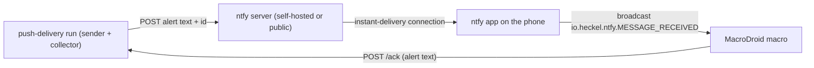

# E13 real run: push delivery on the household phones

This is the measurement `run.sh` cannot make: content-free alerts sent at random times for 7 days, idle nights included, to every household Android phone, on the default self-hosted ntfy server and on a public one (D118). E13 passes when every phone receives 99 % of the self-hosted server's alerts within 10 minutes (D105).

What gets recorded: an anonymous phone label (`phone-1`, `phone-2`, ...), the server kind (`self-hosted` or `public`), a random alert id and times. No phone model, owner name, server name, URL, topic or token reaches the results file; the tool refuses any other label.

## How it measures



- The phone receives alerts through the ntfy Android app, the UnifiedPush distributor of the ntfy type, on the same connection it would use for Vilicus alerts.
- On each message, the ntfy app broadcasts the intent `io.heckel.ntfy.MESSAGE_RECEIVED` with the message text. An automation app (MacroDroid, free) catches it and posts the text back to the collector. The collector finds the alert id in it.
- The delay that counts is send time to the acknowledgement's arrival at the collector. It is an upper bound of the reception time, so a pass is never overstated. The phone's own clock time is also recorded, for information only.
- The acknowledgement path is part of what is measured: an alert received but whose acknowledgement never reaches the collector counts as not delivered. If a phone fails, step 9 explains how to tell the two apart.

## 1. What you need

- A Linux host that stays up for the 7 days plus a margin (the Vilicus host is fine), with Docker. It runs the sender and collector.
- The self-hosted ntfy server, the image `run.sh` uses: `binwiederhier/ntfy@sha256:803b2aaeb94df76c8b32ecd91039dc80b0fddb7041dcaf082b33bcdfd4ba39ad` (ntfy 2.31.0).
- A public ntfy server chosen by the household (for example the operator's public instance). Check its published rate limits: the sender posts about 48 alerts a day per phone to it.
- On each Android phone: the ntfy app and MacroDroid.
- Reachability, the point most likely to spoil the result:
  - each phone must reach the self-hosted server wherever it is (home Wi-Fi, mobile data, away), the way it will in production: an always-on VPN to the household network, or the server published over TLS. Measuring only at home would overstate the result;
  - each phone must reach the collector's `/ack` the same way. Publish it on the same path as the push server (behind the same VPN or reverse proxy).

## 2. Build the tool

From `spikes/push-delivery/` on the host:

```sh
docker build -f compose/Dockerfile -t vilicus-spike-push-delivery-runtime .
alias push-delivery='docker run --rm vilicus-spike-push-delivery-runtime push-delivery'
```

## 3. Prepare the self-hosted server

1. Generate one topic per phone: `push-delivery new-topic` (128 random bits each).
2. Configure ntfy (`server.yml`): `base-url` set to the URL the phones use, `auth-file` and `cache-file` on persistent storage, `auth-default-access: deny-all`, `behind-proxy: true` if a reverse proxy is in front, and a `keepalive-interval` under 77 s (the default 45 s is fine).
3. Create the accounts with the ntfy CLI inside the server container:
   - a sender account with write-only access to every phone topic, and an access token for it (`ntfy user add`, `ntfy access <user> <topic> wo`, `ntfy token add <user>`);
   - one account per phone with read-only access to that phone's topic only, and a password (`ntfy access <user> <topic> ro`).
4. Check from outside the household network, on mobile data, that `https://<server>/v1/health` answers.

## 4. Prepare the public server topics

Generate one more topic per phone with `push-delivery new-topic`. Public topics get no token; their 128-bit random name is the protection AD-32 asks for.

## 5. Write the configuration

Copy `push-delivery.example.conf` outside the repository (for example `/etc/push-delivery/run.conf`), fill in the URLs, one `target` line per phone and server, and keep the criterion lines unchanged: any other value labels every report `criterion=simulation`. Put the topics and the sender token in an environment file (`/etc/push-delivery/secrets.env`, mode 0600), referenced as `env:NAME` in the configuration.

Choose the night hours of the `night` line in local time; they only serve to show that nights were measured.

## 6. Set up each phone

1. Install the ntfy app. Prefer the F-Droid build, where instant delivery is always on; with the Google Play build, enable instant delivery for every subscription. Note which build each phone uses (not the phone model) for the result.
2. In the ntfy app, add the self-hosted server's phone account (user settings of the app), then subscribe to the phone's self-hosted topic on that server and to its public topic on the public server.
3. Mute both subscriptions in the ntfy app, so the 7 days of alerts do not ring at night. Muting changes the display, not the delivery.
4. Exempt the ntfy app and MacroDroid from battery optimisation, as the ntfy app asks. Record that this was done: the production setup needs the same.
5. In MacroDroid, create one macro:
   - trigger: Intent Received, action `io.heckel.ntfy.MESSAGE_RECEIVED`, package `io.heckel.ntfy` (without the package, the ntfy documentation warns that intents may be swallowed); store the extra `message` in a variable;
   - action: HTTP Request, method POST, URL `https://<collector>/ack`, body the `message` variable, content type `text/plain`. Optionally append `?t=` followed by MacroDroid's current Unix time (seconds or milliseconds both work) to record the phone's clock.
   MacroDroid's labels change between versions; the probe in step 7 is what proves the macro works.
6. Leave the phone as it is used every day: no forced Wi-Fi, no charger rule, no app kept open.

## 7. Probe each phone

With the configuration in place and nothing else listening on its port:

```sh
docker run --rm -p 8080:8080 --env-file /etc/push-delivery/secrets.env \
  -v /etc/push-delivery/run.conf:/etc/push-delivery/run.conf:ro \
  vilicus-spike-push-delivery-runtime \
  push-delivery probe --config /etc/push-delivery/run.conf --phone phone-1 --wait-ms 120000
```

Each line must read `published=yes acknowledged=yes`. Repeat for every phone, once on home Wi-Fi and once on mobile data. Do not start the run until every phone passes on both.

## 8. Run for 7 days

```sh
docker run -d --name e13-run --restart unless-stopped -p 8080:8080 \
  --env-file /etc/push-delivery/secrets.env \
  -v /etc/push-delivery/run.conf:/etc/push-delivery/run.conf:ro \
  -v /var/lib/push-delivery:/var/lib/push-delivery \
  vilicus-spike-push-delivery-runtime \
  push-delivery run --config /etc/push-delivery/run.conf --duration-ms 612000000
```

The duration is 7 days and 2 hours, so the last evaluated alert is at least 7 days after the first. After a restart the container resumes sending and appends to the same results file; the report shows any gap as `max_gap_ms`. Stop it with `docker stop e13-run` once the report is complete (step 9).

Do not change the phones' setup during the run. Phones that leave home, sleep, travel or lose signal are what the run is meant to measure.

## 9. Read the results

At any time:

```sh
docker run --rm --env-file /etc/push-delivery/secrets.env \
  -v /etc/push-delivery/run.conf:/etc/push-delivery/run.conf:ro \
  -v /var/lib/push-delivery:/var/lib/push-delivery \
  vilicus-spike-push-delivery-runtime \
  push-delivery report --config /etc/push-delivery/run.conf --explain
```

- The first line must say `criterion name=d105`. A report that says `simulation` is not an E13 result.
- One `target` line per phone and server: `evaluated`, `in_time`, `late` (acknowledged after 10 minutes), `missing` (never acknowledged), `unpublished` (the server refused the alert or was unreachable), `pending` (deadline not yet passed), `rate_percent`, latency percentiles and a cumulative distribution, `night_evaluated` and `night_in_time`, `coverage_ms`, `max_gap_ms`, `duplicate_acks`, and the phone-reported median delay. Its `verdict` is `INCOMPLETE` until it covers 7 days with at least 100 alerts and one night alert per day, then `PASS` or `FAIL`.
- One `server` line per server kind: `PASS` only when every phone passes; a public server that fails is marked `status=not-recommended`.
- The `e13` line: E13 follows the self-hosted server (D118).
- `--explain` lists every late, missing or unpublished alert with its send time, to match against what happened that day (a trip, a dead battery, a server restart).
- A large `max_gap_ms` means the sender was down; that stretch was not measured, and the run should be extended rather than reported.
- To tell a lost push from a lost acknowledgement: the ntfy app lists the messages a subscription received, muted or not, each with the alert text (check on the first day that a muted subscription still lists them on your app build). An alert present there but `missing` in the report lost its acknowledgement, not its push; note it in the result as such.

## 10. Record the result

In the story's Result section and in `doc/research-notes.md`, record per phone label and per server kind: alerts evaluated, the in-time rate, late and missing counts, the latency percentiles, and the verdicts; the ntfy app build of each phone and whether battery optimisation was disabled; the run dates. Never a phone model, a person's name, a server name, a URL or a topic.

If any phone is below 99 % on the self-hosted server, E13 fails: record the fallback of AC3 (a second push distributor within the same webhook transport, plus the maximum waits of FR-56; polling is never the only path) as a new decision record, after the owner's decision. If only the public server is below, record it as not recommended; E13 is not failed.

## 11. Clean up

Delete the MacroDroid macro, unsubscribe the ntfy topics on the phones, delete the phone and sender accounts on the self-hosted server, and delete the results file once the result is recorded.
